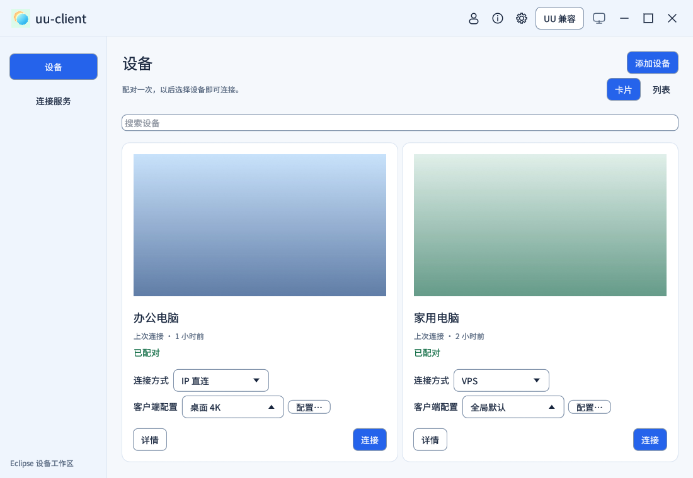
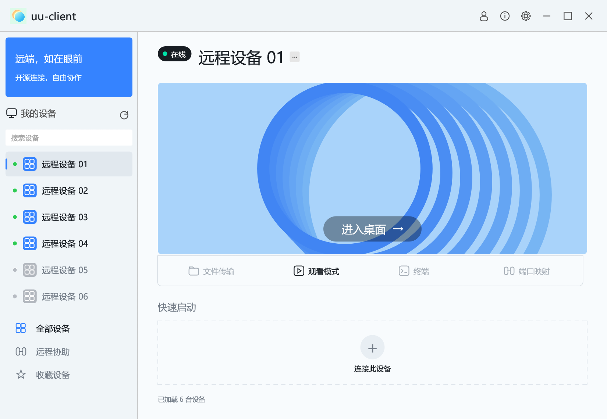
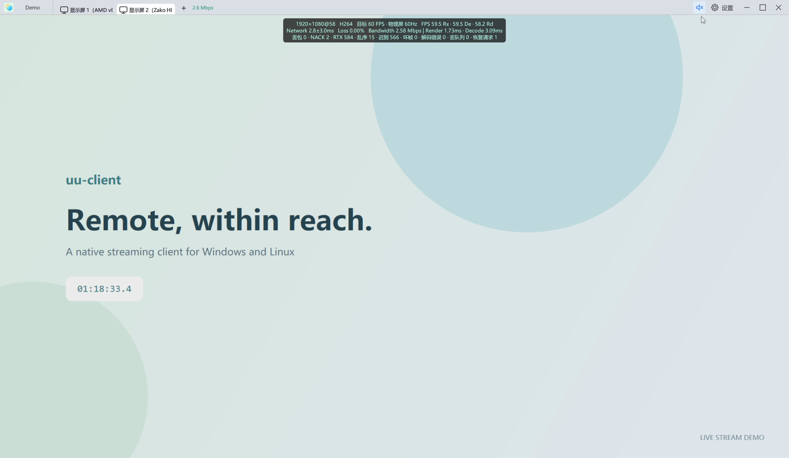

# uu-client

> **版权与项目声明**：本项目由个人维护，目前无盈利，与网易及其 UU 远程产品无隶属、合作或官方授权关系。第三方名称仅用于说明兼容对象，相关商标与权利归原权利人所有。如 UU 官方或相关权利人要求下架，维护者将配合停止公开分发并处理相关内容。独立实现、非盈利及此声明不代表已获得接入许可，也不消除服务协议或知识产权风险；使用前请阅读[许可与兼容接入说明](docs/licensing-and-compatibility.md)。

<p align="center">
  
</p>
<p align="center"><strong>远端，如在眼前。</strong><br>面向 Windows 与 Linux 的原生远程串流客户端</p>

uu-client 使用 Rust 构建，提供设备列表、远程画面、音频、键鼠和多显示器操作。Linux 客户端原生运行，无需 Wine。当前开发分支默认进入 **设备工作区**：保存多台原生设备及 IP、UU、VPS 地址，首次短码配对后跨入口复用公钥授权。服务管理集中管理连接、采集、编码、权限与会话，应用设置保留软件通用选项。主页显示壁纸与最后画面卡片，右键管理连接方式和多个命名客户端配置；官方被控端入口集中在顶部“UU 兼容”。详见[新版配置与设备页](docs/client-and-server-settings.md)。详见[局域网连接与配对](docs/native-lan.md)。

目前已达到日常远程桌面基本可用的 demo 阶段，仍在快速迭代。原生通路提供图形共享、公钥授权的输入控制、[系统声音与恢复](docs/native-audio.md)及[双方许可的文本与图片剪贴板](docs/native-clipboard.md)，IP 直连不需要第三方账号。Linux 共享支持 X11 和 [Wayland 门户 / PipeWire](docs/linux-client.md#wayland-本机共享)；Windows 锁屏共享使用可选的[后台服务](docs/windows-background-service.md)。

开发分支增加[硬件 H.264 / HEVC / AV1 与 CBR / VBR](docs/native-encoding.md)、[原生分段延迟统计](docs/native-latency.md)、[运行中切换共享显示器](docs/native-lan.md#串流中切换显示器)和[手柄与陀螺仪](docs/native-gamepad.md)。共享最多接受 4 个会话，按设备授权和单独断开，输入控制权统一交接；硬件格式、帧率和实体外设仍需按目标驱动验证。“共享本机”默认自动选择硬编，旧邀请入口与 CLI 保留软件默认值。**原生协议仍在迭代，不兼容 Sunshine / GameStream。** 两种模式的互通边界、UDP/WebRTC 传输、Moonlight 对比见[协议与传输架构](docs/protocol-compatibility-and-transport.md)。

原生公网入口与自建连接服务见[使用说明](docs/native-internet.md)：IP 直连和连接服务共用原生串流，用户已确认两台不同 UU 设备连接成功，跨 NAT 和中继仍待验收。新版共享设置、多设备配置、公钥配对和官方协助入口见[设备连接、共享与授权](docs/device-connection-and-trust.md)。

## 界面

**新版原生设备工作区（Linux 隔离演示配置，设备与地址均为示例）**



以下两张均为 Windows 实机截图。主界面的设备别名与壁纸使用客户端隐私显示；串流界面的远端运行专用演示画面。

**设备主界面（兼容模式）**



**串流界面**



## 已有功能

下表描述 UU 兼容模式。原生模式提供独立主机、图形端共享与显式授权的键鼠控制，具体范围见[原生串流说明](docs/native-streaming.md)。

| 方面 | 当前支持 |
|---|---|
| 账号与设备 | 扫码登录、取消或刷新二维码、设备列表与搜索、异步设备预览、本地收藏与最近使用、退出账号；退出后断开本客户端串流，保留软件偏好。 |
| 视频 | H.264（Windows D3D11VA / Linux VA-API，失败回退 OpenH264）；Windows 与 Linux UU 串流可在设置中优先选择 H.265 / HEVC，硬解能力按实际探针确认。 |
| 画质 | 自动 / 预设 / 自定义码率，保持远端或指定分辨率，预设与自定义 5–144 FPS。实际帧率受被控端、屏幕和网络限制。 |
| 音频 | Opus 播放、音量、静音、限长缓冲与丢包平滑；顶部声音快捷按钮。 |
| 键盘与鼠标 | 标点与组合键、鼠标中键与拖动；桌面绝对定位 / 游戏相对移动，本地 / 远端光标。 |
| 多显示器 | 真实显示源标签、切屏、拖动排序；新设备默认加入现有串流窗口，可整组排序或移到独立窗口。 |
| 桌面体验 | 保留设备主窗口、窗口缩放、跨 DPI 适配、全屏串流、可隐藏悬浮菜单、居中统计 HUD。 |
| 剪贴板 | Windows 与 Linux 的前台串流双向文本同步，单次上限约 30 KiB。 |
| 网络恢复 | RTP 重排、NACK / RTX 重传、序号回绕与参考链恢复、限长呈现队列；尚未接入视频 FEC。 |

默认使用自动画质、60 FPS 目标、远端原分辨率，串流窗口在目标显示器工作区约 80% 范围内等比居中。设置中可以修改默认偏好；窗口右上角按钮负责最大化 / 还原，快捷键进入串流全屏，多设备时保留顶部设备标签。

全屏悬浮按钮默认贴右边缘、距顶部 15%，可自由拖动。按钮白色面积较旧版减少约 30%；悬停立即展开菜单，悬停离开立即收起。点击后保持交互，离开菜单或窗口失焦约 2 秒收起；菜单内编辑时保留键盘焦点。靠边收起后只露出约三分之一，Ctrl+Alt+H 可隐藏或显示入口。

0.6起提供[收藏与最近使用](docs/device-library.md)（0.5旧标签不含）；小窗口使用紧凑筛选栏，设备长名称按实际宽度省略并可悬停查看。

0.7修复了[丢包与重传跨 SRTP 序号回绕时可能永久停图的问题](docs/stream-recovery.md)，并保留加密认证与重放保护。该修复覆盖兼容模式接收端和原生模式；原生串流建议主机与控制端一起升级。0.8进一步修正Linux原生硬件编码与硬件解码的互通，减少BGRA转换开销，并在停图后及时将解码FPS归零。0.9将图形观看切换为 GPU 平面颜色转换，减少 CPU 与纹理上传工作；[延迟路径和计时说明](docs/windows-latency.md)明确保留的同步读回及测试范围。

## 开始使用

当前版本 **v0.19.3** 支持自定义客户端快捷键与内部冲突提示，见[0.19.3 说明](docs/releases/v0.19.3.md)。此前 HUD、原始丢包与控制恢复见[0.19.2 说明](docs/releases/v0.19.2.md)。实验性 [PyroWave 原生串流](docs/pyrowave.md)支持 Windows GPU 共享纹理路径和 Linux CPU 传输路径，范围与实测见[0.19.0 说明](docs/releases/v0.19.0.md)。继承[0.18.10 客户端码率、光标与 HUD](docs/releases/v0.18.10.md)及[0.18.9 外屏延迟与悬浮菜单修复](docs/releases/v0.18.9.md)。正式安装包以 [GitHub Releases](https://github.com/TheRainstorm/uu-client/releases) 实际可用版本为准，旧标签与产物独立保留。

安装包随里程碑版本发布到 [GitHub Releases](https://github.com/TheRainstorm/uu-client/releases)，自动构建与标签规则见[版本发布说明](docs/releases.md)。

已有源码目录且已安装并登录 GitHub CLI、Python 3.11+ 时，可直接下载已发布产物，无需本机编译：

```sh
python3 tools/release/download.py
# 指定版本或平台：--tag v0.8.0 --platform windows
```

校验后的包统一位于 `artifacts/packages/`；工具核对发布标签对应提交、压缩包校验和及每个文件的哈希。下载不会安装或启动软件。

主机点击顶部互联网图标进入“服务管理”，在连接服务页启用所需入口并启动服务；启动后默认接受配对申请。控制端在设备主页空白处右键添加地址，将八位配对码输入主机确认。之后单击设备卡片即可串流，右键可切换连接方式和客户端配置。默认 TCP / UDP 监听端口为 48998 / 48999。详见[局域网连接与配对](docs/native-lan.md)。

v0.5.0 起的 UU 兼容模式内置 PC 客户端共享的请求签名值，首次使用无需手工创建签名文件；账号仍需扫码登录，远端操作仍受账号与设备权限控制。该共享值可从源码或程序中读取，不是用户个人令牌，也不代表获得官方接入授权。需要覆盖默认值时，见[连接签名配置说明](docs/connection-credentials.md)。v0.1–v0.4 发布包仍要求本地配置。

在你有权控制的远端设备上安装并配置官方被控端。启动 uu-client，点击顶部“UU 兼容”，扫码登录后从原版设备列表选择设备连接。主页在串流期间保留，可继续连接其它设备。

UU 本机显示名自动使用“电脑名-Eclipse”，原生共享名称独立设置。扫码登录或“服务管理 → 连接服务 → UU 账号 → 更新注册信息”会提交真实系统与硬件资料，保留编号和原生配对。旧设备尚未认证时，手机可能仍显示旧名；确认登录后同步名称。

“服务管理 → 连接服务 → UU 账号 → 管理 UU 设备”可查看和确认解绑本账号设备。与官方客户端共存时可能有两条同名、不同编号的记录；身份与解绑范围见[UU 设备名称与管理](docs/uu-device-identity.md)。

顶部依次提供设备列表、服务管理、UU 兼容与应用设置入口。服务管理集中本机连接、采集、编码和权限；应用设置使用“软件设置 / 关于”页签，仅管理壁纸、软件自启动、设备发现等通用选项。客户端画质通过设备右键的配置编辑设置，串流内设置只应用于当前会话。主页、设置和菜单沿用蓝白风格，版本与构建提交在应用设置的“关于”页查看。登录态和设置保存在本地用户目录，安装包不包含账号数据。账号文件使用原子替换，Unix 权限仅当前用户可读写；诊断不记录认证或二维码凭据。

0.6起会明确提示本地账号文件损坏、过大或不可读取，保留原文件并阻止重新注册覆盖；修复配置后可重试。短暂读取失败不自动退出已经建立的串流。
设置文件异常时使用内存默认值，自动保存不会覆盖原件；可在设置中主动备份异常文件后保存当前选项。

0.6起在 Windows / Linux 和软件解码路径中统一读取 H.264 的色彩范围与 BT.601 / BT.709 矩阵，避免因构建未启用 Linux 硬解而忽略色彩信息。

### Windows

在 Linux 上交叉编译并打包 Windows x64：

```bash
python3 tools/windows/package.py
```

将 `artifacts/packages/uu-client-windows-x64-<提交号>.zip` 复制到 Windows，解压后运行：

```powershell
powershell.exe -NoProfile -ExecutionPolicy Bypass -File .\install.ps1
```

安装会保留登录态、设置和现有进程。完成后关闭旧主页与串流窗口，再从桌面 **uu-client** 打开新版。工具链准备、自定义安装目录和校验方法见 [Windows 编译与打包](docs/windows-build.md)。

### Linux

安装 Rust 稳定版及系统开发依赖，构建原生客户端：

```bash
# Ubuntu / Debian
sudo apt install build-essential pkg-config cmake nasm libssl-dev \
  libasound2-dev libpulse-dev libva-dev libgbm-dev libclang-dev libxkbcommon-dev libxkbcommon-x11-dev libpipewire-0.3-dev
cargo run --release -p uu-gui --features vaapi --locked
```

生成含安装器的 Linux 包：

```bash
python3 tools/linux/package.py
```

解压后执行 `python3 install.py`，从应用菜单 **uu-client** 或 `~/.local/bin/uu-client` 启动。支持 Wayland / X11；运行库、驱动及平台差异见 [Linux 客户端说明](docs/linux-client.md)。

### 快捷键

Windows 上再次打开程序会唤起已有主页，避免并行运行多个主实例。串流工作区独立于主页运行；新连接默认加入已有串流窗口，各设备保留独立会话，也可移到独立窗口。更新后需要关闭旧主页和旧串流窗口，再打开新版本；替换文件不会升级正在运行的进程。

以下字母键均与 **Ctrl+Alt** 同时按下：

| 按键 | 功能 |
|---|---|
| S | 显示 / 隐藏串流统计 |
| F 或 X | 进入 / 退出串流全屏 |
| Q | 退出当前串流 |
| M | 静音 / 恢复声音 |
| H | 显示 / 隐藏全屏悬浮入口 |
| Z | 捕获 / 释放输入 |
| P | 切换桌面绝对定位 / 游戏相对移动 |
| C | 切换本地和远端 / 仅远端光标（UU 兼容串流） |

光标显示提供“本地和远端光标”与“仅远端光标”，Ctrl+Alt+C 在两者间切换；旧的仅本地设置自动迁移为本地和远端。鼠标移动方式仍可选择桌面绝对定位或游戏相对移动，游戏捕获时隐藏本地光标。原生主机目前不支持远端光标合成切换。

上述快捷键由客户端处理，不发送到远端；窗口、全屏、仅观看或打开菜单时均可使用，与“全屏时将系统快捷键发送到远端”设置独立。按住或切换全屏时不会重复触发。

开启系统快捷键捕获后，仅当前台全屏串流画面获得输入焦点时，Win、Alt+Tab 等组合键才发送到远端。打开菜单、仅观看或失焦时暂停，关闭菜单、恢复控制或重新获得焦点后自动恢复；鼠标悬停工具栏不释放键盘。Ctrl+Alt+Z 可显式释放／重新捕获输入。退出全屏后系统快捷键交回本机，普通远端键鼠仍可使用。Win+Shift+方向键与其它系统组合键遵循同一捕获设置；捕获开启时作用于远端，释放时作用于本机。Ctrl+Alt+Del 由 Windows 保留。Wayland 是否允许快捷键抑制取决于合成器支持。

0.7起在 Windows 原生捕获路径中保留右 Alt / AltGr 作为远端输入，避免输入 `@` 等字符时误触退出或其它本地操作；本地快捷键请使用 Ctrl+左 Alt。

## 当前边界

- 原生被控端目前为实验性共享通路，默认 IP 连接，也可使用 [UU / 自建连接服务](docs/native-internet.md)寻址；含 Windows DXGI、Linux X11 / Wayland 门户采集、可选系统声音和输入控制。H.264 默认自动选择硬编，Windows Media Foundation 支持 H.264 CBR / VBR；Windows AMD 使用原生 AMF，Intel 可使用 VPL，NVIDIA 使用驱动 MFT；Linux 保留 VA-API，Intel 自定义参数使用 VPL。可用格式与码控受硬件和驱动限制。Windows 锁屏共享需安装后台服务、保持该用户登录及有效显示输出；Wayland 仍需系统门户授权。
- Windows UU 串流支持 H.264 和可选 H.265 Main 8-bit 硬解；HEVC 需要系统解码扩展与兼容 GPU，连接前检查失败时使用 H.264。Linux UU 接收可选 HEVC 硬解；原生支持 H.264 / HEVC / AV1，GUI 可请求 5–240 FPS，分辨率与实际吞吐受格式、硬件及驱动限制。Windows 原生连接支持 [HDR10](docs/hdr.md)，需要两端系统显示输出及 10 位编解码支持，Linux 当前使用 SDR；新版原生两端支持有预算上限的 [XOR 视频 FEC](docs/native-fec.md)，每组可恢复一包，不兼容官方 UU 的 FEC。高帧率选项不保证所有远端都能达到对应实际帧率。
- 文件传输、终端和端口映射尚未实现。新版“远程协助”可按官方设备 ID 与验证码发起兼容连接；原生主机发布官方协助码尚未实现。
- 本项目原生主机暂不能供官方手机客户端连接；当前认证与协商需要独立兼容入口，详见[官方手机客户端兼容可行性分析](docs/official-mobile-client-feasibility.md)。
- 硬解仍存在 CPU 回读，尚未做到完整零拷贝；网络波动、恢复与音频长稳体验仍需持续打磨。
- 服务兼容性依赖官方接口与被控端版本，可能随更新失效；未获官方认可或授权，账号与服务使用存在协议风险。

## 实现与开发

GUI 使用 egui / eframe，媒体面采用 WebRTC/UDP 与 Opus；原生视频支持 H.264 / HEVC / AV1，UU 兼容模式协商 H.264 / HEVC。协议、输入和呈现分层，账号配置与软件偏好分开保存。

```text
crates/uu-gui      设备主页、设置、串流窗口、输入捕获与呈现
crates/uu-core     账号 API、信令、WebRTC、显示源与恢复策略
crates/uu-proto    协议类型、控制消息与帧格式
crates/uu-media    解码、音频播放与媒体抽象
crates/uu-cli      调试与诊断命令 uu
crates/uu-capture  DXGI / X11 / Wayland 门户采集与合成测试源
crates/uu-input    按会话许可工作的 Windows / Linux 输入注入后端
tools/            构建、打包及隔离验证工具
vendor/           带有来源、许可与修改记录的局部依赖
```

```bash
cargo test --workspace --locked
cargo run -p uu-cli -- devices
cargo run -p uu-cli -- probe
```

详细文档：[协议兼容与 Moonlight 技术对比](docs/protocol-compatibility-and-transport.md) · [串流质量与恢复](docs/streaming-quality.md) · [帧率协商](docs/frame-rate.md) · [功能与源码参考索引](docs/reference-index.md) · [协议笔记](docs/protocol-notes.md)。诊断输出可能包含设备标识或网络信息，提交 issue 前请自行清理。

原生公网架构见[公网直连与可替换 STUN 服务](docs/native-public-connectivity.md)，当前使用方法和验证边界以[原生连接服务说明](docs/native-internet.md)为准。已接入 UU 和自建信令，正式默认仅直连，开发可显式测试中继；跨 NAT 与实际中继能力仍需验证。

## 方向与致谢

当前名称 **uu-client** 说明其兼容客户端定位。下一阶段计划以 **Eclipse / 日蚀** 为名，探索采集端与客户端一体化、自主串流协议与更完整的跨平台体验；原生局域网基础已实现，后续范围与验收顺序见[产品远景](docs/vision.md)和[交付路线图](docs/roadmap.md)。

感谢 [Moonlight](https://github.com/moonlight-stream/moonlight-qt)、[Sunshine](https://github.com/LizardByte/Sunshine)、[Foundation Sunshine](https://github.com/AlkaidLab/foundation-sunshine)、[uu-remote-linux](https://github.com/VallierDev/uu-remote-linux)，以及 Rust WebRTC、egui、OpenH264、Opus 等项目。参考机制与引用代码应分别遵守来源许可，具体参考版本和入口见源码参考索引。

## 许可证

本项目原创部分采用 **[MIT](LICENSE-MIT) OR [Apache-2.0](LICENSE-APACHE)** 双许可，由使用者任选其一，允许按许可商用。第三方组件保留各自许可证，见 [第三方通知](THIRD-PARTY-NOTICES.txt) 与 [依赖清单](docs/dependency-licenses.md)。

开源许可只涵盖维护者有权授予的代码权利，不授予官方服务接入、第三方商标或全部编解码专利许可。详见[许可与兼容接入说明](docs/licensing-and-compatibility.md)。
