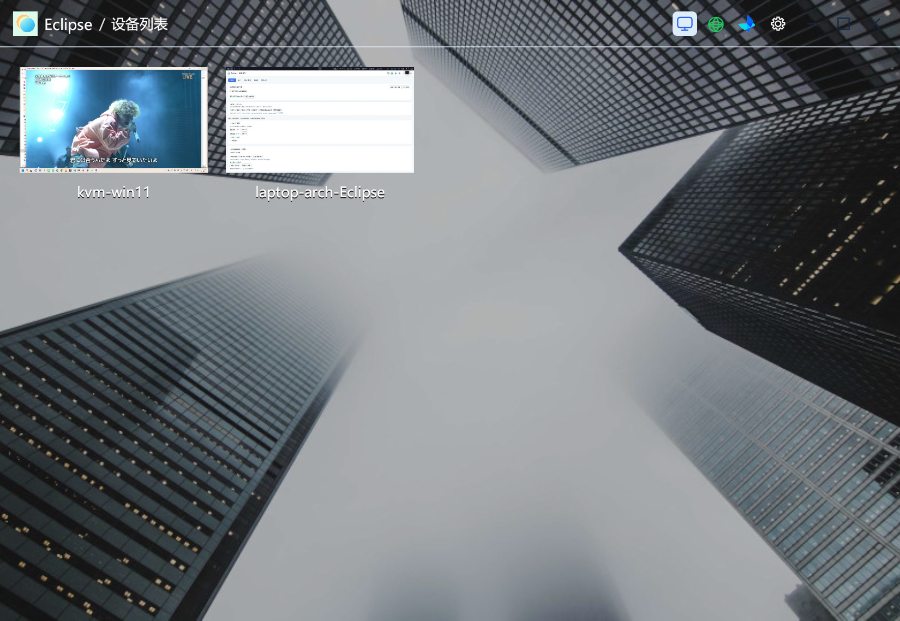
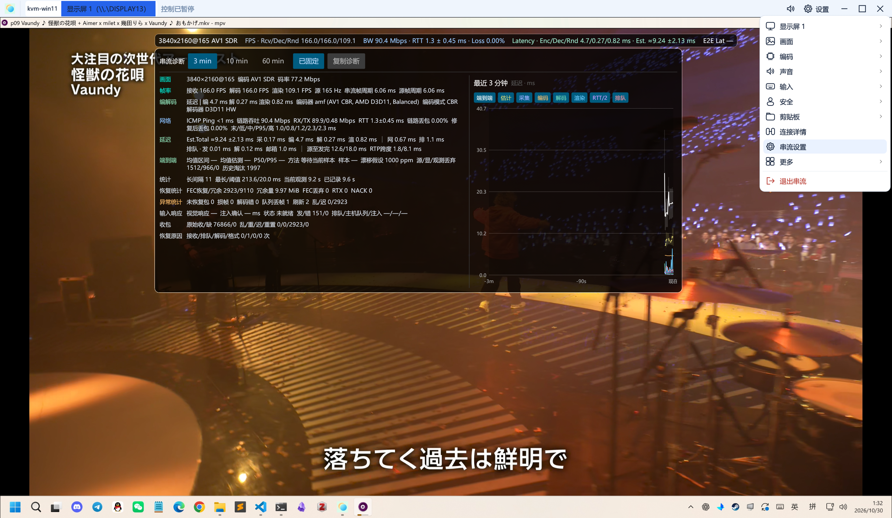
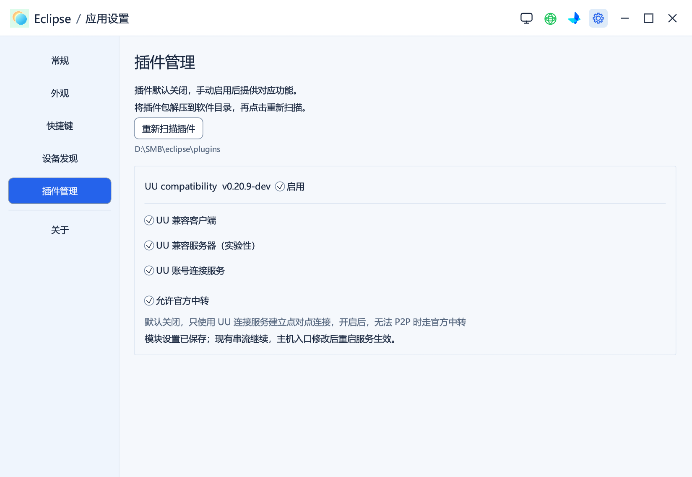

# Eclipse / 日蚀

<p align="center">
  
</p>
<p align="center"><strong>远端，如在眼前。</strong><br>使用 Rust 构建的 Windows / Linux 远程桌面与低延迟串流</p>

Eclipse 将多屏远程办公、游戏串流和主机共享管理放在同一个开源应用中。Windows / Linux 均可作为控制端和被控端，Linux 原生运行，无需 Wine。可以在局域网直接连接，也可以部署自己的公网连接服务；原生串流无需第三方账号，设备配对与访问授权由自己管理。

正式完整包自带 UU 兼容与壁纸合集插件，均默认关闭，在设置中按需启用。UU 插件源码仍在独立仓库维护，原生串流无需启用插件。项目仍在快速迭代，实际格式、帧率和延迟取决于两端硬件、驱动、显示与网络。

[下载正式版](https://github.com/TheRainstorm/eclipse/releases) · [文档索引](docs/README.md) · [版本说明](docs/releases/README.md) · [设备连接与授权](docs/guides/device-connection-and-trust.md) · [插件安装](docs/guides/plugins.md) · [TODO / 路线图](docs/roadmap.md)

## 核心功能

以下介绍当前代码已具备的能力；正式包以对应[版本说明](docs/releases/README.md)为准，平台条件和待完善项目见[当前边界](#当前边界)与[路线图](docs/roadmap.md)。

### 连接与自托管

- **免账号直连**：局域网发现、IPv4 / IPv6 地址连接，配对后保存设备公钥身份；支持配对密码、临时授权与逐设备撤销。
- **自己的公网连接服务**：WSS 设备目录、ICE / STUN 打洞、直连优先与 TURN/UDP 中转。面向 NAT / CGNAT 网络协商可用路径，无需两台电脑都暴露公网地址；UDP 完全受限的网络仍有边界。
- **一份接入码加入私人设备组**：导入服务器地址、组凭据及必要证书；不同组隔离设备目录，组内发现仍需独立设备配对。可管理多个TURN服务器。

[设备连接与授权](docs/guides/device-connection-and-trust.md) · [连接服务部署](docs/guides/connection-service.md)

### 多屏与工作区

- **多设备、多显示器标签工作区**：在同一窗口管理多台电脑和多块屏幕，按屏保存画质配置；屏签可拆到独立窗口、拖动合并，切屏保留连接，同一设备的声音连续播放。
- **Windows 按需虚拟显示器（实验性）**：串流时新增临时屏，或保存持久屏；编辑名称、分辨率、刷新率与 HDR。启用才创建设备，禁用或删除实际移除设备，无需预留一排断开的显示器。
- **临时与持久生命周期**：最后一个使用者断开后自动禁用临时屏；持久屏在退出程序或停止服务后继续保留。支持恢复单屏上次位置，首次启用默认向右扩展。首次使用需要安装虚拟显示驱动。

[多屏与独立窗口](docs/guides/multiple-displays.md) · [虚拟显示器](docs/guides/virtual-displays.md)

### 共享协作与房主控制

- **多客户端同屏**：Windows 主机可向多个客户端共享同一显示器，共用采集、独立编码和画质设置。获准客户端在空闲约 500 毫秒且没有长按时交接键鼠；手柄按会话独立授权。
- **房主会话中心**：通过托盘、会话页或悬浮球查看连接，逐会话开关键盘、鼠标、手柄，调整显示器、码率和帧率，或断开连接。
- **共享游戏厅**：新加入者默认只看画面，由房主按需授予输入权限，并控制画质与显示器；Windows 本机键鼠优先，默认本机停止操作 3 秒后恢复远程键鼠，也可手动暂停。

[会话中心与共享游戏厅](docs/guides/host-session-control.md)。会话中心是普通桌面窗口，尚无阻止已获键鼠权限的远端点击面板的输入隔离。

### 音视频与输入

- **H.264 / HEVC / AV1**：按两端实际能力选择软硬件后端，支持 CBR / VBR、自定义分辨率与帧率、本地刷新率上限；协商支持时，编码准备失败可尝试其它允许格式，并显示实际回退结果。
- **Windows HDR10 与 GPU 视频路径**：在显示器、编解码器及驱动满足条件时传输 10-bit HDR；支持 GPU 采集、转色、缩放、编解码与呈现路径，具体覆盖随平台和硬件而异。
- **桌面与游戏输入**：绝对 / 相对鼠标、独立远端光标、系统快捷键捕获、可自定义客户端快捷键；双方许可的文本与 PNG 图片剪贴板。可转发手柄与运动传感器，主机需相应虚拟手柄驱动。
- **系统声音**：Opus 音频、音量与静音、多屏音源协调；可在串流时静音主机输出，并在最后一路声音串流正常结束后恢复原状态。

[编解码](docs/architecture/native-encoding.md) · [HDR](docs/guides/hdr.md) · [输入](docs/architecture/native-input.md) · [剪贴板](docs/architecture/native-clipboard.md) · [手柄](docs/architecture/native-gamepad.md) · [声音](docs/architecture/native-audio.md)

### 后台运行与隐私

- **Windows 主机服务**：关闭图形界面后继续共享，集中管理授权、会话与虚拟屏；Linux 在登录的桌面会话中共享，可通过托盘保留运行。
- **串流结束恢复锁屏**：Windows 默认按连接前的锁定状态决定是否恢复锁屏，也可设置始终锁定或不自动锁定；在最后一个会话结束后执行。客户端另有“锁定远端”和“锁定远端并断开”。
- **便携配置与版本隔离**：Windows 默认在程序旁保存 `eclipse-data`，解压即可运行；设置中可更换数据目录，应用后迁移并重启。客户端与服务端配置独立保存，一台 Windows 电脑同时只激活一个主机服务配置。
- **连接可见**：Windows 被控端显示短暂连接提醒，会话页可分页查看最近 200 次连接记录。

[后台服务与锁屏](docs/guides/windows-background-service.md) · [配置与便携模式](docs/guides/configuration-storage.md)

### 诊断与扩展

- **可展开的串流诊断**：精简 HUD、历史曲线、网络路径、丢包与恢复、输入确认 RTT、采集 / 编解码 / 呈现阶段统计，以及带误差区间的视频端到端估测。提供可复现的延迟测试与 profiling 工具。
- **独立插件 SDK**：主程序提供原生串流，完整包自带匹配 SDK 的 UU 兼容与壁纸合集，分别启用；必应每日壁纸、收藏、缓存与前后浏览内置于应用。

[统计定义](docs/guides/hud.md) · [延迟实测与工具](docs/performance/streaming-latency-profiling.md) · [插件](docs/guides/plugins.md)

## 与 Sunshine / Moonlight、UU 远程的侧重点

Sunshine 是主机端，通常搭配 Moonlight 客户端使用，因此这里比较整套方案。Eclipse 更侧重把多屏工作区、自托管连接和房主会话管理放进同一应用；Sunshine / Moonlight 侧重游戏串流和广泛的客户端生态；UU 远程提供官方服务支撑的跨端远控与游戏体验。[Sunshine 项目](https://github.com/LizardByte/Sunshine) · [Moonlight 官网](https://moonlight-stream.org/) · [UU 远程官网](https://uuyc.163.com/)

| 方面 | Eclipse | Sunshine + Moonlight | 网易 UU 远程 |
|---|---|---|---|
| 使用方式 | Windows / Linux 同一应用兼任控制端与被控端 | Sunshine 运行主机，Moonlight 提供独立客户端 | 桌面远控应用，配合手机、平板及 TV 客户端 |
| 连接与设备管理 | IP 直连，或自建 WSS / STUN / TURN 服务；私人组接入码与设备配对分开 | 主机配对；外网可使用端口转发、IPv6 或 VPN 等方案 | 官方账号设备列表，或设备 ID / 验证码协助；被协助方可免登录 |
| 显示与输入管理 | 多设备 / 多屏标签、逐屏画质、拆分合并窗口、Windows 虚拟屏，以及房主逐会话权限中心 | 主机 Web UI 配置采集显示器及键盘、鼠标、手柄输入；不同客户端和社区分支另有增强 | 已有多屏标签、独立窗口、虚拟屏、观看模式及隐私功能 |
| 平台范围 | 当前聚焦 Windows / Linux 桌面两端 | Moonlight 覆盖桌面、手机、平板与多种 TV / 嵌入式设备 | 官方提供 Windows / macOS，以及移动与 TV 客户端 |

联网与主机配置参考 [Moonlight 官方说明](https://moonlight-stream.org/)和 [Sunshine 配置文档](https://docs.lizardbyte.dev/projects/sunshine/latest/md_docs_2configuration.html)，UU 功能参考[协助介绍](https://uuyc.163.com/features/support/)、[多屏教程](https://uuyc.163.com/help/multiscreen.html)、[观看模式](https://uuyc.163.com/help/viewonly.html)、[下载页](https://uuyc.163.com/download/)。各方案都面向低延迟与高画质；这里不作未经同条件实测的性能排名，也不把未列出的第三方能力判定为缺失。Eclipse 原生协议不兼容 GameStream，不能直接替换 Sunshine 接入 Moonlight。

## 界面

以下为 Windows 实机截图。

**设备列表**：保存多台设备、连接方式与客户端配置，显示壁纸和最近画面；右键可编辑设备、切换配置。壁纸空白处右键可刷新、收藏或下载当前壁纸，下载时通过系统对话框选择保存位置。

壁纸菜单显示的是实际下载文件解析出的原图像素。随机图片来源每次可能返回不同尺寸，不能把接口参数视为实际分辨率；界面和收藏网格会按显示需要缩放，下载则保留当前图片的原始编码与完整像素。



**串流与诊断**：悬浮菜单集中提供画面、声音、输入和连接设置。精简 HUD 可展开串流诊断，查看阶段耗时、网络和历史曲线。



**应用设置与插件**：软件设置按类别组织。插件独立启用，插件提供的模块还可分别控制。



截图中的版本和勾选状态是拍摄时的示例。新安装的插件总开关默认关闭；手动启用 UU 插件后，兼容客户端和账号连接服务默认开启，实验性兼容服务器、官方中转默认关闭。HUD 的阶段估计与视频端到端指标口径不同，都不能直接当作完整操作响应时间，详见[统计定义](docs/guides/hud.md)。

## 平台支持

| 能力 | Windows | Linux |
|---|---|---|
| 原生控制端 / 被控端 | 支持 | 支持 X11 / Wayland；Wayland 取决于门户或合成器授权 |
| 音视频 | 软硬件编解码，满足条件时支持 HDR10 | 软硬件编解码，当前 SDR；具体格式受 GPU 与驱动限制 |
| 虚拟显示器 | 临时 / 持久，需安装驱动，实验性 | 尚未实现同等管理能力 |
| 主机运行 | Windows 后台服务，GUI 可退出 | 登录桌面中的进程，关闭主页可保留托盘，明确退出会停止共享 |
| 本机输入优先 / 结束锁屏 | 支持 | 可手动暂停远端键鼠；尚无通用物理输入检测与自动锁屏后端 |

并发会话数、高分辨率和高帧率受硬件资源限制；请求帧率不等于实际采集、接收或显示帧率。

## 开始使用

从 [GitHub Releases](https://github.com/TheRainstorm/eclipse/releases) 下载对应平台的完整包。以下为当前开发分支的使用方式，旧版本以包内说明和[发布记录](docs/releases/README.md)为准。

### Windows

1. 解压 Windows ZIP 到可写目录，保留包内文件。
2. 双击 **eclipse.exe**，即可使用。

默认采用便携模式，设置、设备、配对与服务端配置保存在程序旁的 **eclipse-data**。在“应用设置 → 常规 → 配置存储”可以更换目录；保存应用后自动迁移并重启，原目录保留作为备份。

旧版配置仍在 AppData 时，可在同一设置页点击“使用旧版用户配置”，确认后重启使用原目录，旧数据和新便携目录均保留。

作为被控端时，在“服务管理”启用本机后台服务，按系统提示授权。日常运行无需执行安装脚本；需要创建系统入口时，可选用包内的 `install.ps1`。[配置与迁移](docs/guides/configuration-storage.md) · [后台服务](docs/guides/windows-background-service.md)

### Linux

解压 Linux 压缩包，在包目录执行：

```sh
python3 install.py
~/.local/bin/eclipse
```

也可从应用菜单打开 **Eclipse**。卸载工具随包提供，先退出软件，再执行：

```sh
python3 uninstall.py
# 默认保留配置；清除默认用户配置时使用：python3 uninstall.py --purge
```

安装和卸载均可用 `--prefix` 指定同一个安装前缀。自选的外部数据目录保留，可自行备份或清理。Linux 支持 X11 / Wayland，采集与控制受桌面授权约束。[依赖与平台说明](docs/development/linux-client.md)

### 连接设备

在被控端打开“服务管理”启动共享；控制端添加 IP 地址，或导入同一TURN服务器接入码并选择在线设备。首次连接按提示完成配对，以后从设备列表直接连接。

[连接与配对](docs/guides/device-connection-and-trust.md) · [TURN服务器](docs/guides/connection-service.md)

### 壁纸与可选 UU 插件

- **壁纸合集已随完整包提供**：打开“应用设置 → 插件”，启用“壁纸合集”，再到“外观”选择 Pipw 二次元或 Wallhaven；必应每日壁纸无需插件。
- **UU 兼容插件也已随包提供**：在“应用设置 → 插件”启用，再选择需要的 UU 兼容客户端、账号连接服务等模块。登录、远程协助和实验性兼容入口见 [UU 插件仓库说明](https://github.com/TheRainstorm/uu-client-plugins#readme)。只有单独更新插件时，才需要下载匹配主程序 SDK 的插件包。

壁纸合集和 UU 插件均默认关闭，用户自行启用。升级时保留 `eclipse-data`、自选目录的 `eclipse-profile.json` 及外部数据，并使用匹配主程序 SDK 的插件。[插件说明](docs/guides/plugins.md)

正式包使用版本标签命名，例如 `eclipse-windows-x64-v0.24.10.zip`。开发包使用 `eclipse-windows-x64-dev-<主程序提交号>.zip`。UU 插件源码版本记录在包内清单中。

本项目由个人维护，目前无盈利，与网易及其 UU 远程产品无隶属、合作或官方授权关系。第三方名称仅说明兼容对象，商标及权利归原权利人所有。如相关权利人要求下架，维护者将配合停止公开分发并处理相关内容。[许可与兼容接入说明](docs/legal/licensing-and-compatibility.md)

## 快捷键与统计

默认客户端快捷键均以 **Ctrl+Alt** 开头：`F / X` 全屏或窗口、`S` 启用 HUD、`Q` 退出当前串流、`M` 静音、`V` 垂直同步、`H` 悬浮入口、`Z` 释放或捕获输入。可在应用设置中自定义，菜单按实际绑定显示。[完整快捷键](docs/guides/keyboard-shortcuts.md) · [键盘捕获规则](docs/architecture/keyboard-capture.md)

视频端到端统计从源画面到客户端显示回执区间，不包含此前的输入上行和远端应用响应。`Est.Total` 是已知阶段的独立窗口估计；帧周期是节拍参考，不会额外加入视频 E2E。两者都不能用来直接判断完整鼠标跟随延迟。[延迟口径](docs/performance/native-latency.md) · [HUD](docs/guides/hud.md) · [延迟实测与工具](docs/performance/streaming-latency-profiling.md)

## 当前边界

- 原生协议仍在迭代，不兼容 Sunshine / GameStream。Windows 登录前及锁屏共享需要后台服务和有效显示输出，已有安装需更新实际后台程序；冷启动仍待实机验收。Wayland 仍受系统授权约束。
- Linux 当前为 SDR。硬件格式和 GPU 直通受平台、驱动与适配器限制，部分路径仍有 CPU 读回。窗口提交或 DXGI 回执估测不能证明物理显示器已经发光。
- 文件传输、终端、端口映射、手柄震动与自适应扳机尚未实现。Windows 偶发 DXGI 断链后重连失败、高帧率卡顿和输入跟随延迟仍在排查。
- 可选插件依赖第三方接口，服务更新可能影响兼容；项目开源许可不代表第三方服务接入授权。

## TODO / 路线图

- **近期完善**：窗口模式延迟与偶发输入卡顿、混合 DPI 迁屏、锁屏 / 无头恢复、公网连接速度、多客户端及实体外设长稳、安装更新体验。
- **待补齐的能力**：TURN/TCP / TLS、原生 NVENC 后端、Linux HDR 与 GPU 路径、房主面板输入隔离、手柄震动、麦克风与多声道。
- **后续候选**：文件传输、远程终端、端口转发与唤醒；需要单独设计和验证。

[完整 TODO 与路线图](docs/roadmap.md)分别说明已有基础、当前缺口和完成判据，不承诺未经验证的功能或发布日期。

## 构建与开发

GUI 使用 egui / eframe，媒体传输使用 WebRTC / UDP 与 Opus。主程序工作区与具体插件分仓，运行时通过精确匹配的共享 SDK 加载插件。

```text
crates/uu-gui         Eclipse 图形应用、设备、设置与串流窗口
crates/uu-cli         eclipse-cli 与 eclipse-signal
crates/uu-core        原生连接、设备授权、会话、恢复与观测
crates/uu-media       编解码、声音、GPU 图像与呈现支持
crates/uu-capture     DXGI / X11 / Wayland 采集与生成源
crates/uu-input       按会话授权的输入注入
crates/uu-plugin-sdk  通用插件契约、加载与共用界面
```

```sh
cargo test --workspace --release --locked
python3 tools/windows/package.py
# Linux 构建环境中：python3 tools/linux/package.py
```

[架构与资源所有权](docs/architecture/architecture.md) · [Windows 构建](docs/development/windows-build.md) · [Linux 构建](docs/development/linux-client.md) · [插件架构](docs/guides/plugins.md) · [协议与传输](docs/architecture/protocol-compatibility-and-transport.md) · [源码参考索引](docs/development/reference-index.md)

感谢 [Moonlight](https://github.com/moonlight-stream/moonlight-qt)、[Sunshine](https://github.com/LizardByte/Sunshine)、[Foundation Sunshine](https://github.com/AlkaidLab/foundation-sunshine)、[uu-remote-linux](https://github.com/VallierDev/uu-remote-linux)，以及 Rust WebRTC、egui、OpenH264、Opus 等项目。参考机制与引用代码分别遵守来源许可。

本项目原创部分采用 **[MIT](LICENSE-MIT) OR [Apache-2.0](LICENSE-APACHE)** 双许可，由使用者任选。第三方组件保留各自许可证，见[第三方通知](THIRD-PARTY-NOTICES.txt)与[依赖清单](docs/legal/dependency-licenses.md)。
