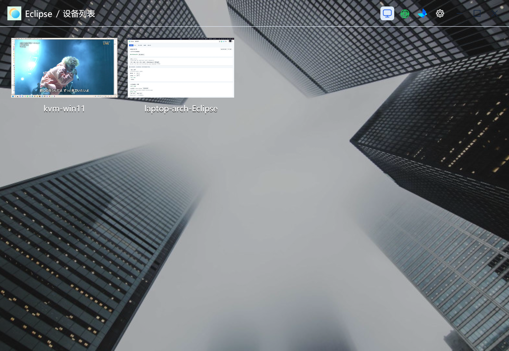
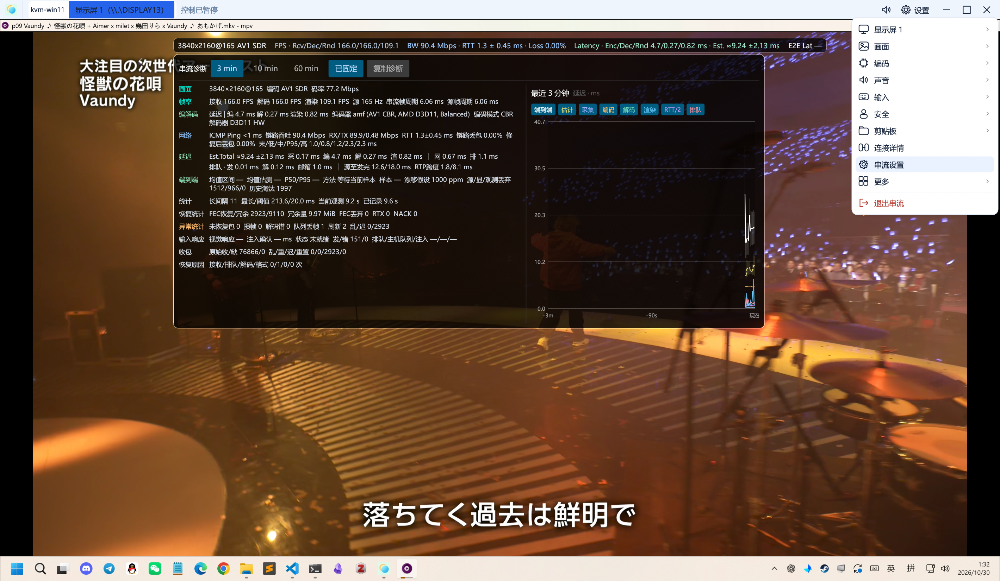
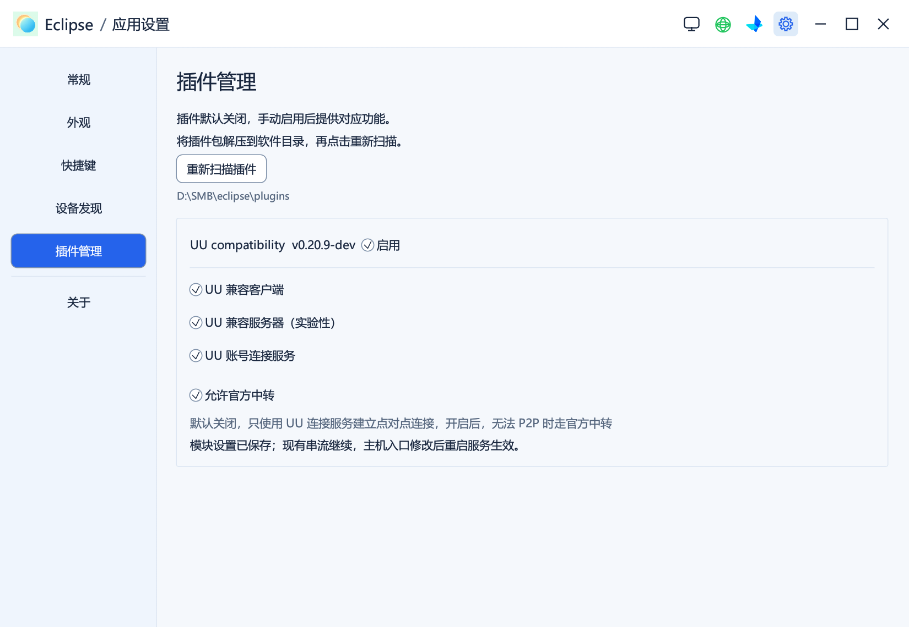

# Eclipse / 日蚀

<p align="center">
  
</p>
<p align="center"><strong>远端，如在眼前。</strong><br>使用 Rust 构建的 Windows / Linux 远程桌面与低延迟串流</p>

Eclipse 将设备管理、画面共享、声音和输入控制放在同一个应用中。主程序提供独立的原生串流：可以在局域网直接连接，也可以通过自建连接服务寻址。首次配对后，设备使用公钥身份确认授权，无需第三方账号。Linux 客户端原生运行，无需 Wine。

可选功能通过独立下载的插件提供。主程序完整包不包含 UU 插件，也不需要插件才能构建或使用原生串流。项目仍在快速迭代，实际格式、帧率和延迟取决于两端硬件、驱动、显示与网络。

[下载正式版](https://github.com/TheRainstorm/eclipse/releases) · [版本说明](docs/releases.md) · [设备连接与授权](docs/device-connection-and-trust.md) · [插件安装](docs/plugins.md)

## 界面

以下为 Windows 实机截图。

**设备列表**：保存多台设备、连接方式与客户端配置，显示壁纸和最近画面；右键可编辑设备、切换配置或刷新壁纸。



**串流与诊断**：悬浮菜单集中提供画面、声音、输入和连接设置。精简 HUD 可展开串流诊断，查看阶段耗时、网络和历史曲线。



**应用设置与插件**：软件设置按类别组织。插件独立启用，插件提供的模块还可分别控制。



截图中的版本和勾选状态是拍摄时的示例。新安装的插件总开关默认关闭；手动启用 UU 插件后，兼容客户端和账号连接服务默认开启，实验性兼容服务器、官方中转默认关闭。HUD 的阶段估计与视频端到端指标口径不同，都不能直接当作完整操作响应时间，详见[统计定义](docs/hud.md)。

## 能力

| 方面 | 原生串流 |
|---|---|
| 连接与授权 | 局域网发现、IP 直连、自建连接服务、公钥配对、设备权限与撤销。连接服务负责寻址，设备授权独立校验。 |
| 视频 | H.264 / HEVC / AV1，按实际能力选择软硬件后端；CBR / VBR、分辨率与 5–240 FPS 请求。Windows 支持满足条件的 HDR10。 |
| 桌面与窗口 | 多显示器切换、多设备串流工作区、独立窗口、全屏、跨 DPI、可拖动的悬浮菜单。 |
| 输入与协作 | 桌面绝对定位 / 游戏相对移动、远端光标、系统快捷键捕获、双方许可的文本与 PNG 剪贴板、可选手柄与陀螺仪。 |
| 声音 | 系统输出采集与 Opus 播放、音量和静音、限长缓冲与恢复。 |
| 共享管理 | 最多四个并发会话，按设备授权和断开；一次只有一个会话持有输入控制权。Windows 可安装后台服务支持锁屏后的共享。 |
| 诊断与恢复 | 精简 HUD、3 / 10 / 60 分钟曲线、带区间的视频端到端估测、RTP 重排、NACK / RTX、可协商的 XOR FEC。 |

自动模式优先使用可用硬编，显式选择的硬件或格式不可用时会报告失败。高帧率请求不保证实际接收与呈现达到同样帧率。[编解码与硬件条件](docs/native-encoding.md) · [HDR](docs/hdr.md) · [声音](docs/native-audio.md) · [剪贴板](docs/native-clipboard.md) · [手柄](docs/native-gamepad.md)

## 开始使用

当前版本 **v0.21.1** 更新 HUD 输入时间线和诊断清除，改进解码画面交付与 Windows 原生呈现，并恢复按设备记住远端显示器。详见 [0.21.1 版本说明](docs/releases/v0.21.1.md)。旧配置继续使用；Windows 后台服务需在服务管理中单独更新。

从 [GitHub Releases](https://github.com/TheRainstorm/eclipse/releases) 下载对应平台的完整包，保留包内全部运行库与清单。

**Windows**：解压 `eclipse-windows-x64-<提交号>.zip`，在解压目录执行：

```powershell
powershell.exe -NoProfile -ExecutionPolicy Bypass -File .\install.ps1
```

默认安装到 `%LOCALAPPDATA%\Programs\Eclipse`，桌面入口为 **Eclipse**；`-InstallDir` 可指定位置。升级已有安装时，请指定原安装目录以更新原程序。安装保留用户配置与现有进程，完成后退出旧主页、串流窗口再重新打开。后台共享服务需在服务管理中单独更新并重启。[安装与运行库说明](docs/windows-build.md) · [后台服务](docs/windows-background-service.md)

**Linux**：解压 `eclipse-linux-x86_64-<提交号>.tar.gz`，在包目录执行：

```sh
python3 install.py
~/.local/bin/eclipse
```

应用菜单入口为 **Eclipse**，命令行为 `eclipse-cli`。旧 `uu-client`、`uu-remote-rust` 和 `uu-rust` 别名保留，原用户数据目录继续使用。共享支持 X11 与 Wayland；Wayland 需要门户授权或合成器提供的采集与输入能力。[运行依赖与平台差异](docs/linux-client.md)

**连接两台设备**：在被控端打开“服务管理”，启用所需入口并启动共享；在控制端设备页右键添加地址，发起配对，将八位码输入被控端确认。之后可从设备卡片连接，并按设备保存画质配置。[局域网连接与配对](docs/native-lan.md) · [公网与自建服务](docs/native-internet.md)

已有源码和 GitHub CLI 时，也可下载并校验发布包，无需本机编译：

```sh
python3 tools/release/download.py
# 也可指定 --tag v0.21.1 --platform windows
```

下载工具核对标签提交、归档校验和与包内全部文件，保存到 `artifacts/packages/`，不会安装或启动程序。

## 可选 UU 兼容插件

插件在[独立仓库](https://github.com/TheRainstorm/uu-client-plugins)分发。下载与主程序 SDK 匹配的版本，解压到软件目录，使文件位于 `plugins/uu/`，重启 Eclipse 后在“应用设置 → 插件”手动启用。

三个模块可分别开关：**UU 兼容客户端**提供原设备列表和远程协助；**UU 账号连接服务**为原生设备提供账号寻址；**UU 兼容服务器（实验性）**提供官方客户端连接本机的兼容入口。允许官方中转默认关闭，只有显式开启后才允许无法 P2P 时使用官方中转。真实官方手机互通仍待验收。[插件安装与默认值](docs/plugins.md)

本项目由个人维护，目前无盈利，与网易及其 UU 远程产品无隶属、合作或官方授权关系。第三方名称仅说明兼容对象，商标及权利归原权利人所有。如相关权利人要求下架，维护者将配合停止公开分发并处理相关内容。[许可与兼容接入说明](docs/licensing-and-compatibility.md)

## 快捷键与统计

默认客户端快捷键均以 **Ctrl+Alt+Shift** 开头：`F / X` 全屏或窗口、`S` 启用 HUD、`Q` 退出当前串流、`M` 静音、`H` 悬浮入口、`Z` 释放或捕获输入。可在应用设置中自定义，菜单按实际绑定显示。[完整快捷键](docs/keyboard-shortcuts.md) · [键盘捕获规则](docs/keyboard-capture.md)

视频端到端统计从源画面到客户端显示回执区间，不包含此前的输入上行和远端应用响应。`Est.Total` 是已知阶段的独立窗口估计；帧周期是节拍参考，不会额外加入视频 E2E。两者都不能用来直接判断完整鼠标跟随延迟。[延迟口径](docs/native-latency.md) · [HUD](docs/hud.md)

## 当前边界

- 原生协议仍在迭代，不兼容 Sunshine / GameStream。Windows 锁屏共享需要后台服务、已登录用户及有效显示输出；Wayland 仍受系统授权约束。
- Linux 当前为 SDR。硬件格式和 GPU 直通受平台、驱动与适配器限制，部分路径仍有 CPU 读回。窗口提交或 DXGI 回执估测不能证明物理显示器已经发光。
- 文件传输、终端、端口映射、手柄震动与自适应扳机尚未实现。Windows 偶发 DXGI 断链后重连失败、高帧率卡顿和输入跟随延迟仍在排查。
- 可选插件依赖第三方接口，服务更新可能影响兼容；项目开源许可不代表第三方服务接入授权。

## 构建与开发

GUI 使用 egui / eframe，媒体传输使用 WebRTC / UDP 与 Opus。主程序工作区与具体插件分仓，运行时通过精确匹配的共享 SDK 加载插件。

```text
crates/uu-gui         Eclipse 图形应用、设备、设置与串流窗口
crates/uu-cli         eclipse-cli 与 eclipse-signal
crates/uu-core        原生连接、设备授权、会话、恢复与观测
crates/uu-media       编解码、声音、GPU 图像与呈现支持
crates/uu-capture     DXGI / X11 / Wayland 采集与生成源
crates/uu-input       按会话授权的输入注入
crates/uu-plugin-sdk  通用插件契约、加载与共用界面
```

```sh
cargo test --workspace --release --locked
python3 tools/windows/package.py
# Linux 构建环境中：python3 tools/linux/package.py
```

[Windows 构建](docs/windows-build.md) · [Linux 构建](docs/linux-client.md) · [插件架构](docs/plugins.md) · [协议与传输](docs/protocol-compatibility-and-transport.md) · [源码参考索引](docs/reference-index.md)

感谢 [Moonlight](https://github.com/moonlight-stream/moonlight-qt)、[Sunshine](https://github.com/LizardByte/Sunshine)、[Foundation Sunshine](https://github.com/AlkaidLab/foundation-sunshine)、[uu-remote-linux](https://github.com/VallierDev/uu-remote-linux)，以及 Rust WebRTC、egui、OpenH264、Opus 等项目。参考机制与引用代码分别遵守来源许可。

本项目原创部分采用 **[MIT](LICENSE-MIT) OR [Apache-2.0](LICENSE-APACHE)** 双许可，由使用者任选。第三方组件保留各自许可证，见[第三方通知](THIRD-PARTY-NOTICES.txt)与[依赖清单](docs/dependency-licenses.md)。
