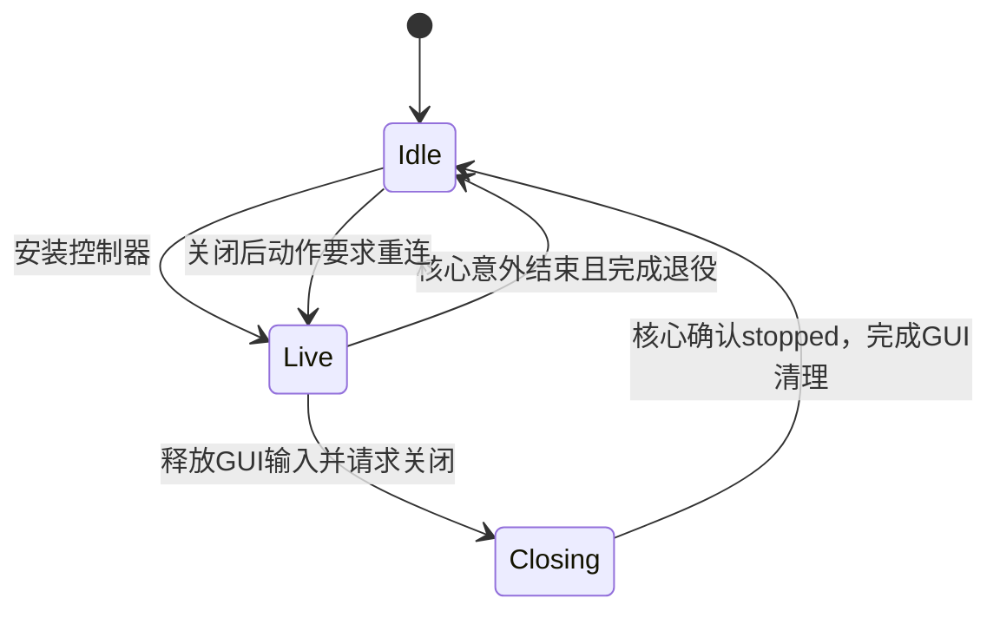

# 架构与资源所有权

Eclipse 使用同一个引擎支持 GUI、CLI、Windows 主机服务及独立协议插件。模块边界围绕连接、设备和媒体资源的所有者组织；一个模块不对应一个线程。

## 工作区分层

| 模块 | 责任 |
|---|---|
| `uu-gui` | 设备与设置编辑、窗口归组、逐会话呈现、客户端连接状态、GUI 输入归属 |
| `uu-cli` | 命令入口、信令服务、Windows 安装及主机进程监督 |
| `uu-core` | 设备身份和授权、连接准入、会话与媒体编排、显示管理、恢复和观测 |
| `uu-capture` | 平台采集、源身份、物理输入映射与生成源 |
| `uu-input` | 统一 HID 事件、注入接口、成功按下的跟踪及平台适配 |
| `uu-media` | 编解码、声音、像素与颜色转换、GPU 图像租约及平台呈现能力 |
| `uu-proto` | 提供方无关的共享媒体契约 |
| `uu-clipboard` | 系统剪贴板适配；通过核心接口接入，不让核心直接持有 GUI 剪贴板对象 |
| `uu-plugin-sdk` | 插件契约、加载、共享引擎类型与主题控件 |
| `animal-island-ui` | 只依赖 egui 的可复用控件，不持有业务状态 |

GUI 和 CLI 组织用户操作；核心通过采集、媒体和输入接口使用平台能力。具体协议插件经 SDK 复用引擎，主工作区不静态依赖某个提供方。

SDK 是 Rust 动态库，要求主程序、运行库和插件精确匹配源码、编译器、目标、特性与 flags。它不承诺稳定的 Rust ABI；内部重构后仍需交付完整匹配包。[插件契约与部署](plugins.md)

## 主机、连接与媒体阶段

`host_runtime` 组织 GUI 和后台主机的共同启动路径，注入剪贴板等平台能力，运行连接入口并拥有收尾。`shared_host` 为这些入口共享配置所有权、授权和活动会话登记。

一个已授权连接可以跨多个媒体阶段：切换显示源时替换采集、编码和 WebRTC 媒体状态，但显示使用记录和连接作用域的虚拟屏租约继续存在。不能把一次媒体换代当成整个连接已经结束。

| 所有者 | 完成条件 |
|---|---|
| `HostOwner` | 同一配置仅有一个活动主机，入口及接受的设备操作完成后才释放 |
| `SessionGate` / `SessionLease` | 撤销先请求取消，实际会话完成清理后才解除活动登记 |
| `native::capture_worker::Worker` | 关闭输出、请求停止、等待采集编码工作及其采集所有者结束 |
| `NativePeer` | 封闭辅助任务注册，关闭传输，等待任务及 socket 所有者退役 |
| `ControllerHandle` | 输入释放、传输关闭和 runtime 退出后才把 `stopped` 设为真 |

`cancel`、关闭消息和超时是请求或观察结果，不能代替完成回执。已接受的驱动变更需要等到实际结束，不能靠丢弃 future 声称取消成功。

## 客户端会话与窗口

`stream_workspace` 持有逐屏会话，原生窗口只呈现一组视图。拆窗、合并和重排保留会话标识、控制器、解码器和媒体连接；输入归当前活动会话，客户端命令的按键抬起归窗口。[窗口生命周期](window-lifecycle.md) · [多显示器行为](multiple-displays.md)

客户端连接由 `connection::Controller` 维护一个状态来源：



Closing 继续持有控制器，允许完成输入和资源释放，但不再处理晚到画面、目录或连接进度。关闭后的动作与 Closing 一起保存；用户明确断开会取消待重连，不能被晚到的重连请求反转。窗口退出意图仍由窗口层管理。

预算控制器 `stream_workspace::budget` 只接收会话快照并输出码率及延后连接决策。窗口层负责采样统计、应用画质和真正发起连接。刷新节拍、逐流拥塞历史和分配规则在同一个模块维护，不接触窗口或执行 IO。推荐曲线和设备内分配由核心设置模块提供。[带宽分配](bitrate-recommendations.md)

## 采集编码与帧交付

`native` 负责原生协议协商和主机/观看端编排。独立的 `capture_worker` 同时供原生会话与插件采编 facade 使用，拥有阻塞采编循环、质量变更、生产统计和停止收尾。

采编输出使用容量为 2 的有界通道；帧信封携带图像、追踪身份和可选采集租约。原生与插件调用同一个有效性判定。采集代次退休后，旧结果不能重新当作当前桌面发送。

媒体和呈现遵守以下界限：

- 原始未编码图像和已解码显示图像可以使用最新值策略；压缩参考帧依赖解码链，不能为了清队列任意丢弃。
- GPU 表面通过类型租约和平台同步交接，纹理引用不等于完整的样本所有权。
- 编解码器及图形上下文的线程亲和性属于平台接口契约，不能随意搬进可迁移任务。
- 控制和配置可以分模块组织；分层不应引入逐帧阻塞、拷贝、分配或额外线程。

[采集](native-capture.md) · [编码与回退](native-encoding.md) · [恢复与统计](streaming-quality.md)

## 虚拟显示器

`virtual_display::Manager` 统一管理显示定义、活设备、claim 和会话使用者。`policy` 持久化启用意图和属性；Windows backend 操作精确设备与拓扑。保存配置和创建 Windows 设备是两个步骤。[用户操作说明](virtual-displays.md)

`inspection` 是独立的管理读模型：一次刷新持有同一管理条目锁，读取一次 backend 库存和一份保存记录，生成状态、显示列表和槽位。本机与远程管理都从这个结果生成原有协议响应，远程可见性由协议边界处理。单项 `status/list/slots` API 保留，但组合响应应使用 `inspect`。

这保证一次响应使用同一份管理观察，不表示 Windows 外部热插拔是原子事务。刷新不会创建、安装、恢复或自动重试设备。

## Windows 服务管理前端

服务页面保留编辑草稿、导航、确认和反馈，执行责任分为：

- `service_ui::worker`：有界请求和事件通道、后台运行时、IPC 及周期读取、退出信号。
- `service_ui::deployment`：完整包核验、自动更新的空闲准入、配置准备和提权 helper 结果。
- `service_ui::connections`：自建连接条目的编辑状态。

服务导航使用类型化页签，操作结果仍归发起页签。关闭 GUI 只请求结束其管理 worker，不能停止系统主机服务。配置来源和服务归属仍由核心管理边界检查。[服务与配置归属](windows-background-service.md) · [配置存储](configuration-storage.md)

## 修改与验证

先确定行为、状态和所有权，再修改共同路径；平台例外留在平台边界。抽象应减少重复规则或明确资源归属，不为文件长度增加转发层。公共协议、配置字段、默认值及插件入口的变化需要独立说明。

在本机建立并保留基线，按模块运行相关测试，最后检查工作区与另一平台的编译。原生网络夹具共享生产十端口池，应串行执行：

```sh
cargo test --workspace --lib --bins --locked -- --test-threads=1
cargo check --workspace --all-targets --target x86_64-pc-windows-gnu --locked
```

Windows 动态 SDK 的测试程序采用项目 release 配置，避免 debug 大量导出触及 PE 限制。生成媒体、模拟 backend、状态测试和编译检查各自只能证明对应边界，不能替代真实多屏、驱动、声音、HDR、UAC 或物理延迟验收。性能结论需要同硬件、同画质及相同测量口径。
