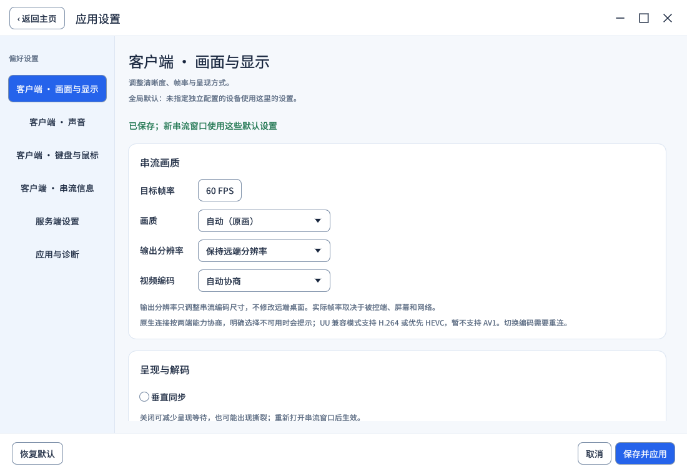
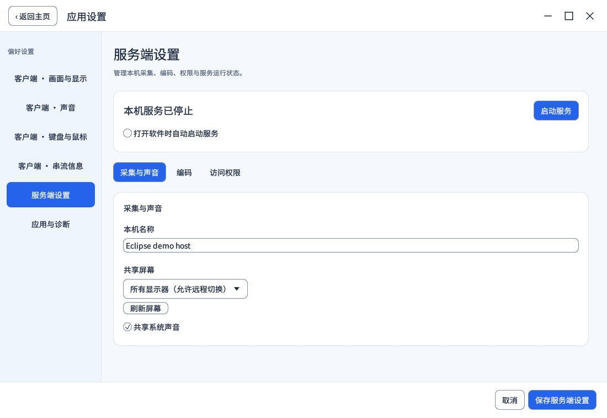

# 客户端配置、服务端设置与连接服务

从 0.13 开发版开始，默认进入“设备”。本机可以同时作为控制端和被控端，设置按角色分别保存。

| 位置 | 管理内容 | 生效范围 |
|---|---|---|
| 设备 | 连接地址、上次成功连接时间、上次画面、客户端配置选择 | 当前设备 |
| 应用设置 → 客户端 | 画面、声音、键鼠、串流信息 | 新连接的全局默认 |
| 设备 → 配置 / 详情 | 多个命名配置，可编辑、复制、删除 | 这台设备的下一次连接 |
| 串流窗口 → 设置 | 临时调整当前串流 | 当前会话 |
| 应用设置 → 服务端 | 名称、屏幕、声音、编码与访问权限、启动及自启 | 本机被控服务 |
| 连接服务 | IP 端口、UU 账号、每台自建服务器及启用开关 | 本机服务入口 |
| 顶部 UU 兼容 | 官方远程协助与官方设备列表 | UU 兼容通路 |

下面的界面使用隔离环境中的演示设备和生成预览。

## 客户端配置

未指定独立配置的设备继承全局默认。设备可以保存多个配置，例如“桌面 4K”“移动网络”“游戏”，并在设备卡片或列表中切换。

每次打开串流窗口时固定读取所选配置。随后编辑设备配置不会改变已经打开的窗口；串流内的临时调整也不会覆盖全局默认或设备配置。已有窗口仍保持自己的会话配置，需要关闭后重开才会使用设备新选择的配置。删除正在选择的配置会恢复为继承全局默认。

分辨率设置限制输出视频尺寸，保持源画面比例，不放大较小的源画面，也不更改被控端系统分辨率。输入仍按照原始桌面范围定位。软件缩放会增加处理工作，保持原始分辨率可避免这部分开销。

垂直同步和解码方式在创建串流窗口时读取，修改后重新打开串流窗口生效。

## 原生画质协商

IP、UU 寻址和自建服务器入口使用同一套原生画质规则：

1. 客户端声明经过解码探针确认的格式，以及帧率、输出分辨率、可选码率和编码偏好。
2. 主机按允许的编码、最大帧率和最大码率限制请求；自动码率使用主机默认值。
3. 主机在实际输出尺寸下初始化编码器，仅回报初始化成功的格式。明确选择的格式不可用时会报错；自动选择可使用允许的其它格式。
4. 运行中调整画质会先释放输入和旧连接，再重新协商。统计和诊断记录实际使用参数。

原生链路目前保留最高 60 FPS、最高 4K60 几何预算。客户端更高的目标会受主机限制。允许 HEVC / AV1 并不代表驱动支持，仍需要相应硬件编码和解码；软件模式使用 H.264。

扩展信息放在可选 SDP 属性中，保留原有严格信令 JSON。旧主机忽略新请求并继续使用自己的参数；旧客户端连接新主机时使用主机默认设置。原生媒体仍是 WebRTC 的 UDP / DTLS-SRTP，不因此切换传输协议。UU 官方兼容模式保留自身的控制协议，原生扩展不会发送给官方主机。

## 服务运行与连接入口

IP 直连默认启用，UU 和每台自建服务器独立启用。启动本机服务时只运行启用的入口，禁用 IP 时不建立其服务或发现监听。所有入口共用本机身份、授权表和会话管理。

顶部电脑图标和服务端设置中的按钮控制同一个服务：绿色表示运行，灰色表示停止；悬停可查看说明。入口登录或网络失败会在连接服务页显示，运行状态不代表每个入口都已经连通。

“打开软件时自动启动服务”只控制主页启动后的行为，不创建操作系统启动项，也不会让每个串流子窗口再启动一份主机。修改入口或采集编码设置前需要停止服务，保存后再启动。

入口开关控制本机接受连接和发布设备。只控制另一台设备时，不需要先启动本机服务。首次配对、撤销授权和观看 / 控制权限规则保持一致，详见[设备连接与授权](device-connection-and-trust.md)。

## 设备预览与壁纸

连接时间在收到首个解码画面后记录。退出或断线时保存远端视频的最后画面缩略图，不保存菜单、HUD 或本机整个桌面。正常串流期间不额外截图或逐帧回读。预览失败时保留上一张可用图片；缩略图只保存在本机用户目录，移除设备记录时清理对应图片。

设备页支持卡片和列表。设备身份归并依据已验证公钥，连接时间、配置和预览随身份归并；同名设备不会自动合并。

壁纸接受直接返回 JPEG / PNG 的 HTTP / HTTPS 图片地址，默认使用 `https://picsum.photos/1920/1080`，与 Moonlight V+ 的摄影壁纸入口一致。这是可替换的图片接口，不是 Moonlight 官方云服务。壁纸缓存在本机，每日检查更新，也可在应用设置里手动刷新或关闭；网络失败不妨碍连接设备。

## 升级与回退

旧客户端偏好保留原有默认值、光标模式和端口迁移规则。设备连接配置升级为第 3 版，首次修改之前保存一份私有的第 2 版原始备份。账号、设备私钥和已有配对不因界面调整重新注册。

旧版本不能读取新版设备配置。回退前先退出应用并保留全部用户数据，再恢复相应旧版备份；不要让旧版本覆盖新版的连接记录。
