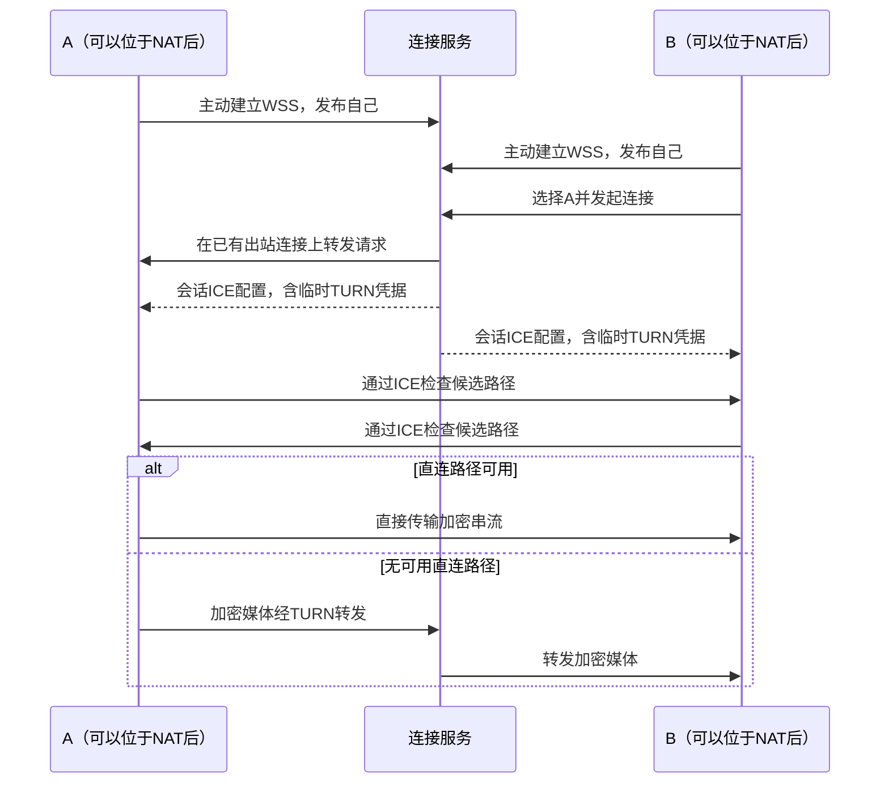

# 连接服务：上线、直连与中转

连接服务让设备通过主动出站的连接找到彼此。两端都加入同一服务并开启自己的主机入口后，都可以发起观看另一端，不要求被控端具有公网 IP 或路由器端口转发。直连和中转使用相同的原生串流、设备配对及权限规则。

## 两台电脑如何加入

1. 在两台电脑的“连接服务”中选择“加入连接服务”，粘贴服务管理员提供的同一个接入码。
2. 软件保存连接配置并启用本机入口。Windows 需要已安装并启用当前配置的主机服务；若已有串流或显示器操作，软件保留当前连接，并提示等待空闲后启用。
3. 在服务的在线设备列表中选择另一台电脑，沿用公钥、配对密码或 PIN 完成首次配对，以后直接连接。

不需要分别输入信令地址、证书路径、STUN 地址、TURN 账号或设备 ID。重复加入同一规范地址的服务会更新原条目，保留服务 ID 和已有设备路由。主机设置与客户端配置分别保存；若其中一步未完成，页面会指出已保存的部分和待完成的操作。

接入码只包含服务名称、WSS 地址、加入凭据和可选的自签证书。拥有接入码可以加入该服务，但不能绕过被控端的配对与控制权限。接入码应通过你信任的渠道交给设备使用者，不要放入公开仓库或发布包。

“在线”表示设备已经发布到连接服务；当前窗口能查询目录，并不意味着本机的主机入口也已启动。旧客户端或旧服务没有目录、自动中转等能力时，需要更新对应程序。

## 网络如何连接



WSS 负责上线、目录、认证协商及信令；STUN 帮助发现映射地址；ICE 检查实际可通的路径；TURN 在无法直连时转发媒体。候选优先级使直连优先，能否打洞成功仍取决于双方的映射、过滤和防火墙条件，不能仅由“Full Cone”等 NAT 名称保证。

连接详情显示实际选中的候选与直连或中转结果；配置了 TURN 不代表当前流量一定经过中转。中转需要服务器有足够的实际带宽承载串流。

当前集成依赖支持 TURN/UDP。双方仍需允许 UDP 出站；UDP 被完全封锁的网络尚不能通过 TURN/TCP 或 TURN/TLS 连接。现有 IP 直连入口继续独立工作，不要求加入连接服务。

## 部署服务器

使用具有公网地址的 Linux 主机，运行两个进程：`eclipse-signal` 和成熟的 [coturn](https://github.com/coturn/coturn)。服务端无需桌面、采集权限或 GPU。

在开发环境构建独立信令包：

```sh
python3 tools/internet/package.py
```

包包含 `eclipse-signal`、匹配的 Rust 运行库、来源与文件摘要清单以及 systemd 示例。解压后把程序及运行库放入同一个版本目录，例如 `/opt/eclipse-signal/versions/<提交编号>`，让 `/opt/eclipse-signal/current` 指向该目录。检查包的 `version.json` 来源与摘要；保留旧目录可用于回退。

安装发行版的 coturn。建立专用的 `eclipse-signal` 用户和 `/etc/eclipse-signal`、`/var/lib/eclipse-signal` 目录；coturn 使用发行版创建的 `turnserver` 用户。不要同时运行发行版默认 coturn 实例与示例中的 `eclipse-turn`，以免争抢端口。

准备以下私密文件并使对应服务用户可读：

| 文件 | 用途 |
|---|---|
| `/etc/eclipse-signal/server.token` | 32 字节随机数的十六进制文本，用于加入服务 |
| `/etc/eclipse-signal/server.pem`、`server.key` | 信令监听器的 TLS 证书与私钥 |
| `/etc/eclipse-signal/turn.secret` | 至少 32 字节的随机文本，只由信令与 coturn 共同持有 |

可以用 `openssl rand -hex 32` 生成随机文本并重定向到对应文件，避免把秘密放入命令参数。复制 [coturn 配置示例](../tools/internet/coturn.conf.example) 到 `/etc/eclipse-turn/turnserver.conf`，按主机情况填写 `relay-ip`、`external-ip`，并把 `turn.secret` 的相同内容填写到 `static-auth-secret`。配置文件仅供 root 与对应服务用户读取。

复制两个 [信令服务单元](../tools/internet/eclipse-signal.service)、[中转服务单元](../tools/internet/eclipse-turn.service) 到 `/etc/systemd/system/`，在 `/etc/eclipse-signal/service.env` 中设置：

```ini
SIGNAL_BIND=127.0.0.1:9443
STUN_URL=stun:server.example.org:3478
TURN_URL=turn:server.example.org:3478?transport=udp
```

这些地址必须替换为本次部署的实际公网入口。coturn 已提供 STUN，因此信令进程不再传 `--stun-bind`。也可以单独运行只提供信令和 STUN 的旧配置，但它不能下发中转凭据。

向外提供有效的 WSS 地址。使用 HTTPS 反向代理时，保留 WebSocket Upgrade，并把路径转发到信令监听器的 `/v1/signal`。使用公网 CA 证书可减少接入码内容；使用自签证书时，把证书通过接入码交给客户端，不关闭证书检查。

防火墙与云安全组都需要允许以下入口：

| 协议与端口 | 用途 |
|---|---|
| TCP 443，或你选定的 WSS 端口 | 目录和信令 |
| UDP 3478 | STUN 与 TURN 分配、维护 |
| UDP 49152–49251 | 本示例的 TURN 中转端口池，可按并发需要调整 |

云主机的公网地址若由私有地址映射而来，coturn 的 `external-ip=公网地址/私有地址` 和 `relay-ip=私有地址` 必须对应；只开放 3478 而没有开放中转端口池仍可能无法传输媒体。

配置完成后加载并启动 `eclipse-signal` 与 `eclipse-turn`。客户端正常会话使用服务端自动签发的临时 TURN 凭据，不需要管理员创建每个用户的 TURN 账号；默认签发期限为 24 小时，用于限制新的分配凭据，长期共享秘密不发送给客户端。

导出接入码：

```sh
eclipse-signal invite --name 'My connection service' \
  --url wss://server.example.org/v1/signal \
  --token-file /etc/eclipse-signal/server.token > connection-code.txt
```

自签入口另加 `--ca-file /etc/eclipse-signal/server.pem`。命令不需要 TLS 私钥。接入码是 `eclipse://connect/` 开头的一段文本，两台电脑粘贴同一份即可。

## 验证与兼容边界

先验证公网 WSS 与 STUN，再验证真实 TURN 分配和媒体；服务器本机能收到 STUN 回应，不能证明云安全组或中转端口池已放行。生成媒体与强制中继探针可以检查实际候选类型、解码增长及退出，但不能代替两台电脑的真实桌面、声音和长期串流验收。

新主机支持目录与每会话 ICE 配置，旧客户端继续收到原来的严格协议事件；新客户端仅在旧服务明确报告不支持版本时回退。目录中的名称用于展示，不能代替设备公钥身份；配对授权仍由真正的被控端验证。

机制依据：[ICE RFC 8445](https://www.rfc-editor.org/rfc/rfc8445.html)、[TURN RFC 8656](https://www.rfc-editor.org/rfc/rfc8656.html)、[coturn TURN REST 凭据说明](https://github.com/coturn/coturn/blob/master/README.turnserver)。
