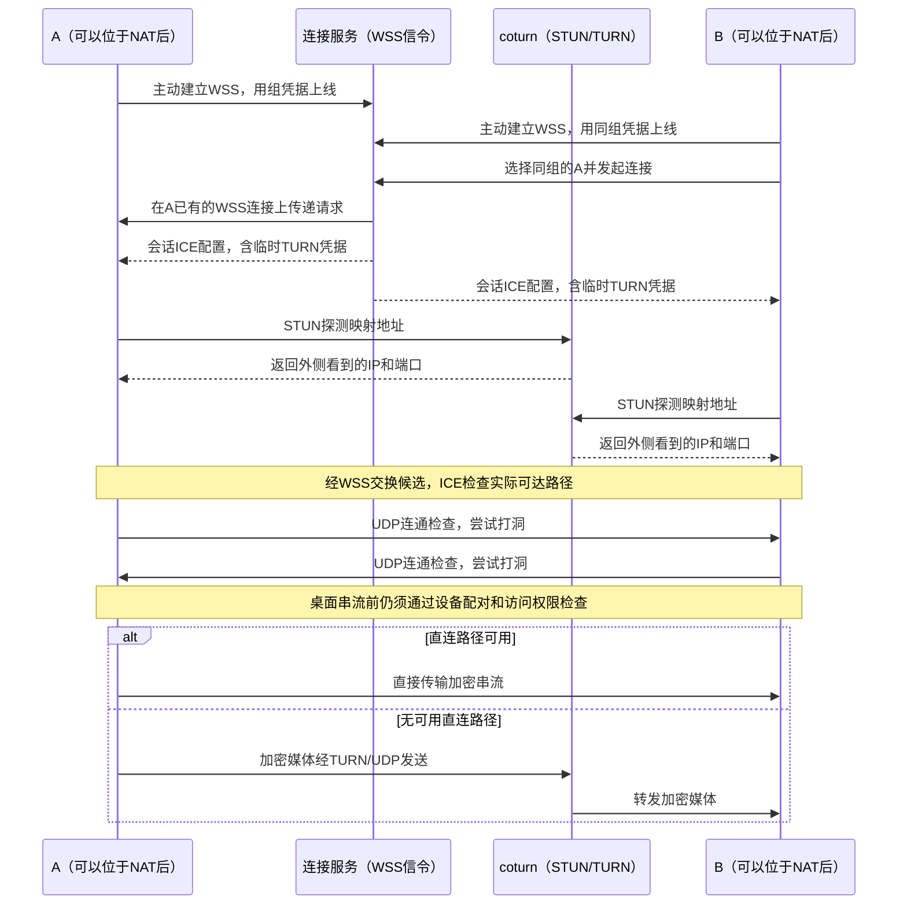

# 连接服务：一步一步配置

连接服务有两个用途：让自己的电脑找到彼此；两台电脑无法直连时帮助中转画面。客户端不用注册账号，使用管理员提供的一份接入码。

**已经部署好服务器，只需要连接两台电脑：读第一、二步。需要给别人使用：再读第三步。** 首次安装服务器的资料放在本文末尾，不要为了添加设备重新安装服务或生成证书。

## 第一步：选择 WSS 地址和端口

WSS 是加密的连接入口。443 是默认端口，也可以明确使用 9443 等其它空闲 TCP 端口。[WebSocket 协议](https://www.rfc-editor.org/rfc/rfc6455.html#section-3)允许 URL 显式指定端口。

本文统一用下面这个示例：

```text
wss://203.0.113.10:9443/v1/signal
```

`203.0.113.10` 是文档示例地址，配置时换成你服务器的真实公网 IP。`:9443` 是端口，`/v1/signal` 是服务路径，都要保留。客户端最终使用的是接入码，不需要自己拼地址。

服务器需要同时开放这些入口。云安全组和服务器防火墙都要检查：

| 方向 | 协议 | 端口 | 用途 |
|---|---|---|---|
| 入方向 | TCP | 9443 | WSS 连接、设备列表和连接协商 |
| 入方向 | UDP | 3478 | STUN 探测和 TURN 连接 |
| 入方向 | UDP | 49152–49251 | 本模板使用的 TURN 中转端口池 |

这是三类不同用途的端口，开放 TCP 9443 不会代替另外两条 UDP 规则。

端口选择不决定备案要求。阿里云说明，通过域名和非标准端口访问中国内地节点，域名仍须完成备案；更换端口不能作为免备案依据。具体要求以服务用途和接入商规则为准。[阿里云说明](https://help.aliyun.com/zh/icp-filing/basic-icp-service/user-guide/icp-filing-server-access-information-check)

### 服务器监听也要与端口一致

管理员编辑 `/etc/eclipse-signal/service.env`。直接用 9443 对外提供服务时，内容如下：

```ini
SIGNAL_BIND=0.0.0.0:9443
STUN_URL=stun:203.0.113.10:3478
TURN_URL=turn:203.0.113.10:3478?transport=udp
```

把两处示例 IP 换成真实公网 IP。`0.0.0.0` 表示监听本机所有 IPv4 网卡，不能填进客户端接入码。

修改监听端口后，管理员在空闲时执行：

```sh
sudo systemctl restart eclipse-signal
sudo systemctl status eclipse-signal --no-pager
```

如果本来就监听 9443，只开放云安全组即可，不需要重启服务。

### 证书怎么处理

- 使用 IP 和私有证书：证书的 SAN 必须包含该公网 IP；管理员导出接入码时附带 `--ca-file`。Eclipse 会随接入码保存根证书并继续校验连接。
- 使用域名和公网可信证书：证书名称必须匹配域名，通常不用附加 `--ca-file`。
- 端口本身不写入证书；换端口不要求换证书。不要关闭证书检查。

只在浏览器打开 WSS 地址，不能验证设备目录和媒体中转是否正常。请继续用下面的接入码步骤验证。

## 第二步：自己的两台电脑使用同一接入码

1. 两台电脑安装当前完整开发包，重开旧程序。Windows 上还要完成“服务管理”中的主机服务更新。
2. 在两端打开“服务管理 → 连接服务”，在“自建服务器”卡片点击“添加服务器”。
3. 两端粘贴管理员提供的**同一份接入码**，点击“加入并启用”。
4. 等待本机入口上线，在对应服务器下方的“在线设备”中选择另一台电脑。
5. 完成首次配对。以后可以直接从保存的设备连接，A、B 都可以发起连接。

如果当前正在串流，程序先保存配置，等空闲后启用。等待期间保持应用运行；退出应用后，下次打开继续检查。

接入码已经包含服务器地址、设备组编号、该组凭据及必要的根证书。不需要另外填写 STUN、TURN 账号、设备发布编号。

服务器列表直接提供别名输入、保存、删除和启用开关。修改别名后点击该行“保存”；留空使用地址和组编号。别名仅在本机显示，接入码里的设备组名称保持独立。展开“详情”可查看和复制 WSS 地址及 Group ID；每台服务器的在线设备单独刷新，刷新保留别名草稿。

“启用”开关控制本机是否在这台服务器上线。关闭后仍可连接下方其它在线设备；本机名称取服务设置中的设备名称，不用再次填写发布编号。

也可以从“添加设备 → 自建服务器”选择已添加的服务器，再从下拉列表选择它的在线设备。旁边的“添加服务器”会跳到同一管理入口。

在串流菜单打开“连接详情”，可以查看本次实际使用的是直连还是中转。有 TURN 配置不代表本次一定经过中转。

## 第三步：不同用户分别创建设备组

**一个私人设备组对应一份接入码。** 例如，自己的台式机和笔记本共用“我的设备”组；给另一个人创建“另一位用户”组，提供另一份码。

- 同组设备可以互相发现，并继续通过配对授权桌面访问。
- 不同组的目录、在线查询和连接路由在服务器端隔离，不能靠猜设备编号跨组连接。
- 设备名称可以重名，服务器不会用名称判断所属用户。
- 任何接入码都只能进入自己的组，没有能查看全部设备的客户端管理员码。

如果把同一码交给两个人，他们就是主动加入同一个组，会看到该组设备。需要互相独立时，分别创建组。

### 管理员：为一个用户生成接入码

下面命令在服务器上执行。它创建一个新组，并把接入码保存到当前目录的 `my-code.txt`：

```sh
umask 077
sudo -u eclipse-signal /opt/eclipse-signal/current/eclipse-signal group create \
  --file /var/lib/eclipse-signal/groups.json \
  --name '我的设备' \
  --url wss://203.0.113.10:9443/v1/signal \
  --ca-file /etc/eclipse-signal/ca.pem > my-code.txt
```

同样把示例 IP 换成真实公网 IP。使用公网可信证书时，去掉 `--ca-file` 一行。把 `my-code.txt` 的完整内容交给该用户，让他在自己的各台电脑上使用；不要公开发布接入码。

再执行一次命令并改用另一个名称、输出文件，就会生成另一个独立设备组。组文件自动更新，运行中的服务器约一秒后载入，新建用户不需要重启服务，不会因此中断已有串流。

### 查看已经创建的组

```sh
sudo -u eclipse-signal /opt/eclipse-signal/current/eclipse-signal group list \
  --file /var/lib/eclipse-signal/groups.json
```

只显示组编号和名称，不显示凭据或接入码。

### 再次导出已有组的码

先从上一条命令取得组编号，将下方 `组编号` 替换为该编号：

```sh
umask 077
sudo -u eclipse-signal /opt/eclipse-signal/current/eclipse-signal group invite \
  --file /var/lib/eclipse-signal/groups.json \
  --id 组编号 \
  --url wss://203.0.113.10:9443/v1/signal \
  --ca-file /etc/eclipse-signal/ca.pem > my-code.txt
```

使用 `invite` 会导出原组；使用 `create` 会新建另一个组。添加自己第二台电脑时，复制已有组的码即可。

## 管理员首次安装的资料

已安装的服务器跳过本节。服务器运行两个独立组件：

| 组件 | 负责什么 | 配置位置 |
|---|---|---|
| `eclipse-signal` | 私人组、上线、目录、连接协商、临时中转凭据 | `/etc/eclipse-signal/`、`/var/lib/eclipse-signal/groups.json` |
| `coturn` | STUN 探测与加密媒体中转 | `/etc/eclipse-turn/turnserver.conf` |

构建独立服务器包：

```sh
python3 tools/internet/package.py
```

解压到 `/opt/eclipse-signal/versions/构建编号`，保留程序旁匹配的 Rust 运行库和 `version.json`。`/opt/eclipse-signal/current` 指向当前版本目录。

为 `eclipse-signal` 创建专用系统用户，并让它拥有 `/var/lib/eclipse-signal/`。按第三步先创建自己的第一个设备组，然后启动服务；不要把同一份凭据给所有用户。

准备证书时，`server.pem` 是服务器叶证书，`server.key` 是其私钥，`ca.pem` 是要随私有接入码分发的根证书。叶证书必须为 `CA:FALSE`，有匹配入口 IP/域名的 SAN 以及 `serverAuth` 用途。根 CA 私钥只留服务器管理员保存，不分发给客户端。

安装发行版提供的 [coturn](https://github.com/coturn/coturn)，使用包创建的 `turnserver` 用户。将 [coturn 配置模板](../tools/internet/coturn.conf.example)复制到 `/etc/eclipse-turn/turnserver.conf`，填写：

- `relay-ip`：云主机实际网卡的私有 IP。
- `external-ip`：`公网IP/私有IP`，用于云主机的地址映射。
- `static-auth-secret`：与 `/etc/eclipse-signal/turn.secret` 一致的随机私密文本；可用 `openssl rand -hex 32` 生成。

长期 TURN secret 只由信令和 coturn 共同持有，不放入接入码。客户端取得的是每次会话的临时 TURN 凭据。

复制 [信令服务单元](../tools/internet/eclipse-signal.service)和 [中转服务单元](../tools/internet/eclipse-turn.service)到 `/etc/systemd/system/`。组文件由 `eclipse-signal` 用户管理，私钥、凭据及组文件仅允许对应服务用户读取。不要同时启用默认 coturn 实例和 `eclipse-turn`，以免争抢端口。

```sh
sudo systemctl daemon-reload
sudo systemctl enable --now eclipse-turn eclipse-signal
```

如果选择 Nginx 反向代理，可以使用另一个端口监听，但必须转发 WebSocket Upgrade、Authorization 和原始查询参数，保留 `group`；请求最终进入信令的 `/v1/signal`。[Nginx WebSocket 文档](https://nginx.org/en/docs/http/websocket.html)

## 背景：连接是怎样建立的

两端各自主动建立 WSS 连接，服务器沿已有连接传递请求，因此不要求一端能直接访问另一端的公网 IP。设备找到彼此以后，再检查音视频实际走哪条网络路径。

| 名称 | 可以怎样理解 | 在 Eclipse 中的作用 |
|---|---|---|
| WSS | 加密的“报到和传话”通道 | 上线、读取本组设备目录、交换连接请求和协商信息；画面不经过这个通道。 |
| [STUN](https://www.rfc-editor.org/rfc/rfc8489.html) | 看看路由器外侧的地址 | 帮助设备发现 NAT 映射出的 IP 和端口，供直连检查使用；它不转发音视频，也不能单独保证打洞成功。 |
| [ICE](https://www.rfc-editor.org/rfc/rfc8445.html) | 试出实际能通的路线 | 收集本地、映射和中继等候选地址，让双方检查连通性。Eclipse 优先选择可用直连路径，必要时使用中继。 |
| [TURN](https://www.rfc-editor.org/rfc/rfc8656.html) | 让服务器代为转发 | 直连不可用时，由 coturn 转发加密媒体，需要服务器有足够带宽；当前接入的是 UDP 中转。 |

**设备组决定谁能互相发现和发起连接，配对决定谁有权访问桌面。** 同组、在线或拿到临时 TURN 凭据，都不能替代被控端的设备公钥、密码或 PIN 配对及访问权限检查。

下面沿用 A、B 的连接流程，区分信令服务和负责 STUN/TURN 的 coturn。它们可以部署在同一台服务器上：



### 如何理解连接结果

直连优先不代表一定能直连。“Full Cone”等 NAT 类型名称不能保证打洞成功，还要看双方的映射、过滤和防火墙条件。以“连接详情”显示的实际路径为准；配置了 TURN 不代表本次流量一定经过中转。

当前支持 UDP 打洞与 TURN/UDP。UDP 完全不可用的网络还不能改用 TURN/TCP 或 TURN/TLS。

验证应依次检查：TCP/TLS → 设备上线和组隔离 → 配对 → 直连或中转的视频增长。编译、服务器本机 STUN 应答和同机生成画面，均不能代替两台真实电脑的桌面验收。

### 连接耗时

建立连接包含设备认证和媒体准备两个阶段。网络候选发现会提前启动，与等待媒体请求、采集及编码准备并行；发送媒体应答前仍需完整候选和编码验证。STUN 请求丢包时按 [RFC 8489](https://www.rfc-editor.org/rfc/rfc8489.html#section-6.2.1) 重传，所有重试共用原有总期限。WSS 小消息使用低延迟 TCP。

若连接仍慢，请同时保留两端对应时间的诊断日志；区分网络发现、配对等待、主机采编准备和路径建立。只看最终连接总时长，无法判断等待发生在哪一段。客户端和被控端都需更新，才能同时使用两侧的准备优化；这些改进不要求更换接入码。
