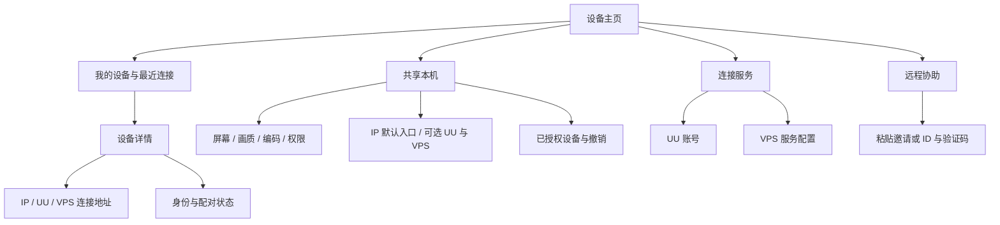

# 设备连接与配对统一设计

原生模式应围绕**设备、共享设置、连接地址、访问授权**组织。共享设置属于本机；一台远端设备可以有 IP、UU、VPS 多个连接地址；访问授权跟随设备，换连接方式不应重新配对。常用操作只需“选设备 → 连接”，首次认识设备才处理配对。

本文区分当前实现与后续改版设计。现有操作见[局域网配对](native-lan.md)和[连接服务使用说明](native-internet.md)；本文中的统一设备身份、多配置、统一共享管理和 UU 远程协助尚未实现。

## 当前三种连接方式需要什么

| 方式 | 被控端准备 | 控制端填写 | 当前如何获得桌面访问授权 |
|---|---|---|---|
| IP 直连 | 开启本机共享；首次开放新设备配对 | 被控端可达的 IP 或主机名及服务端口 | 双方核对配对码，被控端批准后保存独立授权 |
| UU 账号连接服务 | 正常登录 UU，并在本项目中开始共享 | 正常登录 UU，填写目标的 UU 设备编号 | 两端预先持有相同的原生配对文件 |
| VPS 连接服务 | 连接自建服务，以本机的服务内名称发布共享 | 连接同一服务，填写目标发布的名称 | 两端预先持有相同的原生配对文件 |

UU 两端需要不同的 UU 设备身份，不要求使用不同账号。同账号的两台设备已确认能够通过当前原生入口连接；不同账号还取决于 UU 服务允许的访问关系，不能仅凭双方都登录就保证可连。登录和开始共享是两个动作。

VPS 还需配置服务器地址、访问凭据，以及必要的证书信任。**是否手动提供证书取决于客户端是否信任证书链，不取决于是否使用域名**：自签名或私有 CA 通常需要导入；系统信任且名称匹配的公开证书通常不需要。证书还必须匹配实际连接的域名或 IP。它验证的是连接服务器，不能代替远端设备的身份验证。

VPS 的“双方名字相同”应理解为：被控端发布 `desktop-one`，控制端填写目标 `desktop-one`。不是把两台设备都改成同一个本机名字；两个主机在同一服务上发布相同名称会冲突。

当前三个入口最终复用原生媒体通路，但上层授权并未统一。连接方式也不改变网络可达性：当前 IP 入口除了固定服务端口，还会使用动态信令及 UDP 媒体端口；UU/VPS 的默认仅直连策略下，打洞失败仍会失败。

## 共享本机与连接服务如何分开

### 一套本机共享设置

“共享本机”集中保存以下内容，IP、UU、VPS 共用：

| 设置 | 含义 |
|---|---|
| 本机名称与显示源 | 这台设备如何显示、共享哪个屏幕 |
| 帧率与码率 | 默认输出和主机允许的上限；以后支持协商时再接受控制端请求 |
| 编码方式 | 自动、硬件、软件；实际后端及回退原因另行显示 |
| 键鼠、系统声音、剪贴板 | 主机允许提供哪些能力；仍需满足各能力的会话授权条件 |
| 已授权设备 | 谁能观看、谁能控制，能否无人值守，如何撤销 |

观看端的缩放、垂直同步、音量和光标显示属于客户端偏好，不放入共享设置。主机允许键鼠也不等于任意连接者都有控制权限。

目前局域网和互联网页面各自维护了一组共享参数，应迁移到同一份持久配置和同一个共享管理器。不能只把表单画得一样，底层仍分别创建采集、编码和输入会话。

### 启用哪些连接入口

本机有一个总的“允许连接本机”开关；打开后，IP 入口默认启用，UU 和一个或多个 VPS 服务按需启用。这里的“IP 默认启用”指共享开启后的默认入口，不表示软件一启动就授权别人采集桌面。

| 入口设置 | 放在哪里 | 不应重复出现的内容 |
|---|---|---|
| IP 服务端口、发现端口 | 本机共享的高级网络设置 | 屏幕、帧率、编码设置 |
| UU 登录状态、本机 UU 编号 | 连接服务中的 UU 卡片 | 控制另一台设备的目标编号 |
| VPS 地址、访问凭据、证书信任 | 可命名、可复用的服务配置 | 每一台远端各抄一遍服务器配置 |
| 本机在 VPS 上的发布名称 | 本机对该服务的发布设置 | 另一台目标主机的名字 |

保存设置、启用入口、授权访问是不同状态：保存 VPS 配置不代表已经上线，入口上线不代表已经允许新设备。界面分别显示“未配置、连接中、可连接、失败及原因”。端口被占用、登录过期和服务不可达应在对应入口提示，不能让整个页面看起来已就绪。

所有入口把连接请求交给同一个会话管理器。沿用当前一次一个串流会话的限制，第二个入口的请求应得到明确的忙碌提示；不能同时建立两套编码和输入控制。断开串流后仍保持已启用的入口可连接，自动重新发布房间；“停止共享”才关闭所有入口、待确认请求和当前串流。当前互联网入口结束后需要手动重新共享，这也是改版需要修正的生命周期。

## 多台设备应如何保存

### 问题一的处理方式

应支持多个配置，但主要记录对象是**远端设备**，不是每种连接方式各建一套孤立配置。同一台设备在不同网络地址下仍然是同一个信任对象。

例如一张“工作电脑”设备卡片可以包含：

| 内容 | 保存位置 |
|---|---|
| 设备别名、公钥指纹、首次确认时间 | 统一设备记录 |
| IP 地址和端口 | 该设备的 IP 连接地址 |
| UU 目标编号、使用哪个本地账号配置 | 该设备的 UU 连接地址 |
| VPS 服务引用、目标发布名称 | 该设备的 VPS 连接地址 |
| 旧配对密钥或新版信任记录 | 私有凭据存储，由设备记录引用 |
| 观看、控制等许可 | 被控端按控制端身份保存的授权记录 |

服务器配置单独命名，如“家庭服务器”“备用服务器”，多台设备共用引用。VPS 访问凭据是加入该服务的凭据，不是所有设备的桌面通行证。当前服务使用共享访问令牌；后续也可独立扩展服务成员权限。

主页只显示设备和一个“连接”按钮，旁边可选择连接地址。添加设备时选择 IP、UU 或 VPS，只填写该方式需要的字段；已有服务从列表选择，已有设备可增加地址。发现的 IP 设备、UU 账号中的设备和手动配置都只是候选；合并记录必须验证同一原生设备身份，不能因为名字或 UU 账号相同就自动合并。

自动连接可先尝试已验证的局域网地址，再尝试用户启用的服务地址；用户也可指定本次方式。切换地址不自动扩大权限或切换到中继。兼容官方被控端的设备还需标记协议类型，不能把“UU 地址相同”当作原生协议互通。

### 建议的页面结构



配对密钥文件、证书路径和协议选项放入相应的首次配置或高级设置，不让用户每次连接都重新面对全部字段。串流中的地址、端口和实际媒体路径继续放在独立“连接详情”，不增加 HUD 内容。

## 现在几种 key 各自做什么

### 问题二的处理方式

| 项目 | 当前用途 | 能否互相代替 |
|---|---|---|
| IP 配对凭据 | 主机给某个控制端颁发的长期随机授权 | 当前不能直接当作互联网配对文件 |
| UU/VPS 原生配对文件 | 32 字节随机预共享密钥，认证原生建连消息 | UU 和 VPS 之间可使用同一文件内容 |
| VPS 访问凭据 | 允许连接自建信令服务器 | 不授予桌面访问权 |
| VPS 服务器证书 | 验证 WSS 服务器身份 | 不验证远端电脑身份 |
| 本机设备私钥 | 证明本机身份；未来统一设备信任的基础 | 不应分享给其它设备 |
| UU 账号令牌、协助验证码 | UU 服务侧登录或临时协助授权 | 不等于原生设备配对密钥 |

当前 UU/VPS 配对文件通过 HMAC-SHA256 认证完整的 SDP、DTLS 指纹、服务会话、角色及新鲜挑战，阻止不持有密钥的人篡改或伪造原生协商。它不直接作为视频加密密钥；媒体使用 WebRTC 的 DTLS-SRTP，HMAC 本身也不加密信令内容。实现见[互联网认证](../crates/uu-core/src/internet.rs)。

**同一对设备在不同连接方式下，应共用一份信任关系；不同设备对之间，应使用独立的授权。** 不应把所有电脑放进同一个全局配对密钥组：持有同一密钥的成员难以互相区分，泄露和撤销也会影响整组。

假设三台设备为 A、B、C，可以有独立的 A–B、A–C、B–C 信任关系，只建立实际需要的关系。无需用户手工管理三个文件，软件按设备保存即可。A 控制 B 和 B 控制 A 的许可分别决定；双方能算出同一个密钥，不代表自动互相授予桌面控制权。

当前实现有一个实际限制：互联网主机一次只加载一个配对文件，尚无按控制端选择密钥的授权表。所以只给控制端增加多个 profile，还不能让同一个主机同时认识多个独立密钥。过渡方案也必须给主机增加按设备管理的凭据表，或直接迁移为公钥授权。

## IP 直连配对实际建立了什么

### 问题三的处理方式

可以把它理解为“首次确认后，保存以后重连所需的秘密授权”，但不是双方事先填写相同密码，也不是从双方公钥算出共享密钥。

当前流程如下：

1. 主机保留长期 TLS 证书和私钥；控制端检查目标公开信息，取得主机证书。
2. 首次开放配对时建立 TLS 1.3 连接。两端从本次 TLS 会话和设备上下文独立导出同一个八位核对码。
3. 控制端显示核对码，用户在被控端输入相同号码并批准。此步骤确认的应是本次连接，而不只是对方声称的设备名称。
4. 主机生成该控制端专属的 32 字节随机凭据，通过 TLS 发给控制端。控制端保存凭据及固定的主机证书；主机只保存凭据哈希及授权记录。
5. 以后重连，控制端先验证固定证书，再在 TLS 内出示凭据。主机验证后，签发本次串流的短期邀请，随后建立 WebRTC 媒体连接。

八位码是一次连接的人工核对码，长期凭据是后续访问授权，二者不同。主机保存的是哈希，也不是双方存着同一份明文 key；从授权原理看，这是“固定主机身份 + 客户端持有秘密凭据”。当前主机用客户端 ID 和秘密凭据验证控制端，尚未要求控制端证明持有某个长期公钥对应的私钥。实现见[配对流程](../crates/uu-core/src/native_lan.rs)与[私有授权存储](../crates/uu-core/src/native_lan_store.rs)。

现有机制已经支持多个控制端分别授权、分别撤销，也能在主机重启后重连。主要缺口是授权仍属于 IP 入口，没有复用到 UU/VPS。不能直接把保存的凭据哈希当成新协议的共享密钥，否则会改变已有存储的安全含义。

## 用设备公钥统一配对

### 问题四的处理方式

这个方向可行。每台设备生成并保留自己的长期身份，私钥留在本机；其它设备保存其公钥或证书，以及允许它做什么。设备身份属于这次安装，不应绑定易变化的 IP，也不依赖 UU 账号。升级保留身份，重装或换钥则需要明确迁移或重新确认；复制整个配置目录会复制身份，不能当成生成了另一台设备。

你描述的“双方自动算出相同 key”，在使用 X25519 这样的密钥协商算法时，关系是：

```text
A 使用：A 的私钥 + B 的公钥
B 使用：B 的私钥 + A 的公钥
双方得到相同的共享秘密
```

只有两份公钥的人不能算出这个秘密。共享秘密还需经 HKDF 等密钥派生过程，并绑定协议用途和双方身份；不能直接当作各种用途共用的密钥。这是能力说明，不是一份完整握手协议。[X25519 密钥协商](https://www.rfc-editor.org/rfc/rfc7748.html#section-6.1)、[HKDF](https://www.rfc-editor.org/rfc/rfc5869.html)

需要同时处理三个容易遗漏的条件：

- **首次公钥必须可信。** 未认证网络传来的公钥可以被替换；从服务查询得到公钥也不自动代表设备本人。首次通过双方核对、可信渠道的设备名片或经过认证的一次性邀请固定公钥。
- **对方必须授权本机。** 在 A 中填入 B 的公钥，只让 A 知道要验证谁。B 仍需保存 A 的身份并批准权限，否则任何人都能生成自己的密钥对、填 B 公钥后申请访问。
- **长期信任与会话密钥分开。** 仅使用两把固定私钥会长期得到相同秘密；每次串流仍应进行带临时密钥的认证握手，并将双方身份、角色、挑战、协商结果和 DTLS 指纹绑定起来。TLS 1.3 的临时密钥协商提供了可参考的成熟机制。[TLS 1.3](https://www.rfc-editor.org/rfc/rfc8446.html#section-2)

签名身份密钥和密钥协商密钥也不是同一种东西。若使用 Ed25519 做身份签名，不能直接把它当 X25519 使用；具体算法、密钥绑定及旧证书迁移应在协议实现时确定，使用经过审查的库和握手协议。

因此，建议的产品能力是**一次认识设备，之后跨 IP、UU、VPS 验证同一身份**。底层可以从密钥协商得到认证材料，也可以使用公钥签名验证会话；用户不必关心是否存在一个永久不变的“配对 key”。

### 用户如何交换设备身份

日常入口使用“设备名片”和“配对邀请”，不让用户复制裸公钥：

| 场景 | 建议操作 |
|---|---|
| 第一次能 IP 直连 | 沿用双方核对和主机批准，在已确认的通道内交换长期设备身份，保存授权 |
| 两台设备不在一起 | 复制一次性邀请，通过可信渠道发送；邀请携带主机身份、连接地址和有时限的配对许可 |
| 已经知道对方公钥 | 在高级入口导入设备名片；被控端仍需批准本机身份，或预先导入并授权本机名片 |
| 原来已经 IP 配对 | 用现有固定证书和有效凭据认证连接，再协商升级为统一身份，避免要求用户全部重新配对 |
| 以后切换连接方式 | 给已配对设备添加 UU 或 VPS 地址，验证同一身份后直接连接 |

公钥名片可以公开；包含一次性秘密的邀请则授予配对能力，应有到期、使用次数和撤销状态。接收端可自动解析整段分享文本，识别连接地址和身份，展示“这是哪台设备、将获得什么权限”，确认后完成保存。

分享文本若必须很短，可以使用短码换取邀请；若短码用于两端之间的认证，应采用成熟的密码认证密钥交换方案并限制在线尝试，不能把短码直接当作现有 256 位 HMAC 密钥。PAKE 例如 SPAKE2 能让持有相同密码的双方协商强密钥，但并不消除在线猜测或不可信分享渠道的问题。[SPAKE2](https://www.rfc-editor.org/rfc/rfc9382.html)

统一身份后，被控端授权表仍是最终访问依据。撤销 A 对 B 的访问，应同时阻止所有连接入口；拒绝旧邀请、已有恢复凭据和失效授权，必要时结束当前串流。删除控制端的本地 profile 只删除本地记录，不能代替被控端撤销。

## UU 远程协助能否作为第四种入口

### 问题五的处理方式

**可以增加“UU 远程协助”入口，支持粘贴分享文本或填写设备 ID、验证码。** 它在界面上是第四种发起连接的方式，在底层仍属于 UU 提供方，增加“按协助码加入”的寻址和授权流程，不需要第四套采集、编码或媒体管线。

协助中的公开连接 ID 与当前账号入口使用的内部设备编号是不同字段，不能把分享文本中的数字 ID 直接填入现有 `room/join/by_device` 流程。也不能把协助验证码当成原生配对文件。

已有参考：uu-remote-linux 的控制端实现了 `room/join/share/by_code`，主机端实现了访客及账号两种协助身份、协助开关、验证码挑战和取消流程。其临时码可配置按会话、按时间或不自动刷新，另有自定义码选项，因此验证码不一定每次随机变化。这些属于该固定版本的参考行为，仍需在本项目中实现和实测。[协助加入实现](https://github.com/VallierDev/uu-remote-linux/blob/50ed54d77a9084d18797061650bed9f85293c421/src/viewer/api.rs)、[协助主机实现](https://github.com/VallierDev/uu-remote-linux/blob/50ed54d77a9084d18797061650bed9f85293c421/src/assist.rs)

该项目还记录了同账号设备可能被 UU 协助接口拒绝；这种情况应引导使用账号设备连接。它支持访客被控端，不代表任意控制端都已支持免登录。具体登录要求和限制需按服务实际响应处理。[参考项目协助说明](https://github.com/VallierDev/uu-remote-linux/blob/50ed54d77a9084d18797061650bed9f85293c421/AGENTS.md#7-protocol-facts-verified-against-the-official-clients)

### 两种目标需要分别处理

| 目标 | 所需能力 | 能否省去手工原生 key |
|---|---|---|
| 本项目控制官方 UU 被控端 | 协助码加入 + 现有 UU 兼容媒体和控制协议 | 可以，不使用本项目的原生 key |
| 本项目原生端控制另一个原生端 | 协助码加入 + 原生首次身份确认和临时授权 | 可以设计成不手工复制 key，但当前尚未实现 |

官方被控端不认识本项目原生协议，加入 UU 房间后不能直接向它发送原生控制消息。原生两端如果只补了 UU 协助加入 API，现有 HMAC 认证仍会要求原生 key；要消除这一步，必须增加身份引导和新版原生认证协商。

原生协助应默认只授权本次会话，结束或取消后失效；需要长期访问时，由被控端明确批准“保存为已授权设备”。记住设备 ID 或最近连接记录，不等于保存永久控制权限。

还有一条信任边界：参考实现把验证码交给 UU 的 HTTPS API，UU 协助授权不证明验证码对 UU 服务保密。若原生模式还要求不依赖服务方验证设备身份，分享文本中应带主机身份指纹等独立校验材料，或由双方核对本次握手。不能直接用 UU 验证码派生密钥，就宣称获得了独立于 UU 的端到端身份认证。

“只需 ID 和验证码”减少的是配置步骤，不保证所有网络都能直连。原生 UU 模式仍遵守已选定的正式仅直连策略；不得因改用协助入口就自动启用官方中继。

## 后续改版顺序

| 顺序 | 交付内容 | 验收重点 |
|---|---|---|
| 1 | 一套本机共享设置、统一启停与单会话管理 | 三个入口参数一致；一路失败不伪装全部就绪；断开后可再连接，停止时全部关闭 |
| 2 | 设备记录、多连接地址和独立服务配置 | 多设备切换不覆盖目标或凭据；已验证设备增加地址不重复建卡 |
| 3 | 统一设备身份与跨入口授权，迁移已有 IP 配对 | 冒充、换钥、撤销、反向控制权限和未知设备首次确认均符合统一规则 |
| 4 | 设备名片、一次性邀请及整段文本导入 | 首次配对无需手抄密钥；邀请过期、重放、错误对象和取消得到明确结果 |
| 5 | UU 远程协助加入与主机发布，再接原生临时配对 | 官方兼容和原生扩展分别验收；不承诺官方端理解原生协议 |

这些调整集中在配置、寻址与授权，继续复用现有低延迟采集、编码、WebRTC 和呈现路径。先统一状态和所有权，再简化页面，避免把当前分散的逻辑只是换一层外观。
