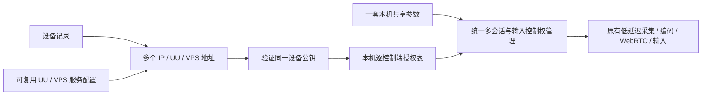
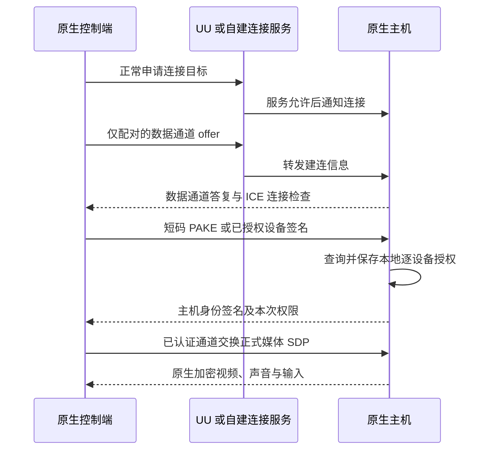

# 设备连接、共享与授权

当前开发分支以**设备**组织连接：一台设备可保存 IP、UU、VPS 多个地址；本机只有一套共享参数和一张控制端授权表。切换连接方式仍验证同一个设备身份，无需两端手选相同的配对 key 文件。旧发布包的行为以对应标签文档为准。

0.13 开发版的客户端默认、每设备多个配置、预览和服务运行规则见[客户端与服务端设置](client-and-server-settings.md)。

## 页面与常用操作

| 页面 | 用途 |
|---|---|
| 设备 | 保存多台远端、选择连接地址、打开独立串流窗口；详情中添加、编辑或移除地址 |
| 服务管理 | 设置显示器、帧率、码率、编码、声音、键鼠、剪贴板；启停服务、管理控制端权限 |
| 连接服务 | 管理 IP 端口、UU 账号和自建服务器；分别启用本机入口 |
| 顶部 UU 兼容 → 远程协助 | 说明原生首次配对；粘贴官方 UU 分享文本或输入设备 ID、验证码发起兼容连接 |
| 顶部 UU 兼容 → UU 兼容设备 | 连接账号中的官方被控端，使用现有 UU 兼容媒体和控制协议 |

观看端的缩放、垂直同步、音量、光标和输入捕获仍在“应用设置”中。串流地址和选路仍由悬浮菜单的“连接详情”单独显示，不加入 HUD。

### 三种原生连接方式

| 方式 | 被控端准备 | 控制端填写 |
|---|---|---|
| IP 直连 | 开始共享，IP 服务默认开启 | 可达 IP 或主机名；非默认端口填写 `主机:端口` |
| UU 账号 | 正常登录、勾选使用 UU 服务、开始共享 | 正常登录；添加设备时填写被控端的内部 UU 编号 |
| 自建 VPS | 配置服务器、启用本机发布并开始共享 | 配置同一服务器；添加设备时选择服务并填写被控端的发布名称 |

三个入口都按以下首次配对流程授权。启动服务后默认接受新设备配对申请；申请仍需完成验证才会获得桌面授权。

UU 两端需使用不同的 UU 设备身份，可以登录同一个账号。跨账号还受 UU 自己的访问规则限制，不能保证任意账号互通。不要复制整份账号或设备身份文件来创建另一台设备。

VPS 的名称是寻址地址：主机发布 `desktop-one`，客户端填写目标 `desktop-one`；不是让两台主机都发布同一个名字。名称支持字母、数字、`-` 和 `_`。同一服务重复发布同名主机会冲突。

### 第一次连接怎样操作

1. 被控端在“连接服务”启用所需入口，在“服务管理”配置采集与编码，再在连接服务页点击“启动服务”。
2. 服务启动即接受新设备申请，无需再操作配对开关。公钥配对每分钟最多接收五次新申请，同一时刻确认一个请求；达到次数限制后自动恢复。
3. 控制端在“设备”添加 IP、UU 或 VPS 地址，点击“保存并连接”。附近发现的设备也需首次确认。
4. 控制端的串流窗口显示八位临时码。通过可信方式告诉被控端；被控端输入该码、选择是否允许键鼠控制，再批准。
5. 软件交换并验证完整公钥，保存设备身份与授权，然后开始串流。以后选设备连接即可，不必再次输入码。

被控端等待人工批准最长两分钟。关闭控制端窗口、拒绝或停止共享，会取消当前申请并清理提示。配对码不会放进 HUD、命令行或自动诊断日志。

已经配对后，给同一设备添加另一种地址即可。认证确认公钥相同后，重复设备卡片会合并；名称相同或处于同一 UU 账号不会触发合并。每次使用用户选择的地址，不自动换目标或放宽中继策略。打开的窗口固定本次地址和服务器配置，编辑设备不会把该窗口的重连改到另一台主机。

### 如何配置 VPS

“连接服务 → 添加服务器”填写名称、服务器地址和访问令牌。可填写 `signal.example:8443` 或完整的 `wss://…/v1/signal` 地址。令牌由服务器部署者提供，在本地私有保存；高级设置也可引用已有凭据文件。

自签名或私有 CA 需要导入证书；公开可信证书且名称匹配时可留空。这取决于证书链是否受信任，而不是是否使用域名。证书必须匹配实际连接的域名或 IP，它验证连接服务器，不代替远端设备身份。

在连接服务页启用此服务器后，启动本机服务会在该服务器发布本机。可同时启用 UU 和多个 VPS；服务配置可供多台目标设备复用。服务保存前会检查本地地址、凭据与证书；上线失败会在连接服务页对应入口显示原因。

部署方法见[自建连接服务](native-internet.md#自建信令与-stun)。自带服务提供 WSS 信令及 UDP STUN，尚不提供自建 TURN 媒体中继。

## 多客户端授权如何工作

每次安装生成一把长期 Ed25519 身份私钥；设备标识是公钥的 SHA-256 指纹。私钥只保存在本机，主机为每个客户端记录公钥、名称、观看及键鼠权限。客户端也保存并验证主机公钥。名字、IP、UU 账号和服务器名称均不能代替身份验证。

例如主机 B 可分别授权 A、C、D：

| 控制端 | B 保存什么 | 权限示例 |
|---|---|---|
| A | A 的公钥 | 观看与控制 |
| C | C 的公钥 | 观看与控制 |
| D | D 的公钥 | 仅观看 |

A、C、D 各自持有自己的私钥，不共享同一份长期秘密。主机可在“已授权的控制端”切换“允许控制”或撤销某台设备；修改权限会结束这台设备的当前串流，重连后按新权限检查。撤销跨 IP、UU、VPS 生效，其它客户端授权保持有效。控制端删除本地设备记录不代替被控端撤销权限。

授权是有方向的：A 获准控制 B，不表示 B 自动获准控制 A。仅在客户端填入 B 的公钥，也不表示 B 已经批准 A。

同一本机共享最多同时接受 **4 个媒体会话**，IP、UU、自建三个入口共用会话表与授权。共享页列出连接，可单独断开或断开全部；“停止共享”关闭全部入口、配对请求和媒体。相同配置只允许一个主机共享管理器运行。

多端可同时观看，同一时刻只有一端拥有键鼠控制权。关闭控制、失焦或断线后，主机等待系统实际释放按键，再允许另一端控制；仍请求控制的前台客户端每秒重试。只读权限不能申请控制。每会话独立采集和编码，最多会占用四份相关资源，不宣称单次编码广播。自建信令服务也需更新以支持多个会话；UU 房间按会话编号分流，但云端账号、并发及连接策略仍由其服务决定，实际 UU 多端场景需另行验证。

### 短码为什么能替代手抄公钥

八位码不是截短公钥，也不直接充当旧的 256 位 HMAC 密钥。首次配对使用 RustCrypto `spake2` 的 SPAKE2 协商，以短码认证本次交换，再用双方 Ed25519 签名确认长期身份和权限。消息绑定本次通道、双方角色、公钥及新鲜随机挑战；已信任设备重连只需签名证明持有私钥。

IP 入口把认证绑定到 TLS 1.3 exporter。UU/VPS 先建立没有媒体和输入的数据通道，绑定提供方会话及完整 SDP；认证成功后，才通过已认证通道协商正式媒体 Peer。媒体继续使用原有 WebRTC DTLS-SRTP、音频、恢复和输入实现。短码不经过 UU 或 VPS 的验证码验证 API。

此实现及依赖没有独立安全审计，不能表述为经过审计的完整协议。短码仍需可信分享渠道和在线尝试限制；当前已有申请超时、次数限制及单请求限制。协议实现见[设备认证](../crates/uu-core/src/device_auth.rs)、[设备信任](../crates/uu-core/src/device_trust.rs)。

“双方用私钥和对方公钥算同一共享秘密”是密钥协商的一种能力，例如 X25519；本次实现选择 Ed25519 身份签名，临时通道密钥由 TLS/WebRTC 与首次 PAKE 协商，不把两份公钥直接当作秘密。用户无需管理永久配对 key 文件。

## UU 在这里提供什么

| 层次 | UU 负责 | 原生端负责 |
|---|---|---|
| 账号与寻址 | 正常登录、内部设备编号、创建或加入房间 | 将 UU 地址关联到本地设备记录 |
| 信令 | 连接通知、转发 SDP | 建立认证通道、验证远端公钥与权限 |
| STUN / ICE | 下发可用服务地址 | 发现映射、执行连接检查并选择媒体端点 |
| 桌面权限 | 仍执行 UU 自己的服务访问规则 | 查询本地客户端授权表，决定观看与控制权限 |
| 串流 | 默认仅直连时不经 UU TURN 转发 | 两端直接传输原生视频、声音和输入 |

连接必须同时通过 UU 服务侧门禁和原生授权。相同账号不能跳过公钥验证；已经原生配对也不能绕过 UU 的离线或跨账号拒绝。以后换成 VPS 或 IP，原生身份和授权可以保留。

STUN 帮助发现映射，不能保证所有 NAT 都能直连。正式原生 UU 默认只允许直连，失败不会自动转 TURN；开发中继需显式开启。媒体直连后仍维护信令心跳，不能据此认为可以立即断开提供方。

## 旧配置怎样迁移

- 原有 IP 设备记录和手动地址自动导入设备页，原文件保留。已有固定主机证书和有效客户端凭据，可在认证旧关系后交换新公钥，无需再次抄码。主机记录旧授权别名，撤销后旧 token 不能恢复权限。
- 原有 UU/VPS 目标和服务器配置导入新页面。旧的全局配对文件不能识别不同客户端，因此新共享入口要求首次短码配对，不把该文件自动视为公钥授权。
- 原生两端应升级到新版。新共享入口拒绝旧互联网 PSK 握手；旧 `uu internet` CLI 仍保留 PSK 诊断方式，与新版 GUI 配对流程分开。
- 原有旧版 IP 客户端可保留固定证书及 token 的兼容路径；已明确固定新版公钥的连接不因失败自动降级。

身份及授权存放在用户数据目录的 `device-trust/`，包括私钥、信任表、连接配置与私有启动快照；旧 `native-lan/` 文件保留供迁移和兼容。配置通过文件锁和原子替换保存。Unix 私有文件为 600；损坏或不可读的文件保留并报错，不静默换钥。更新需保留整个用户配置；复制整个身份目录会复制设备身份，重装或换钥应重新核实。

## 官方 UU 远程协助

此入口用于**本项目客户端连接官方 UU 被控端**。对方开启官方远程协助后，可粘贴整段“设备ID／设备验证码”文本，或分别填写两项；控制端需正常登录 UU。调用按验证码加入的接口，随后复用现有兼容串流，不保存为原生长期授权。验证码只经子进程 stdin 传递，不写入启动参数、配置或诊断。

分享中的数字 ID 不同于“UU 账号”原生入口使用的内部设备编号，不能互相替填。验证码过期、同账号协助限制等按 UU 服务响应报告；新版加入路径缺失时才尝试旧路径，不把权限拒绝当成可降级重试。

目前没有实现原生主机发布官方协助码、访客主机模式或原生一次会话临时授权。原生两端首次连接使用前述独立八位配对码，并由主机明确保存授权。不能把官方验证码当成本项目私钥或配对文件，也不能宣称官方端支持原生协议。

## 验证范围

核心回归覆盖错码、通道绑定修改、逐客户端授权与撤销、取消配对、旧 IP 凭据迁移、真实 TLS 和 WebRTC 生成视频／音频。自建 WSS 回环覆盖首次配对、断开后重新发布、已授权重连；GUI 测试覆盖多地址、错误表单保留、私有服务令牌、协助文本、端口冲突和共享退出。

这不等于真实桌面交互或跨 NAT 验收。新版公钥流程经 UU 的真实双设备实流、官方协助目标、不同 NAT 及 TURN 路径仍需分别验证。此前旧 PSK UU 连接成功的用户反馈不能替代新版握手验收。
