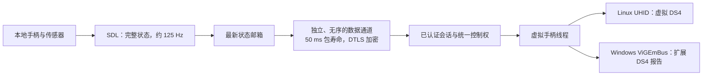

# 原生手柄与陀螺仪

开发分支的原生 IP、UU 连接服务、自建连接服务共用手柄输入路径。控制端在“应用设置 → 输入与协作”启用“转发本地手柄和陀螺仪”，串流菜单也有手柄开关和状态。最多转发 4 个 SDL 能识别的本地手柄；主机将它们呈现为虚拟 USB DualShock 4。

此功能需要原生主机与原生控制端均更新到支持此扩展的版本，尚未接入官方 UU 兼容设备的外设协议。常规按钮、方向键、双摇杆和模拟扳机可用；陀螺仪、加速度需要实体手柄及其驱动支持。当前不转发震动、触摸板坐标和自适应扳机。触摸板点击作为普通按钮传输。

## 焦点和控制权

手柄遵循键盘、鼠标的同一套输入规则：主机授予控制权限、客户端请求输入、画面在前台且没有本地菜单或对话框占用输入时才转发。仅观看、释放输入、失焦、切屏或断线时停止转发并恢复中立状态。多人观看时，同一时刻只有一个会话获得这些输入的控制权；系统实际释放上一会话的输入后才能交接。

本地设备的读取和虚拟设备的创建各有独立线程，驱动初始化不会占用视频呈现线程或键盘事件队列。控制端退出时关闭自己打开的 SDL 句柄，主机仅移除该会话创建的虚拟设备。

菜单和设置页显示最近检测到的本地手柄数量、运动传感器和主机状态。打开本地菜单会暂停输入，因此这里保留“最近检测到”的数量，并显示暂停状态；设备缺失、SDL 初始化失败、UHID 权限或 ViGEmBus 错误会在这里显示，不增加 HUD 行数。

## 平台依赖

Windows 被控端需要已安装、正常工作的 [ViGEmBus](https://github.com/nefarius/ViGEmBus)。应用通过 [vigem-rust](https://github.com/arounre/vigem-rust) 创建虚拟 DS4，不自动安装驱动或修改系统设置。普通键鼠、视频不依赖此驱动；驱动缺失只使手柄不可用。

Linux 被控端使用内核 UHID，需要加载 `uhid` 模块并允许运行共享的用户访问 `/dev/uhid`。可由管理员配置只针对 UHID 的 udev 规则，例如供本地活动桌面会话使用：

```udev
KERNEL=="uhid", SUBSYSTEM=="misc", TAG+="uaccess", OPTIONS+="static_node=uhid"
```

后台服务可使用独立用户组授予该节点权限。客户端的物理手柄及传感器读取遵循 SDL 与系统现有的 evdev / HID 权限；设备只提供普通按键而无传感器时仍能转发普通手柄。

SDL 随源码依赖静态构建，Windows 包不需要另放 SDL DLL。构建工具链要求 Rust 1.88 或更新版本及现有的 CMake、C/C++ 编译器。

## 传输和校准



高频传感器状态不进入可靠键盘队列。每次传输全部四个槽位的状态，后续快照可修复丢包造成的按键抬起遗漏；每个快照携带当前输入授权代数；失焦、重新捕获后，旧代数的快照即使带着更大的序号也不会执行。旧序号被拒绝，250 毫秒没有有效更新会释放虚拟手柄。发送队列有界，不重播积攒的旧传感器数据。该通道仍使用现有 WebRTC/UDP 连接，与视频共用网络带宽。

协议保留 SDL 的 SI 单位：角速度为弧度/秒，加速度为米/秒²。主机依据对应后端的校准报告转换到 DS4 原始整数单位。Linux 合成设备和 ViGEmBus 校准不同，不能直接共用一组硬编码比例。时间戳来自控制端的相对单调时钟，转为 DS4 时间戳并允许正常回绕；按钮与轴范围、有限传感器数值、槽位数和消息长度均被校验。

实现参考 [SDL 传感器 API](https://wiki.libsdl.org/SDL2/SDL_GameControllerGetSensorData)、[Linux UHID UAPI](https://docs.kernel.org/hid/uhid.html)、Moonlight 的输入生命周期和公开 DS4 报告布局。所用描述符、功能报告与校准数据来源、固定版本及 MIT/BSD 许可见 [数据来源](../vendor/ds4-data/UPSTREAM.md)，未复制 GPL Sunshine 输入实现。

## 验证边界

开发验证使用 SDL 进程内虚拟手柄、生成的传感器状态、自有 UNIX socket 的 UHID ABI 夹具以及本地加密数据通道，覆盖轴、按钮、热拔插、焦点暂停、恢复、旧包拒绝、超时中立与两套校准往返。这些测试不操作真实桌面，也不等同于实体手柄、实际 UHID 内核设备或目标 ViGEmBus 驱动验收。目标平台仍需验证 USB / 蓝牙手柄识别、游戏内轴向、运动灵敏度及退出后的设备释放。
