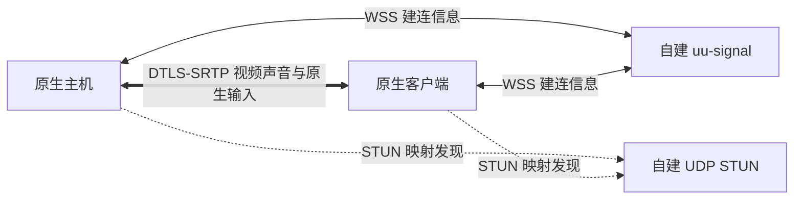

# 原生公网连接与自建服务

当前开发分支的设备配置、共享与公钥授权已统一，完整操作与迁移见[设备连接、共享与授权](device-connection-and-trust.md)。旧版的两端共用配对文件仅保留在 CLI 诊断路径中。

原生连接支持 IP 直连、UU 账号及自建 VPS。连接服务负责寻址和信令；认证成功后仍复用原生视频、声音、输入、剪贴板和呈现。它不等于媒体中继。

默认只接受 UDP 直连候选；无法直连时明确失败，不自动分配 TURN。开发选项可显式允许 UU 下发的 TURN/UDP；目前底层不支持 TURN/TCP 或 TURN/TLS。

## 桌面使用

“应用设置 → 服务端设置”统一设置显示器、编码和权限；“连接服务”管理 IP、UU 和每台自建服务器的启用与网络配置。IP 默认启用，启动服务后运行已启用入口，各入口显示上线状态和错误。当前共享最多同时接受四个已授权会话，各连接有独立权限和生命周期，键鼠与手柄共用独占控制权。停止一个会话不影响其它会话；停止共享才关闭全部入口。UU 服务侧是否允许并发仍取决于其策略。

UU 连接步骤：

1. 两端在“连接服务”各自正常登录 UU；可以同账号，必须使用不同的 UU 设备身份。
2. 被控端在“连接服务”启用 UU，再在服务端设置点击“启动服务”；首次再点击“允许新设备配对”。仅登录不会自动共享。
3. 控制端在“设备 → 添加设备 → UU 账号”填写被控端“连接服务”显示的本机 UU 编号。
4. 控制端显示八位配对码，被控端输入并批准，软件保存公钥及独立权限。以后直接选设备连接；无需共享 key 文件。

UU 的 `2001` 表示被控设备不在线：先检查对方是否开始共享，不能仅凭错误推断账号不同或身份重复。跨账号能否加入仍取决于服务侧权限。

VPS 模式先在“连接服务”添加服务器、访问令牌及必要的证书。主机启用本机发布并设置名称；控制端添加设备时选择同一服务，填写该目标名称。多个设备可引用同一服务器配置。名称仅使用字母、数字、短横线或下划线。

服务器地址支持 `主机:端口` 和完整 `wss://…/v1/signal` URL。是否导入证书取决于信任链，自签名或私有 CA 通常需要；公开可信且名称匹配的证书可留空。证书验证服务器，原生公钥验证对端设备，两者分开。

旧 UU/VPS PSK 配置会导入目标和服务，但首次需要新版短码配对。新版 GUI 共享入口拒绝旧全局 PSK，防止其绕过逐设备撤销。原生两端请升级到同版。

## 查看连接地址

串流时打开悬浮菜单（窗口模式为右上角“设置”菜单），点击 **“连接详情”**。信息在独立窗口中显示，不增加 HUD 内容；支持“复制连接信息”，关闭窗口可继续操作远端。

- **实际使用的端点**：当前 ICE 选中的本机、远端 IP 和端口，以及 UDP/TCP 和直连/中继状态。判断媒体路径应看这一项。
- **内网 / 网卡候选**：双方提供的网卡地址和串流端口，也可能包含公网 IPv6；不是应用信令监听端口。
- **公网 / 映射候选**：STUN 或对端观测得到的地址和端口，可能仍属于上级 NAT 的内网。没有得到映射时明确显示未发现，不推测公网地址。
- **中继候选**：存在时单独显示。仅发现 TURN 地址不代表实际使用中继，仍以选中端点为准。

详情显示的是双方媒体端点，不是 UU/自建信令服务器的地址，也不是 STUN 服务自身的地址。两端候选可能不完整；可用候选取决于当前网络及 ICE 服务。面板打开时约每秒刷新，地址不会加入自动诊断日志；分享复制内容前可自行隐藏地址。

## 自建信令与 STUN

`uu-signal` 是独立进程，无桌面采集、输入或媒体转发功能。WSS 自定义协议支持版本 1 和 2，包含主机注册、加入、会话消息与退出。新版主机用版本 2 注册最多四个会话；服务端明确不支持时才回退版本 1 的单会话模式。旧控制端可继续使用版本 1 加入，路由按会话隔离。它不是任意 WebRTC 客户端均可使用的统一信令协议。标准 UDP STUN Binding 服务与其运行在同一进程中。



构建：

```sh
cargo build --release -p uu-cli --bin uu --bin uu-signal
```

服务器准备 TLS 证书、私钥和随机访问凭据。访问凭据可通过 `uu internet keygen --file server.token` 生成，不覆盖已有文件。使用自签名证书时必须包含用户实际连接的 IP 或域名 SAN，客户端通过证书文件建立信任，不能关闭证书校验。

```sh
uu-signal --bind 0.0.0.0:8443 \
  --certificate /etc/eclipse-signal/server.pem \
  --private-key /etc/eclipse-signal/server.key \
  --token-file /etc/eclipse-signal/server.token \
  --stun stun:YOUR_PUBLIC_HOST:3478 \
  --stun-bind 0.0.0.0:3478
```

`YOUR_PUBLIC_HOST` 替换为实际地址；监听地址 `0.0.0.0` 不能作为对外发布地址。云安全组、主机网络策略需要允许选定的 TCP 信令端口和 UDP STUN 端口。进程监听成功不代表公网端口已开放。普通 STUN 只返回 NAT 映射，无法保证所有 NAT 组合均能直连。

可参考 [systemd 服务模板](../tools/internet/eclipse-signal.service)，建立专用系统用户、安装二进制到 `/opt/eclipse-signal/uu-signal`，配置目录限制读取权限。模板的 `/etc/eclipse-signal/service.env` 内容：

```ini
SIGNAL_BIND=0.0.0.0:8443
STUN_BIND=0.0.0.0:3478
STUN_URL=stun:YOUR_PUBLIC_HOST:3478
```

已有 HTTPS 服务可反向代理 WSS。需透传 `Authorization`、WebSocket Upgrade 并将外部路径映射到 `/v1/signal`；默认 heartbeat 为 10 秒，代理空闲超时应大于 35 秒。STUN 是独立 UDP 服务，HTTP 反向代理不能代替开放 UDP。

本实现限制连接数量、消息大小、候选类型、会话归属及 STUN 请求速率；不提供 TURN Allocate，不接受媒体作为信令负载。

## 旧 PSK CLI 诊断

以下保留旧预共享密钥协议，用于已有 CLI 诊断；不是新版 GUI 公钥授权的操作方式，不能用它连接新版共享入口。配置中的路径由使用者填写：

```json
{
  "provider": "self_hosted",
  "server": "signal.example:8443",
  "device": "my-desktop",
  "access_key": "access.key",
  "server_token": "server.token",
  "server_ca": "server.pem",
  "development_relay": false
}
```

UU 配置将 `provider` 改为 `uu`，`device` 填目标 UU 编号，服务器字段不使用。主机使用本机正常登录身份，不使用该字段冒充目标主机。

```sh
uu internet keygen --file access.key
uu internet host --settings connection.json --synthetic --width 640 --height 360 \
  --synthetic-audio --encoder software --max-seconds 15
uu internet probe --settings connection.json --frames 120 --report metrics.json
```

真实屏幕共享去掉 `--synthetic`，按需显式启用 `--allow-input`、`--audio`、`--encoder auto`。硬件编码仍取决于平台构建和驱动，不因连接方式改变。

## 验证边界

旧 PSK 通路已通过 Linux 与 Windows 的独立信令及自建 WSS 原生加密生成视频/音频闭环、STUN Binding 事务与端点返回、密钥不匹配/修改 SDP 的拒绝、旧会话清理与原 LAN 回归。真实 VPS WSS 信令路径的生成画面测试完成 120 帧解码、零错误及音频接收；该测试的媒体两端仍在同一局域网，不能当作跨 NAT 验收。用户已确认两台不同 UU 设备在被控端开始共享后连接成功；本次未独立采集实流帧数和实际路径，不能据此宣称跨 NAT 直连或官方 TURN 实流通过。

新版设备授权另通过本地真实 TLS、WebRTC 生成视频和音频，以及自建 WSS 首次配对／重发布／免码重连。新版公钥经 UU 的真实双设备及官方协助目标尚未验收，不能沿用旧 PSK 的成功结论。

连接详情通过真实回环 UDP/DTLS 会话核对了双方实际选中的地址和端口，界面测试覆盖直连与未使用中继的区分、IPv6 端口和关闭操作；自动测试不代替真实桌面的交互验收。

部署后应分别验证公网 WSS、实际 STUN 响应与选中媒体候选，不能把“安装成功”“存在服务器配置”或“LAN 能播”当作不同 NAT 之间已经打洞成功。

相关说明：[公网组件与可替换服务](native-public-connectivity.md)、[协议边界](protocol-compatibility-and-transport.md)。
