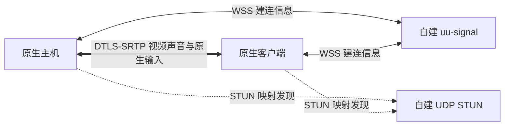

# 原生公网连接与自建服务

原生主机和客户端有两种连接方式：

- **IP 直连**：自行准备路由或端口映射，在 IP 直连页填写主机地址和端口，按原有流程配对。
- **连接服务**：选择 UU 账号或自建服务器，由服务交换建连信息。连接成功后复用原生视频、声音、输入及呈现，不切换到另一套桌面协议。

连接服务不等于媒体中继。默认只接受 UDP 直连候选；无法直连时连接失败，不自动分配 TURN。开发选项可显式允许 UU 下发的 TURN/UDP，并记录实际候选路径；目前底层不支持 TURN/TCP 或 TURN/TLS，不能仅凭下发地址宣称支持。

## 桌面使用

主界面的“IP 直连”和“连接服务”都是原生入口；“兼容设备”保留原有 UU 主机兼容客户端。

在连接服务页面选择提供方，配置配对文件和主机共享参数。首次创建配对文件后，通过可信方式复制到目标设备，两端选择同一文件。它是当前版本的独立访问授权，不能仅凭加入云房间获得桌面权限。配对文件不发送给连接服务；服务转发的 SDP 通过挑战及完整性认证绑定本次会话与 DTLS 指纹。

自建模式还需填写服务器地址、服务访问凭据文件；使用自签名证书时选择服务器证书，使用公开可信证书时可留空。支持 `IP:端口` 和完整 `wss://.../v1/signal` URL。设备名称由双方约定，主机发布此名称，客户端填写同一名称连接。

UU 模式使用各设备正常登录的 UU 账号。主机会创建房间并显示自己的设备编号，客户端填写目标编号。**两端必须是不同的 UU 设备身份**；复制同一个账号状态文件不等于正常登录另一台设备，不能用设备自连验证跨设备兼容。原生双方需要运行本项目连接服务入口，不能假设官方客户端理解原生控制通道。

例如用控制端连接另一台主机：

1. 两端各自登录 UU，可以使用同一账号；两端选择相同的配对文件。
2. 在被控端的“连接服务 → UU 账号”中点击“开始共享”。仅登录账号不会自动开始共享；作为主机时不必填写目标编号。
3. 在控制端填写被控端显示的“本机 UU 编号”，然后连接。不要填写控制端自己的编号。

加入房间返回 `2001` 表示被控设备不在线：先检查被控端是否已开始共享，不能仅凭这个错误认定账号不同、配对文件错误或设备身份重复。

当前一次共享接受一个控制端，结束后需要重新开启共享。互联网入口暂未接入系统剪贴板共享；IP 入口保留已有能力。

## 查看连接地址

串流时打开悬浮菜单（窗口模式为右上角“设置”菜单），点击 **“连接详情”**。信息在独立窗口中显示，不增加 HUD 内容；支持“复制连接信息”，关闭窗口可继续操作远端。

- **实际使用的端点**：当前 ICE 选中的本机、远端 IP 和端口，以及 UDP/TCP 和直连/中继状态。判断媒体路径应看这一项。
- **内网 / 网卡候选**：双方提供的网卡地址和串流端口，也可能包含公网 IPv6；不是应用信令监听端口。
- **公网 / 映射候选**：STUN 或对端观测得到的地址和端口，可能仍属于上级 NAT 的内网。没有得到映射时明确显示未发现，不推测公网地址。
- **中继候选**：存在时单独显示。仅发现 TURN 地址不代表实际使用中继，仍以选中端点为准。

详情显示的是双方媒体端点，不是 UU/自建信令服务器的地址，也不是 STUN 服务自身的地址。两端候选可能不完整；可用候选取决于当前网络及 ICE 服务。面板打开时约每秒刷新，地址不会加入自动诊断日志；分享复制内容前可自行隐藏地址。

## 自建信令与 STUN

`uu-signal` 是独立进程，无桌面采集、输入或媒体转发功能。WSS 自定义协议版本为 1，包含主机注册、加入、会话消息与退出；它不是任意 WebRTC 客户端均可使用的统一信令协议。标准 UDP STUN Binding 服务与其运行在同一进程中。



构建：

```sh
cargo build --release -p uu-cli --bin uu --bin uu-signal
```

服务器准备 TLS 证书、私钥和随机访问凭据。访问凭据可通过 `uu internet keygen --file server.token` 生成，不覆盖已有文件。使用自签名证书时必须包含用户实际连接的 IP 或域名 SAN，客户端通过证书文件建立信任，不能关闭证书校验。

```sh
uu-signal --bind 0.0.0.0:8443 \
  --certificate /etc/eclipse-signal/server.pem \
  --private-key /etc/eclipse-signal/server.key \
  --token-file /etc/eclipse-signal/server.token \
  --stun stun:YOUR_PUBLIC_HOST:3478 \
  --stun-bind 0.0.0.0:3478
```

`YOUR_PUBLIC_HOST` 替换为实际地址；监听地址 `0.0.0.0` 不能作为对外发布地址。云安全组、主机网络策略需要允许选定的 TCP 信令端口和 UDP STUN 端口。进程监听成功不代表公网端口已开放。普通 STUN 只返回 NAT 映射，无法保证所有 NAT 组合均能直连。

可参考 [systemd 服务模板](../tools/internet/eclipse-signal.service)，建立专用系统用户、安装二进制到 `/opt/eclipse-signal/uu-signal`，配置目录限制读取权限。模板的 `/etc/eclipse-signal/service.env` 内容：

```ini
SIGNAL_BIND=0.0.0.0:8443
STUN_BIND=0.0.0.0:3478
STUN_URL=stun:YOUR_PUBLIC_HOST:3478
```

已有 HTTPS 服务可反向代理 WSS。需透传 `Authorization`、WebSocket Upgrade 并将外部路径映射到 `/v1/signal`；默认 heartbeat 为 10 秒，代理空闲超时应大于 35 秒。STUN 是独立 UDP 服务，HTTP 反向代理不能代替开放 UDP。

本实现限制连接数量、消息大小、候选类型、会话归属及 STUN 请求速率；不提供 TURN Allocate，不接受媒体作为信令负载。

## CLI 验证

配置文件示例，所有路径由使用者填写：

```json
{
  "provider": "self_hosted",
  "server": "signal.example:8443",
  "device": "my-desktop",
  "access_key": "access.key",
  "server_token": "server.token",
  "server_ca": "server.pem",
  "development_relay": false
}
```

UU 配置将 `provider` 改为 `uu`，`device` 填目标 UU 编号，服务器字段不使用。主机使用本机正常登录身份，不使用该字段冒充目标主机。

```sh
uu internet keygen --file access.key
uu internet host --settings connection.json --synthetic --width 640 --height 360 \
  --synthetic-audio --encoder software --max-seconds 15
uu internet probe --settings connection.json --frames 120 --report metrics.json
```

真实屏幕共享去掉 `--synthetic`，按需显式启用 `--allow-input`、`--audio`、`--encoder auto`。硬件编码仍取决于平台构建和驱动，不因连接方式改变。

## 验证边界

目前已通过 Linux 与 Windows 的独立信令及自建 WSS 原生加密生成视频/音频闭环、STUN Binding 事务与端点返回、密钥不匹配/修改 SDP 的拒绝、旧会话清理与原 LAN 回归。真实 VPS WSS 信令路径的生成画面测试完成 120 帧解码、零错误及音频接收；该测试的媒体两端仍在同一局域网，不能当作跨 NAT 验收。用户已确认两台不同 UU 设备在被控端开始共享后连接成功；本次未独立采集实流帧数和实际路径，不能据此宣称跨 NAT 直连或官方 TURN 实流通过。

连接详情通过真实回环 UDP/DTLS 会话核对了双方实际选中的地址和端口，界面测试覆盖直连与未使用中继的区分、IPv6 端口和关闭操作；自动测试不代替真实桌面的交互验收。

部署后应分别验证公网 WSS、实际 STUN 响应与选中媒体候选，不能把“安装成功”“存在服务器配置”或“LAN 能播”当作不同 NAT 之间已经打洞成功。

相关说明：[公网组件与可替换服务](native-public-connectivity.md)、[协议边界](protocol-compatibility-and-transport.md)。
