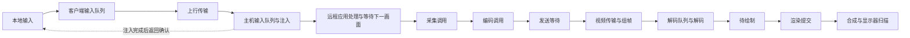

# 原生串流延迟统计

HUD 以同帧视频端到端为主项，输入响应另列；采集、编码和输入处理的阶段耗时保留为诊断。阶段均值合计不是鼠标到屏幕的总延迟。

**当前已提供源端遥测、时钟区间映射、同帧关联模型和 HUD 展示，但客户端系统显示回执桥尚未接通，完整视频端到端测量仍不可用。** 主机支持扩展也不代表能给出当前主值：没有可靠的同帧系统显示回执时显示“显示时间未知”，不以 Present API 返回、GPU fence 完成或 UI 提交代替显示。旧主机未协商扩展、源时间缺失、时钟无效或样本过期时也显示未知，不回退阶段和。生成图预览只验证展示规则，不能证明实机端到端测量已可用。

视频端到端的起点是主机源画面的呈现时间，终点是同一画面在客户端的系统显示回执。源身份必须跟随实际编码输出 PTS、SSRC 和 RTP 时间戳，并与真实解码输出及显示图像关联；编码器延迟输出、丢帧或 UI 重绘不能把另一个帧的时间借给当前图像。媒体或观测换代后，旧标识不能关联到新帧。

两台机器的 QPC 或单调时钟属于独立域，不能直接相减。四时间戳探针分别记录客户端发送、主机接收与发送、客户端接收，以路径延迟非负约束时钟偏移上下界，不假设上下行对称。不同频率使用向外舍入换算成纳秒，相对漂移继续扩大区间；epoch 或频率变化、逆序、不可能的负 RTT、无效源时间及过期样本均不用于估测。当前最大源帧及校时样本年龄为五秒，相对漂移使用 1000 ppm 的工程假设并在详情显示，不能当作平台保证。探针和逐帧遥测使用单独协商的有界通道，拥塞时允许丢观测，不要求视频等待测量消息。

具备可靠显示桥时，端点方法区分系统显示回执与有同帧证据的刷新时间区间。刷新区间需要证明具体帧实际显示，不能简单填入半个刷新周期。没有此证据的呈现路径保持未知。HUD 的 `≈均值 ±误差` 及 P50/P95 是最近三秒同帧延迟区间中点的估测，误差包含窗口内最大的时钟和显示区间界以及微秒舍入，中点不是精确时间。窗口年龄按实际显示事件计算，晚到的遥测或校时回复不会刷新旧显示的年龄。系统显示终点仍不覆盖物理像素响应，也不等于输入到视觉响应。



| 项目 | 测量边界 |
|---|---|
| 视频端到端 | 同一主机源画面呈现至客户端系统显示的带误差估测；当前显示桥未接通，无可靠同帧回执时未知 |
| 输入视觉响应 | 输入事件至其对应画面显示的因果测量尚未接入，保持未知；视频端到端和注入确认均不能代替 |
| 主机采集 | 调用采集后端到获得画面，可能包含等待桌面更新、读回及复制 |
| 主机编码 | 编码调用耗时，可能包含颜色转换、上传及驱动等待，不是单独的视频芯片执行时间 |
| 主机发送等待 | 编码生产线程等待向有界媒体队列交付输出的时间 |
| 客户端输入队列 | 输入加入本地原生队列到控制任务取出发送；在 HUD 悬浮说明和诊断报告查看 |
| 主机输入排队／注入 | 事件到达主机输入队列后的等待，以及调用输入后端的耗时 |
| 输入确认 RTT | 抽样输入发出，经主机实际注入完成，再收到确认的往返时间；不要求两端校时 |
| 控制 RTT | 普通控制消息的应用层往返时间，包括通道排队与对端响应，与 ICMP ping 不同 |
| Decode | 解码调用；CPU 读回路径还包括硬件画面下载 |
| 待绘制 | 解码图像交付到 UI 取走的等待，被新图像覆盖的旧图像不计入交付均值 |
| Render CPU | UI 准备及渲染提交的 CPU 墙钟时间，包含驱动同步阻塞，不是 GPU 执行时间，也不包含完整显示过程 |

已采样阶段均值按以下方式相加：

```text
采集调用 + 编码调用 + 发送等待
+ 控制 RTT / 2
+ 解码前排队 + Decode + 待绘制 + Render
```

阶段小计中的单程网络使用往返对称假设，各项是不同样本的窗口均值，没有按同一帧关联，不能视作严格下界或端到端测量。当前只在详情显示“阶段小计”或缺项时的“已知阶段小计”，旧版主栏曾称 `Video sum` / `Video known`。它还缺输入设备采样与输入去程、远程应用响应、等待下一次采集、未覆盖的视频组帧等待、GPU 完成、呈现队列、VSync、桌面合成、显示器扫描及像素响应。165 FPS 的帧周期约 6.06 ms，60 FPS 约 16.67 ms；仅等待应用更新或下一次采样便可能跨过一个以上帧周期，因此视频阶段小计低于 10 ms，也不能说明鼠标响应只有几毫秒。不将理论半帧等待或显示器标称响应时间填成实测值。

主机逐帧遥测另提供 `source_present_to_last_rtp` 与 `rtp_write_span`。前者用主机同一 QPC 的源画面呈现与最后一个 RTP 写入返回配对，覆盖捕获调用之前的画面年龄；后者测同一帧的首末 RTP 写入返回。HUD 显示各自均值/P95，收到超过五秒或媒体换代后失效。两个跨度与阶段小计重叠，不能相加，也不把总体不同的均值相减视作某个精确分段；RTP 写入返回仍不是网卡发完或客户端完成显示。

与 Moonlight 比较时，应分别核对解码、帧队列、视频回调、完整 UI 提交和 Present 的边界。日蚀的 Render CPU 包含完整 UI 准备与提交，诊断中的 `video_paint_window.new_image` 仅覆盖新视频图像的回调；两者都不是 GPU 完成时间。Moonlight 的[官方统计说明](https://github.com/moonlight-stream/moonlight-docs/wiki/Frequently-Asked-Questions#what-do-the-numbers-mean-in-the-on-screen-connection-statistics)也说明不同客户端同名指标不能直接比较，准确的端到端延迟需要外部测量。低均值还会掩盖短暂长间隔，可结合 HUD 的最近一分钟计数和最长间隔检查稳定性。

Wayland 的采集调用取得后台 PipeWire 线程发布的最新画面，统计不包含该后台线程的像素复制和系统门户的合成工作。其采集调用接近零也不表示没有复制或没有捕获负载；源捕获帧率可能高于客户端输出帧率。

输入注入确认只证明操作系统输入后端已接受事件，不能证明远程应用已响应或对应画面已显示。HUD 将“输入响应”保持未知，并单独显示注入确认 RTT 及客户端队列、主机队列和注入耗时。要报告输入视觉响应，还需输入事件到应用画面变化再到具体显示的因果证据，不能把确认 RTT、视频端到端或阶段小计替代它。确认统计以不超过每 250 ms 一次的输入抽样进行；按键释放始终使用原有输入路径，不依赖统计确认。

解码调用时间计入暂未输出图片及失败的调用，避免驱动暂缓输出时低估耗时。一次输入若返回多张图片，接收端收尽所有已解码输出，交付最新一张显示；不会再次提交同一访问单元，也不会为降低显示延迟丢弃尚未解码的参考数据。

主机阶段窗口最多保存最近两秒的 120 条样本；客户端收到的主机统计超过五秒没有更新后显示未知。没有样本不会显示成零。确认只接受本会话中匹配的序号，重复、过期或范围无效的消息不参与统计。原生 CLI 诊断报告的 `native_timing` 字段保留对应分段。

旧版原生主机未声明支持新增统计时继续发送原有输入消息；不丢弃输入，也不伪造远端耗时。UU 官方兼容主机没有这些原生扩展，HUD 继续显示其可测的客户端阶段和控制 RTT。

手柄和运动传感器使用独立的最新状态通道；这里的抽样输入确认统计针对键盘、鼠标，不包含手柄到游戏响应的完整延迟。详见[原生手柄](native-gamepad.md)。

采集时钟在轻微超时后保留相位，超时债务达到一帧时重新定时；只安排后续采集，不重放旧图像或积累无界任务。`cargo run --release -p uu-core --example capture_pacing_probe -- --fps 165 --seconds 10 --work-ms 5.3` 可运行 A/B/B/A 调度模型。Windows 构建需指定目标后在 Windows 执行；工具只模拟工作与线程等待，没有 GPU、桌面、输入或网络访问。它可以验证调度误差是否累积，不能替代同硬件、同画质的真实串流对照。
