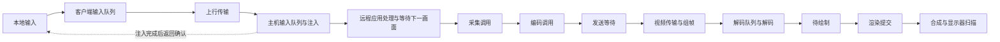

# 原生串流延迟统计

原生主机与客户端可以交换采集、编码及输入处理的实测耗时。HUD 的“已知画面段估计”仍然不是鼠标到屏幕的总延迟；它用于区分耗时主要发生在哪个阶段。



| 项目 | 测量边界 |
|---|---|
| 主机采集 | 调用采集后端到获得画面，可能包含等待桌面更新、读回及复制 |
| 主机编码 | 编码调用耗时，可能包含颜色转换、上传及驱动等待，不是单独的视频芯片执行时间 |
| 主机发送等待 | 编码生产线程等待向有界媒体队列交付输出的时间 |
| 客户端输入队列 | 输入加入本地原生队列到控制任务取出发送；在 HUD 悬浮说明和诊断报告查看 |
| 主机输入排队／注入 | 事件到达主机输入队列后的等待，以及调用输入后端的耗时 |
| 输入确认 RTT | 抽样输入发出，经主机实际注入完成，再收到确认的往返时间；不要求两端校时 |
| 控制 RTT | 普通控制消息的应用层往返时间，包括通道排队与对端响应，与 ICMP ping 不同 |
| Decode | 解码调用；CPU 读回路径还包括硬件画面下载 |
| 待绘制 | 解码图像交付到 UI 取走的等待，被新图像覆盖的旧图像不计入交付均值 |
| Render | UI 准备及渲染提交的 CPU 时间，驱动同步可能阻塞，不包含完整显示过程 |

原生画面已知段按以下方式估计：

```text
采集调用 + 编码调用 + 发送等待
+ 控制 RTT / 2
+ 解码前排队 + Decode + 待绘制 + Render
```

单程网络使用往返对称假设，各项是不同样本的窗口均值，没有按同一帧关联，不能视作严格下界或端到端测量。它还缺视频组帧、远程应用响应、等待下一次采样、VSync、桌面合成、显示器扫描及内部处理。60 FPS 的帧间隔约 16.67 ms，因此 Decode 与 Render 相加只有几毫秒，也不能说明鼠标响应只有几毫秒。

Wayland 的采集调用取得后台 PipeWire 线程发布的最新画面，统计不包含该后台线程的像素复制和系统门户的合成工作。其采集调用接近零也不表示没有复制或没有捕获负载；源捕获帧率可能高于客户端输出帧率。

输入确认只证明操作系统输入后端已接受事件，不能证明远程应用已响应或对应画面已显示。统计以不超过每 250 ms 一次的输入抽样进行；按键释放始终使用原有输入路径，不依赖统计确认。

解码调用时间计入暂未输出图片及失败的调用，避免驱动暂缓输出时低估耗时。一次输入若返回多张图片，接收端收尽所有已解码输出，交付最新一张显示；不会再次提交同一访问单元，也不会为降低显示延迟丢弃尚未解码的参考数据。

主机阶段窗口最多保存最近两秒的 120 条样本；客户端收到的主机统计超过五秒没有更新后显示未知。没有样本不会显示成零。确认只接受本会话中匹配的序号，重复、过期或范围无效的消息不参与统计。原生 CLI 诊断报告的 `native_timing` 字段保留对应分段。

旧版原生主机未声明支持新增统计时继续发送原有输入消息；不丢弃输入，也不伪造远端耗时。UU 官方兼容主机没有这些原生扩展，HUD 继续显示其可测的客户端阶段和控制 RTT。

手柄和运动传感器使用独立的最新状态通道；这里的抽样输入确认统计针对键盘、鼠标，不包含手柄到游戏响应的完整延迟。详见[原生手柄](native-gamepad.md)。
