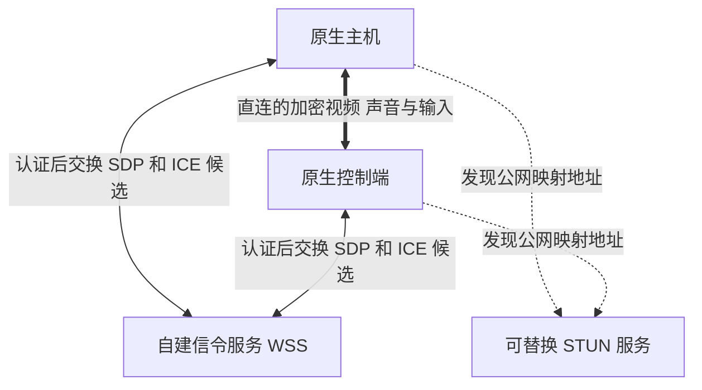

# 原生公网直连与可替换 STUN 服务

当前方向是使用公开允许第三方使用的标准 STUN 服务，或自己 VPS 上的服务，实现原生两端的公网直连。新增 UU 云接入及复用其私有中继的计划已经取消。本文是替代方案，当前原生产品仍为局域网模式，尚未实现这里的公网信令与 STUN 配置入口。

## 推荐架构



STUN 与信令是不同职责，可以放在同一台 VPS 上，也可以分别使用自建信令和公开 STUN。STUN 只帮助发现地址和执行连接检查，不转发持续视频。信令负责找到获授权的对端、交换 SDP 和候选；连接建立后媒体直接在两端之间传输。WebRTC 没有规定信令必须使用某一家服务。[WebRTC 建连文档](https://webrtc.org/getting-started/peer-connections)

因此，**换 STUN 服务不需要更改视频或输入协议**。设计上应允许配置一个或多个 STUN URL，将服务与设备身份、配对和媒体组件分开。若不希望使用 UU 服务，该原生公网路径可以完全不依赖 UU 账号、设备上线或房间 API。

## 公开服务与自己的 VPS

Cloudflare 的官方文档明确介绍了其公开 STUN 地址，可作为可配置选项：

```text
stun:stun.cloudflare.com:3478
```

它提供 UDP STUN 服务。这里引用的是公开 STUN，不是将其 TURN 或 SFU 当作免费中继；部署时仍需按服务当时的使用条件和可达性选择。[公开 STUN 说明](https://developers.cloudflare.com/realtime/sfu/get-started/connection-patterns/#network-connectivity)、[地址与端口](https://developers.cloudflare.com/realtime/turn/#service-address-and-ports)

自己的 VPS 可用开源 coturn 提供 STUN。coturn 同时实现 STUN 和 TURN，但可以设置 `stun-only`，只响应 STUN，关闭 TURN 转发功能。应用端随后使用自己的标准地址，例如：

```text
stun:stun.example.com:3478
```

`example.com` 是示例域名，需要替换为自己的地址。VPS 的 STUN 监听端口需要可从目标网络访问；仅提供 STUN 不需要为媒体建立 TURN 分配。具体安装与运行选项见 [coturn 官方说明](https://github.com/coturn/coturn/blob/master/README.turnserver)。

推荐保留服务列表和明确的失败提示，某个 STUN 不可用时尝试其它配置。不同 STUN 可能得到不同候选，并不保证增加服务数量就一定能打通某种 NAT。能直接使用的公网 IPv6 等地址也应参与 ICE 检查，不应强制每次依赖 STUN 才允许直连。

## 只用 STUN 的边界

STUN 返回公网映射地址，不代表远端一定能向该地址发送成功。某些映射与过滤行为、双重 NAT、UDP 限制或防火墙规则会使直连失败。**不配置 TURN 时，应接受“有些网络无法连接”这个结果，不能承诺任意两台设备都能公网互通。** STUN 本身不是完整的 NAT 穿透方案。[STUN 规范](https://www.rfc-editor.org/rfc/rfc8489.html)

如果以后需要提高成功率，可以独立增加自己 VPS 上、经过认证的 TURN 作为可选回退。选择中继后视频才会经过 VPS 并消耗相应转发带宽；这与 VPS 只运行信令和 STUN 的资源需求不同。当前用户选择先讨论直连方案，不自动启用或部署 TURN。

## 本项目需要改什么

| 部分 | 改动方向 |
|---|---|
| 信令 | 新增自托管、经认证的公网信令服务，两端主动连出 WSS，交换会话描述与候选 |
| 网络设置 | 将 STUN URL 列表与信令地址作为独立配置，可使用公开服务或自建地址，不绑定供应商 |
| ICE | 公网模式允许 host、srflx 及必要的对等反射候选，执行实际连通性检查；直连模式不配置 relay 服务 |
| 身份与权限 | 保留原生可信设备和授权语义，绑定会话与 DTLS 身份，获得许可后才采集和注入输入 |
| LAN 入口 | 保留现有局域网发现与严格候选校验；公网模式采用自己的连接规则 |
| 诊断 | 展示实际选中路径、传输类型及失败阶段，不能把获得 srflx 地址当作直连已成功 |

当前原生信令要求直接连接主机 TLS/TCP 地址，ICE 也只接受与信令对端地址一致的 host 候选，所以不能只在设置里加一条 STUN URL 就声称完成公网连接。需要把公网信令、候选策略、身份绑定和会话关闭一起实现，继续复用已有编解码和呈现组件。

若后续开始实现，应先用生成画面验证自建信令、同机及跨 NAT 直连、STUN 不可达和连接超时，再接正式界面与桌面控制。成功标准是实际选中无 relay 的候选对并持续传输加密媒体；不以“已连接 STUN”代替整链路验收。
