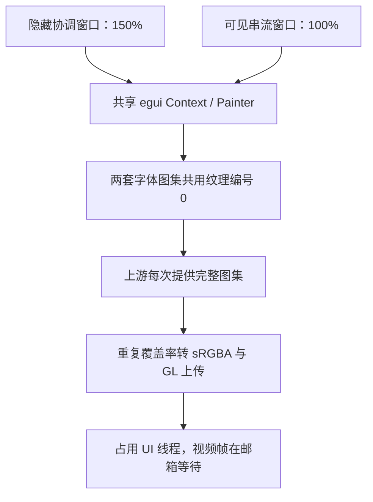

# 混合 DPI 导致外屏 Render 升高：定位、修复与实测

日期：2026-10-27。修复提交：[`7cef038`](https://github.com/TheRainstorm/eclipse/commit/7cef0389f107f1906ab7e4ef37ca65afe8b934a8)，随 v0.18.9 发布。

## 现象与影响

Windows 原生串流在笔记本内屏上显示时，HUD 的 Render 常在 1–2ms；将同一串流窗口放到 HDMI 外屏后，用户观察到约 14–18ms。关闭 HDR 和垂直同步后仍然出现。初期使用 1920×1080、60FPS、AV1 时就能看到，后来按已有 H.264 配置重连也能复现。

这里的 Render 是 UI 绘制线程的 CPU 墙钟时间，包含驱动调用可能造成的阻塞；不是 GPU 时间戳，也不是显示器扫描时间。把采集、编码、网络、解码、Render 等不同采样窗口的均值相加，不能得到某一帧的端到端延迟。

问题确实影响了视频交接：UI 线程消费视频帧之前被额外工作占用，解码后的帧邮箱等待也增加。实际操作仍较流畅、帧率仍接近目标，并不能说明这段等待没有成本。

## 触发条件与历史

客户端使用多设备串流工作区。一个隐藏的原生根窗口负责协调，实际串流画面位于可见子窗口；它们共享同一个 egui Context 和 Glow Painter。

此次实机读取到的显示环境为：

| 项目 | 条件 |
|---|---|
| 客户端 | Intel UHD Graphics，D3D11 硬解及 WGL GPU 共享呈现 |
| 内屏 | 1920×1200，系统缩放 150% |
| HDMI 外屏 | 1920×1080，系统缩放 100% |
| 隐藏协调窗口 | 留在内屏，`pixels_per_point` 为 1.5 |
| 可见串流窗口 | 外屏，`pixels_per_point` 为 1.0 |
| 正式对照串流 | H.264，1920×1080，目标 60FPS，VSync 关闭、实际交换间隔 0 |

外屏和内屏的缩放比例不同，使同一个 UI 上下文同时保有两套字体图集。隐藏窗口没有显示画面，仍会参与 UI 上下文及字体状态维护。

代码历史中，`21fecf6`（10/23）引入多设备共享工作区，`b8cd724` 随后调整隐藏 Windows 协调窗口的调度。这些结构构成了此次问题的触发条件。尚未用历史完整安装包逐版本二分，因此不能把结构加入时间直接当作用户首次遇到回归的时间，也不能仅按版本号断言某个旧安装包一定复现。

## 排查过程：从 Render 总数缩小到字库

最初只有 Render 总数，无法判断工作发生在哪个阶段。排查逐步保留原计时边界并增加分组，没有通过扣除等待来降低显示数值。

| 阶段 | 得到的证据 | 对下一步的作用 |
|---|---|---|
| 解码与呈现路径 | 硬件解码约 0.5–0.8ms，实际使用 D3D11/WGL GPU 共享 | 解码没有对应约十毫秒的增加 |
| 交换策略 | 实际交换间隔为 0，Present 常约 0.1ms，高 Render 仍在 | 恢复交换策略的修正确保设置生效，但没有消除主要耗时 |
| UI 与视频回调分段 | 整轮 UI 约 12–14ms，新视频回调约 2ms | 额外工作主要在视频回调外 |
| OpenGL 绘制调用分组 | 纹理更新组约 7–11ms，网格绘制等调用很短 | 将调查集中到纹理更新、转换及上传 |
| 字体与缩放状态 | 同一上下文同时存在 1.0 和 1.5 两套字体 | 与上游整图上传路径对应 |

相关诊断提交依次包括 `deb6225`、`e5c38ef`、`1b44e7d` 和 `bdef3c8`。它们增加了窗口、UI、视频回调及 GL 调用组的可见性，本身不能当作外屏延迟已经修复。

WGL 实际交换间隔恢复、额外重绘消除、着色器变量位置缓存等改动各自处理了具体开销或状态问题；高 Render 在这些改动后仍存在。主机 SDR 文字彩边修复也属于另一条转换路径，不能据此认定客户端外屏问题已经消失。

## 根因：共享纹理编号下的整张字体图集重传

egui 0.29.1 已按 `pixels_per_point` 缓存不同字体布局和图集，但是各视口的字体仍共用 `TextureId::default()`，即托管纹理编号 0。为保证不同 DPI 窗口使用正确的字体像素，上游在多套字体同时存在时，每次绘制都重新提交完整字体图集，覆盖之前较小的局部更新。

这段行为可在上游 [`ContextImpl::end_pass`](https://github.com/emilk/egui/blob/0.29.1/crates/egui/src/context.rs#L2260-L2284) 中核对。字体覆盖率转 sRGBA 的实现见 [`FontImage::srgba_pixels`](https://github.com/emilk/egui/blob/0.29.1/crates/epaint/src/image.rs)。

旧 Glow 绘制器收到完整字体图像后，会重新处理全部覆盖率像素并执行纹理上传，即使字形与上一帧完全相同。



因此，同一机器上“内屏正常、外屏升高”与 DPI 组合有关。串流窗口和隐藏协调窗口都在 150% 的内屏时，不需要同时维护这两种字体比例；串流窗口移到 100% 的外屏后，重复整图路径被触发。

纹理更新组的计时包含 CPU 转换和 GL 上传。此次没有用 GPU 时间戳进一步拆出两者各占多少，不能把整个组都称为 GPU 执行或显存传输时间。

## 同进程对照：只改变隐藏窗口所在屏幕

在修复前的 `bdef3c8` 上，保持同一客户端进程、连接、编解码配置和外屏可见窗口，进行一次有界的三段对照，每段 20 秒：

1. 隐藏协调窗口在 150% 内屏，串流窗口在 100% 外屏。
2. 仅临时把隐藏窗口移到外屏，使二者都使用 100%。
3. 把隐藏窗口恢复到内屏，恢复混合 DPI。

三段中可见串流窗口的物理尺寸和位置完全一致，窗口大小为 1381×813；没有切换系统 DPI、显示模式、VSync 或编码。每段取进入两秒后的四条诊断，以下数值均为毫秒范围：

| 条件 | Render CPU | 纹理更新组 | 视频帧邮箱等待 |
|---|---:|---:|---:|
| 原混合 DPI | 11.47–13.13 | 9.04–9.95 | 5.58–6.66 |
| 隐藏窗口也在 100% 外屏 | 2.11–3.49 | 0.00009–0.00014 | 0.38–0.49 |
| 恢复混合 DPI | 11.52–12.58 | 8.57–10.11 | 5.07–5.50 |

同一进程中移开与恢复触发条件，主要耗时随之消失、重现，同时帧邮箱等待变化，支持混合 DPI 字库上传是主要原因。临时移动仅用于定位，结束后已核对隐藏窗口的原物理尺寸与位置恢复；产品修复没有保留这种移动。

## 修复：字库 GPU 资源按缩放比例拥有与复用

修正在共同 Glow 绘制路径中完成，见 [`font_atlas.rs`](../../vendor/egui_glow/src/font_atlas.rs) 和 [`painter.rs`](../../vendor/egui_glow/src/painter.rs)：

- 按绘制使用的 `pixels_per_point` 为字体图集保留独立 GPU 纹理。它包含系统 DPI 与应用缩放，不按显示器名称或某一台设备编写例外。
- 收到完整字体图像时，比较图集尺寸、覆盖率像素和采样参数。内容相同就复用纹理，跳过重复的覆盖率转 sRGBA 及上传。
- 新字形的局部更新仍上传，并同步 CPU 图集副本；以后收到相同完整图集时仍能正确识别。
- 字体替换、图集增长或采样参数变化继续更新。手动、没有缩放参数的 `set_texture` API 保留单图集语义，明确清除之前的缓存。
- 最多保留最近使用的四种缩放，超过后淘汰最久未用的图集。释放字体纹理、替换手动纹理及销毁 Painter 时，按所有权回收对应 GPU 资源。

上游仍可能生成完整图集；缓存比较本身也有成本，所以纹理更新组不一定降到零。修复保持字形像素、每屏缩放、视频着色器和编解码路径、VSync 策略及原 Render 计时边界。

## 修复后的实际串流结果

修复版 `7cef038` 重开后，隐藏协调窗口继续位于 150% 内屏，可见串流窗口继续位于 100% 外屏。采用前述现有 H.264 配置，收集约 130 秒、27 条诊断；去掉前四条热身记录，统计剩余 23 条。

每条诊断约每五秒记录一次，其中 Render、纹理等值来自最近约 500ms 的绘制窗口。下表是这些**窗口均值的中位值与范围**，不是逐帧耗时分布或端到端分布。

| 指标 | 中位值 | 窗口均值范围 |
|---|---:|---:|
| Render CPU | 2.650ms | 2.257–3.481ms |
| 字库等纹理更新组 | 0.182ms | 0.152–0.213ms |
| 视频帧邮箱等待 | 0.475ms | 0.354–0.635ms |
| 解码调用 | 0.668ms | 0.575–0.811ms |

末次记录累计解码 7974 帧，解码错误为 0。纹理更新与邮箱等待一起下降，说明改善不只是 HUD 数值变化。

下面保留去掉热身后的采样值，时间以第一条保留记录为零点，数值已四舍五入；可据此独立复算近似中位值。原始精度的统计见上表。

```csv
relative_seconds,render_cpu_ms,textures_ms,mailbox_ms,decode_ms
0.000,2.6490,0.1823,0.5980,0.5990
5.000,3.0545,0.1697,0.3848,0.6500
10.009,2.9953,0.1616,0.3538,0.5810
15.010,2.7136,0.1598,0.4295,0.6010
20.019,2.4463,0.1925,0.5294,0.8110
25.028,3.3059,0.1791,0.3829,0.6070
30.035,3.3496,0.1859,0.4080,0.6180
35.044,3.3366,0.2024,0.4877,0.6760
40.048,2.5463,0.1887,0.5437,0.7550
45.054,3.4811,0.1519,0.3928,0.5750
50.062,3.1470,0.1794,0.5078,0.5990
55.073,2.9713,0.1844,0.4754,0.6950
60.075,2.8741,0.1586,0.3866,0.5760
65.081,2.3443,0.2011,0.6351,0.7100
70.082,2.4572,0.1771,0.5464,0.7220
75.083,2.3690,0.1754,0.4043,0.6680
80.084,2.3855,0.1653,0.3971,0.5940
85.086,2.4634,0.2102,0.5931,0.6930
90.088,2.2570,0.1874,0.5172,0.6710
95.100,2.4876,0.1894,0.5075,0.7220
100.103,2.7203,0.2056,0.4391,0.6480
105.106,2.6504,0.2134,0.5205,0.7690
110.116,2.4397,0.1705,0.4731,0.7510
```

## 验证范围与后续排查边界

除上述真实 Windows 外屏串流，还完成了以下检查：

- 实际字体缓存模块的四项状态检查：多比例独立性、局部字形更新、字体和参数替换、淘汰与释放。
- 私有认证 Xvfb 中 53 项真实 GL 图集像素和生命周期检查，包括多比例切换、图集增长、手动 API、淘汰及销毁；检查仅使用生成的字体覆盖率图像。
- 61 项真实 GL 视频像素回归，覆盖格式、颜色矩阵、行填充、尺寸变化和资源复用。
- Linux 编译检查与 Windows/Linux 完整打包；Windows 原生生成音视频烟测通过。

此次 Windows 实测为外屏窗口模式下的现有 H.264 配置，不能扩展为所有显卡、全屏、AV1、HDR 或长期稳定性均已验收。先前 AV1 的用户报告说明问题也能在该编码下出现，但这次量化结果没有用 AV1 重测。

剩余约 2–3ms 仍包含视频共享/绑定回调及其它 UI 工作。内屏旧日志中的低于 1ms 数值会受到便宜的纯 UI 重绘样本影响，不能与每个新视频帧的绘制开销直接相比。完整 GPU 执行、显示扫描和输入到画面的延迟仍需要同帧关联或专门测量。

排查类似问题时，应同时核对隐藏和可见视口的 DPI，沿 `render_frame_window` → `glow_draw_window` 与 `video_paint_window` 的层级定位，避免重复相加嵌套回调。`presentation_swap_interval` 表示实际交换状态。若纹理组已正常但 Render 仍高，应继续依据新的分组证据调查，不能把所有外屏高值都套用到此原因。字段口径见 [Windows 延迟说明](../windows-latency.md)。

PixPin 首次截图导致全屏窗口变化的问题按用户要求另外搁置，本次没有把它列为已解决。
