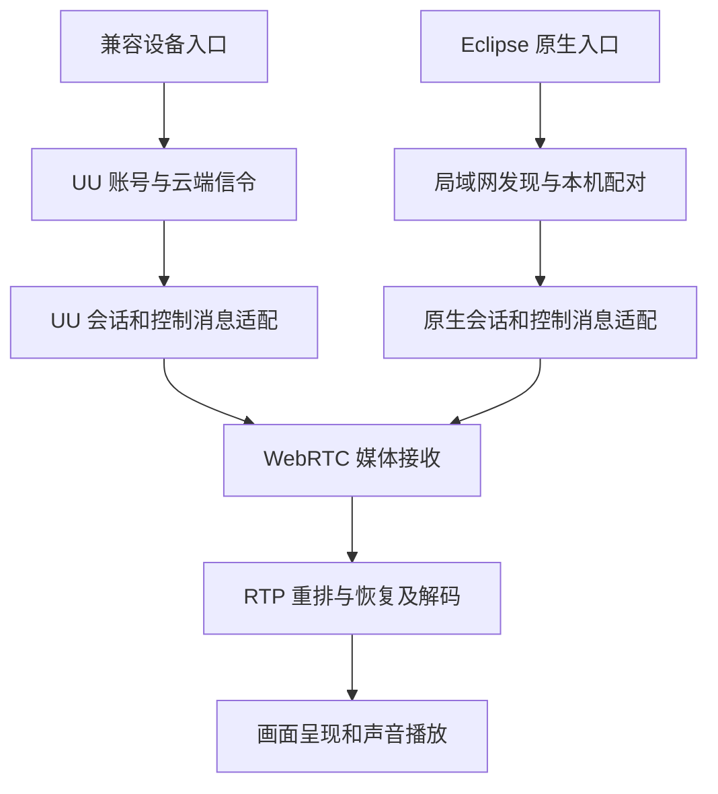

# 原生协议与 UU 兼容模式及 Moonlight 技术对比

本文描述截至 2026-10-22、实现基线为 `3bf741b` 的开发分支。这里的 server 指提供桌面画面并接收输入的被控主机，client 指观看和操作它的控制端；UU 云端账号及信令服务另行说明。

本项目有两套会话入口：**Eclipse 原生主机与原生控制端互连；UU 兼容控制端连接官方 UU 被控端。两套入口共用部分媒体和界面代码，但目前不在应用协议层直接互通。** 两条路径的音视频均采用 WebRTC 媒体传输，当前媒体网络使用 UDP，并不是把视频放进 TCP 或 WebSocket。Moonlight 使用 GameStream 协议，也以 UDP 传输音视频；它与 WebRTC 的区别不能概括为 UDP 对 TCP。

## 当前能够连接的组合

| 被控主机 | 控制端及入口 | 当前结果 |
|---|---|---|
| 本项目原生 server | 本项目 Eclipse 局域网或原生邀请入口 | 支持，使用本项目的身份、配对和会话协议 |
| 官方 UU server | 本项目“兼容设备”入口 | 支持已适配的功能，使用官方账号、信令和控制协议 |
| 官方 UU server | 本项目原生配对入口 | 不支持；原生入口不会执行 UU 云端连接流程 |
| 本项目原生 server | 官方 UU client | 不支持；原生主机没有实现完整的 UU 被控端接入协议 |
| 本项目原生 server | Moonlight | 不支持；没有 GameStream 会话适配层 |
| Sunshine | 本项目当前任何入口 | 不支持；当前控制端没有 GameStream 适配层 |
| Sunshine | Moonlight | 属于它们已有的配套协议路径 |

同一个本项目客户端程序可以切换入口，分别连接前两种主机。这是一个程序支持两套协议，不代表任意入口都能连接任意主机。账号退出、原生配对记录和会话授权也有各自的生命周期。

H.264、Opus、RTP 或 WebRTC 相同，只说明某些底层格式可以复用。建立连接仍需要双方在寻址、身份认证、SDP 交换、DataChannel 名称、控制消息和权限语义上达成一致。浏览器也不能仅凭“支持 WebRTC”就直接连接当前原生主机。

## 两条实现路径如何分层



图中的共用部分是实现复用。两个独立连接仍有各自的 SDP、ICE、密钥、数据通道和权限，不会因为使用同一个解码器就自动互认。

| 层次 | UU 兼容模式 | Eclipse 原生模式 |
|---|---|---|
| 设备来源 | 官方账号设备列表与连接房间 | 局域网 UDP 发现、手动 IP 或主机名、已保存设备 |
| 身份与授权 | 官方登录、设备身份、API 签名、房间凭据 | 本机持久证书、首次八位配对码、每设备独立授权与撤销；旧入口使用短期邀请 |
| 连接信令 | HTTPS API、Socket.IO over WSS、官方事件和压缩 SDP、trickle ICE | 本项目 TLS 1.3 RPC 与长度前缀 JSON，交换原生 SDP offer/answer |
| 网络范围 | 使用服务返回的 ICE/STUN/TURN 配置；本实现有自己的支持边界 | 当前只接受与认证信令对端地址一致的 UDP host candidate；没有原生公网 STUN/TURN 服务 |
| 视频 | 接收官方协商的 H.264；Windows 可选 H.265 Main 8-bit | 当前主机发送 H.264；软件、Linux VA-API 或 Windows 硬件 MFT 编码 |
| 音频 | 接收官方协商的 Opus | Opus，可协商 RED 音频冗余 |
| 视频恢复 | 共用接收侧 RTP 重排、NACK/RTX、PLI/FIR 和参考链保护 | 使用同类接收路径，原生发送端也处理恢复请求 |
| 键鼠与会话控制 | `CONTROL_DATA_CHANNEL` 等官方通道，protobuf 控制消息与专用输入 JSON | `eclipse-control-v1`，本项目定义的请求输入许可、状态、心跳和输入 JSON |
| 文本剪贴板 | 官方 TEXT/CONTROL 消息与功能声明 | 独立 `eclipse-clipboard-v1` 通道，双方许可的有界文本协议 |
| 画质与显示源 | 已实现官方画质请求、帧率请求及多显示器操作 | 开始共享前选择一个显示源、帧率和码率；运行中切屏和完整画质重协商尚未接入 |

表中的视频格式是**本项目当前可用的组合**，不是对官方 UU 所有版本编码能力的穷举。兼容客户端支持 HEVC，不等于本项目原生主机已经能编码 HEVC。当前原生 AV1、HDR 和视频 FEC 也未实现。

新版局域网设备配对是原生会话外面的一层连接代理：持久配对成功后，为每次连接签发新的短期串流许可，再复用已有原生串流通路。旧邀请入口仍可直接使用该通路，二者不是两个不同的视频协议。详见[局域网配对](native-lan.md)和[邀请通路](native-streaming.md)。

原生主机可通过有路由的不同网段连接，但需要信令和媒体 UDP 均可达。自动广播发现通常不会跨路由，跨网段应手动添加地址。这里的跨网段不等于已经支持任意 NAT 或公网穿透。

公网方向见[原生公网直连与可替换 STUN 服务](native-public-connectivity.md)：使用自建信令和可配置的公开或自建 STUN，当前仍待实现。此前的 [UU 云端连接与中继研究](uu-cloud-native-connection.md)保留作为架构资料，该接入计划已经取消。

## TCP 和 UDP 分别承载什么

当前原生会话可以理解为三条逻辑通路：

```text
配对、授权、SDP：  原生 RPC / TLS 1.3 / TCP
视频、音频：      H.264 或 Opus / RTP、RTCP / SRTP、SRTCP / UDP
键鼠、剪贴板：    原生应用消息 / SCTP DataChannel / DTLS / UDP
```

DTLS-SRTP 用 DTLS 完成密钥协商，然后由 SRTP/SRTCP 保护媒体包；不是每个视频包再执行一次 TLS 握手。SCTP 数据通道则封装在 DTLS 中。ICE 负责候选地址和连通性检查，不是额外把每帧送到云端的代理。[WebRTC 传输规范](https://www.rfc-editor.org/rfc/rfc8835.txt)、[DataChannel 协议栈](https://www.rfc-editor.org/rfc/rfc8831.html#section-5)

兼容模式将第一行换成官方 HTTPS API 与 WSS 信令，媒体仍交给 WebRTC。当前依赖 `webrtc-rs 0.11` 的默认 ICE 网络类型是 UDP4/UDP6，当前依赖的 TURN 候选收集也仅实现 TURN/UDP；原生模式还显式只启用 UDP，并校验候选类型和地址。兼容模式会接收服务返回的 STUN/TURN 配置，但代码过滤了当前不能使用的 `turns:` 配置；不能把完整浏览器 WebRTC 的 TCP/TLS 回退能力算成本项目已经实现的能力。

标准 WebRTC 可以通过 TURN/TCP、TURN/TLS 等方式适应限制网络。那时某一段链路会引入 TCP，传输性质也会变化；**“使用 WebRTC”本身不能证明某次会话走 TCP，也不能证明一定直连。** 本项目当前原生路径没有这种回退，UDP 不可达会导致媒体连接失败，而不是自动把视频送入原生 TLS RPC。[WebRTC 对中继和 TCP 的定义](https://www.rfc-editor.org/rfc/rfc8835.html#section-3.4)

### UDP 底层不等于消息永远不等待

两种模式目前调用 `create_data_channel(label, None)`，使用默认可靠、有序的数据通道。这意味着包在 UDP 上发送，但 SCTP 仍会为该通道重传和维持消息顺序；丢失的旧消息可能阻塞同一通道内更新的消息。媒体 RTP 不需要等这个通道确认后才继续传输，不过它们仍可能共享网络带宽和执行资源。

这给鼠标优化留下了空间，但不能简单把所有输入改成不可靠：

- 绝对鼠标坐标可以设计成带序号的最新状态，过期位置通常可以合并或丢弃。
- 相对鼠标移动是增量，直接丢包会丢位移，需要累积或校正机制。
- 键和按钮的按下、抬起、权限改变及释放状态需要可靠恢复；拆分通道后还必须保持点击与位置之间的因果顺序。
- 剪贴板等较大消息应受限流与缓冲上限约束；独立 DataChannel 不等于完全独立的网络或拥塞队列。

WebRTC 允许可靠、部分可靠、有序和无序消息；是否启用以及如何保持输入状态正确，是应用协议的选择。[RFC 8831](https://www.rfc-editor.org/rfc/rfc8831.html#section-6.1)

### TCP 是否天然比 UDP 延迟更低

不存在这种保证，反过来也不能保证任意 UDP 实现都更快。无丢包、短队列时，TCP 和 UDP 都可能很快；UDP 的主要优势是应用可以决定哪些过期数据不再等待。

TCP 是可靠有序字节流。发生丢包时，后到的字节可能已经抵达，但应用仍需等待缺口补齐。对于已经过期的视频，这种队头阻塞可能扩大延迟。UDP 不强制应用等所有旧包，但应用自己若设置长重排窗口、重传等待或无限队列，一样会卡。SCTP/ENet 等基于 UDP 的可靠消息机制也有各自的等待与排序语义。[TCP 的可靠有序传输定义](https://www.rfc-editor.org/rfc/rfc9293.html#section-2.2)

因此，本项目与 Moonlight 的比较应该是**两条 UDP 媒体管线的具体实现比较**，而不是“把 TCP 改成 UDP 就解决延迟”。

## 与 Moonlight 和 Sunshine 的技术区别

Moonlight 是控制端，Sunshine 是与其配套的被控主机。它们使用 GameStream 协议及扩展；本项目当前的两种模式均使用 WebRTC 媒体栈，没有实现 GameStream。[Moonlight 项目说明](https://github.com/moonlight-stream/moonlight-qt)

| 方面 | 本项目当前实现 | Moonlight 与 Sunshine |
|---|---|---|
| 建连与会话 | 原生 TLS RPC 或 UU 云端信令，再建立 WebRTC | HTTP/HTTPS 配对与启动，RTSP 会话建立；部分历史版本有不同承载方式 |
| 音视频传输 | WebRTC RTP/RTCP，DTLS-SRTP，当前 UDP 网络 | UDP 音视频、GameStream RTP 封装及专用帧头和恢复信息，不是 WebRTC 媒体协商 |
| 输入控制 | SCTP DataChannel，应用消息因模式而异 | 当前主要为 ENet over UDP 控制，具有可靠发送及不同通道；历史版本存在 TCP 路径 |
| 视频丢包恢复 | NACK/RTX、PLI/FIR、参考链保护；没有视频 FEC | 实现了 Reed–Solomon 视频 FEC、帧组装与参考链恢复机制 |
| 编解码能力 | 原生发送 H.264；Windows 兼容接收可选 HEVC | 支持 H.264、HEVC、AV1；具体依赖主机、GPU 和控制端能力，还支持 HDR 等组合 |
| 主机 GPU 管线 | DXGI/X11 采集，当前有 CPU 转换和上传，再使用 VA-API 或 MFT 硬编 | 提供多种平台及硬件编码后端，例如 Windows QSV 使用 D3D11 硬件输入与低延迟配置；是否全程零拷贝仍取决于平台 |
| 浏览器方向 | 底层媒体标准可复用，但仍需浏览器能使用的认证与信令适配 | GameStream 也需要专用适配，不能直接由普通 WebRTC 页面连接 |

Moonlight 的视频接收代码明确创建 UDP socket，控制代码同时保留 ENet 与旧 TCP 分支。不能把它描述为所有功能都发送裸 UDP，也不能把可靠输入当成 WebRTC 独有开销。[视频接收](https://github.com/moonlight-stream/moonlight-common-c/blob/04053843c90c4268583f2496b997d54d59f03957/src/VideoStream.c)、[控制流](https://github.com/moonlight-stream/moonlight-common-c/blob/04053843c90c4268583f2496b997d54d59f03957/src/ControlStream.c)、[HTTP 会话入口](https://github.com/moonlight-stream/moonlight-qt/blob/dc92b6d2f361064d3e9e53ce5de92f611db77220/app/backend/nvhttp.cpp)、[RTSP 实现](https://github.com/moonlight-stream/moonlight-common-c/blob/04053843c90c4268583f2496b997d54d59f03957/src/RtspConnection.c)

Moonlight 的输入层还有事件合并和很短的批处理等待，用来避免 ENet 队列积压。少发过期状态有时比每次事件立即堆进发送队列更跟手，具体仍需测量。[输入实现](https://github.com/moonlight-stream/moonlight-common-c/blob/04053843c90c4268583f2496b997d54d59f03957/src/InputStream.c)

FEC 提前发送冗余数据，丢包时可能在本地恢复，不必总等一次网络往返；代价是带宽和计算开销，而且仍可能需要等足够的分组抵达。它与 NACK 请求重传是不同策略，也不等于完整解决所有卡顿。原生音频的 RED 不能算作已经实现视频 RS FEC。[Moonlight RS 恢复](https://github.com/moonlight-stream/moonlight-common-c/blob/04053843c90c4268583f2496b997d54d59f03957/src/RtpVideoQueue.c)、[Sunshine FEC 配置](https://github.com/LizardByte/Sunshine/blob/d0b4a88ef727f8dabf80cc970a14739b55c885de/docs/configuration.md#fec_percentage)

编码器和 GPU 路径同样重要。Sunshine 的 Windows QSV 后端使用 D3D11/QSV 硬件输入和较浅的异步配置；本项目当前 MFT 路径仍从 CPU 的 NV12 缓冲送入编码器。这是具体可优化的差异，不能归结为一个 WebRTC 名称造成的固定延迟。[Sunshine 编码后端](https://github.com/LizardByte/Sunshine/blob/d0b4a88ef727f8dabf80cc970a14739b55c885de/src/video.cpp)、[本项目编码范围](native-encoding.md)

## 如何做到兼容并扩展

可以做到一个客户端同时支持官方协议和自有扩展。应将**兼容已有服务**和**为自有两端增加能力**作为不同的会话适配，继续复用输入抽象、硬编硬解、呈现和统计。以下是设计方向，尚未实现成通用扩展协商框架。

### 官方 UU 路径保留已有协议

兼容适配层继续遵循官方信令、通道名称和已验证消息，只启用对端实际支持的功能。解码、GPU 呈现、输入合并、接收队列与调度优化通常可以在本地完成；更换发送端编码器、添加新的视频 FEC、文件协议或输入消息格式则需要对端配合。

不能只给客户端加一个 AV1 开关，就使一个未提供 AV1 的官方主机开始发送 AV1；也不能直接把 `CONTROL_DATA_CHANNEL` 替换成我们的通道后仍期待兼容。即使某种编码能通过 RTP 承载，也仍需双方的编码实现、SDP 和应用策略一致。

### 自有两端通过明确协商启用扩展

原生路径可以独立演进。例如按价值逐步增加 HEVC/AV1、动态画质、显示源切换、视频 FEC、输入状态通道和更完整的统计。

建议按下面的行为规则实现：

1. 保留一个旧客户端可使用的基础观看路径。新功能只有双方明确声明支持后才启用，没协商成功就继续已有功能。
2. 单独协商功能版本、消息格式和边界，例如编码 profile/level、色彩范围、最大帧率、FEC 格式、输入状态语义和消息大小。选择双方支持的交集。
3. 对可选扩展使用明确版本的通道，例如未来的 `eclipse-capabilities-v1`；超时或旧端不识别时，关闭可选通道并保留基础观看。当前不存在这个通用能力通道。
4. 对已有输入、音频和剪贴板能力沿用各自许可；“支持”不等于“已授权”。新增功能不能隐式开启桌面输入或剪贴板。
5. 破坏已有基础格式时使用新版本入口或明确的新版本握手。升级、降级、重连及撤销权限都要有定义，不能靠接收端猜测字段含义。

当前的 TLS `Offer/Answer`、邀请及部分 RPC 采用 `deny_unknown_fields` 并检查协议版本，**直接给旧 JSON 增加字段会被拒绝**。因此不能把“JSON 容易扩展”理解成现有协议已经自动向前兼容。已有 `eclipse-control-v1` 和剪贴板通道体现了可选扩展的做法，但不构成所有版本之间的任意互通保证。

视频新编码应通过 SDP 协商，权限与运行中操作则走应用层。视频 FEC 需要协商实际线上包格式及修复策略；“两边都叫 FEC”并不足以互通。若将来变更鼠标通道的可靠性，需要同时实现前述序号、状态校正和按键生命周期，而不是仅改一个 `ordered` 参数。

### 让官方客户端连接自有 server 需要额外适配

这是另一项工程：需要实现对端接受的设备接入、身份与会话认证、房间信令、SDP、控制握手、输入和显示源语义。目前的原生 server 没有实现完整的这一层。若官方客户端依赖其云端服务，是否允许发现和连接自有主机还受该服务影响，不能单靠开放一个本地端口解决。

让 Moonlight 连接本项目主机则需要 GameStream 适配，包括 HTTP/HTTPS 会话、配对、RTSP、视频封装、输入和恢复协议。它可以复用底层采集与编码组件，但不是把 WebRTC 的 UDP socket 换一个端口就完成。

### 协议网关属于另一种方案

网关可以分别终止两端的会话，再转换认证、控制消息和媒体封装。如果编码格式、profile、色彩和关键帧结构兼容，有机会复用压缩码流，避免重新编码；否则需要转码，增加负载和延迟。两端的 SRTP 密钥、序号和反馈属于不同会话，不能简单转发加密 UDP 包就宣称完成桥接。当前没有实现这样的网关。

## 延迟差距应怎样判断

鼠标拖动的完整反馈链是：

```text
本地输入产生 → 等待转发 → 输入上行 → 主机注入与应用响应
→ 等待采集 → 转换与上传 → 编码 → 视频下行与必要的恢复
→ 解码 → 等待呈现 → 合成与屏幕扫描
```

HUD 的 Decode 和 Render 只覆盖其中一部分。控制 RTT 包含两端应用调度和消息处理，并不等于 ICMP ping；把 RTT、Decode、Render 相加也不是精确的输入到画面延迟，可能遗漏采集、编码、显示等待，并混入与视频不同的往返路径。相关定义见[Windows 延迟计时](windows-latency.md)。

对本项目有依据的优先级是：

1. 原生主机减少采集到编码的 CPU 转换、复制与同步等待，研究 GPU 表面直接进入编码器。当前 Intel 4K 合成输入的一轮编码调用中位约 25–35 ms，包括转换、上传和驱动等待；这已经大于 60 FPS 的 16.7 ms 单帧预算，尚不能据此承诺持续 4K60。
2. 测量输入事件到真正发包的等待，避免呈现或同步交换阻塞输入。可靠有序通道的积压与消息合并单独观测，再决定是否设计新的状态通道。
3. 测量帧间隔和压缩帧、解码图像、GPU 命令及呈现队列的年龄；完整帧及时交付，过期帧有界丢弃。保持解码参考链正确，不能任意丢依赖帧。
4. 对出现丢包或带宽突发的场景比较重传截止、发送节奏与可协商 FEC；对干净的局域网，先确认队列、GPU 和输入路径，而不是假定 FEC 一定降低基础延迟。

当前共用接收代码中的默认 60 ms 是丢包重排和修复的等待预算，不是每一帧固定缓存 60 ms。完整且按序的帧可以立即交付；出现缺口时仍可能等待，这与“配置里看到 60，所以所有帧多 60 ms”不同。

对照 Moonlight 时应使用相同内容、实际分辨率、刷新率、编码与画质条件，并记录实际接收/解码/呈现帧率和队列情况。编码器内部计时可能不包含采集、上传或等待，不能直接与本项目包含这些工作的编码调用时间作数值等价比较。需要准确比较操作到显示的体验时，以高速摄影或同步测量实际输入与屏幕变化，软件分段统计用于定位原因。

## 实现入口与依据

| 内容 | 源码或文档 |
|---|---|
| UU API、Socket.IO、SDP 与 ICE | [controller.rs](../crates/uu-core/src/controller.rs)、[socketio.rs](../crates/uu-core/src/socketio.rs) |
| UU 数据通道、编解码协商与公共接收路径 | [media.rs](../crates/uu-core/src/media.rs)、[control_wire.rs](../crates/uu-core/src/control_wire.rs) |
| 原生局域网身份、配对、连接代理 | [native_lan.rs](../crates/uu-core/src/native_lan.rs)、[native_lan_store.rs](../crates/uu-core/src/native_lan_store.rs) |
| 原生邀请和 TLS 会话信令 | [native_pairing.rs](../crates/uu-core/src/native_pairing.rs)、[native.rs](../crates/uu-core/src/native.rs) |
| 原生 UDP、SDP 和媒体轨道 | [native_media.rs](../crates/uu-core/src/native_media.rs) |
| 原生控制和剪贴板扩展 | [native_control.rs](../crates/uu-core/src/native_control.rs)、[native_clipboard.rs](../crates/uu-core/src/native_clipboard.rs) |
| 当前编译特性和硬件编码边界 | [native-encoding.md](native-encoding.md) |
| 源码参考及既有项目差异 | [reference-index.md](reference-index.md) |

Moonlight/Sunshine 的源码链接固定到本次核对的上游提交，避免后续主分支变化改变引用含义；能力介绍另见 [Moonlight README](https://github.com/moonlight-stream/moonlight-qt/blob/dc92b6d2f361064d3e9e53ce5de92f611db77220/README.md)。本项目的 UU 兼容描述以当前代码和已适配路径为范围，不代表官方所有版本的完整协议规格。
