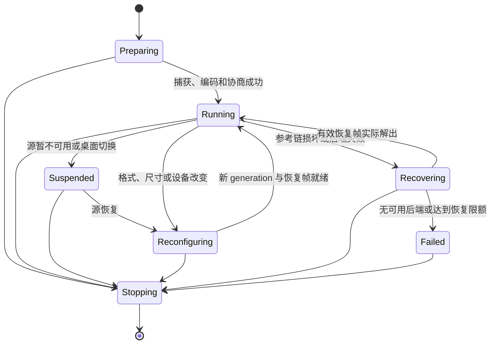
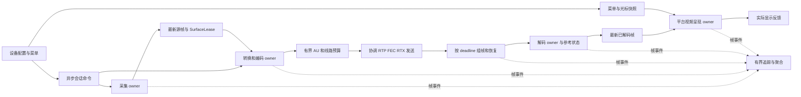

# Eclipse 与 Sunshine + Moonlight：延迟、稳定性对比与重构方案

日期：2026-10-24。本文是源码审计、已有实验复核和实施设计，不代表重构已完成，也不代表已经通过新的双端实机验收。

## 1. 结论：能否达到同一水平

**有工程可行性，应当把同硬件、同画质、同网络路径下达到 Sunshine + Moonlight 的延迟和流畅度作为目标。当前没有发现 Rust、现有配对方式或 WebRTC/UDP 传输本身构成无法跨越的下限。** 但这不是调一个“低延迟”参数就能完成的工作：需要重构主机的采集与编码调度、GPU 资源复用、发送调度，以及客户端的视频呈现调度。

可以明确回答以下问题：

| 问题 | 判断 |
|---|---|
| Eclipse 的主要处理阶段能否进入与参考软件相同的毫秒/亚毫秒量级？ | 可以作为有依据的工程目标。双方能使用同一类采集 API、厂商视频引擎和 GPU 呈现 API；Eclipse 已具备其中不少基础。 |
| 能否现在保证 4K165 时 Encode、Decode、Render 全部为 0.5 ms？ | 不能。缺少同设置、同计时边界的 A/B 数据；截图也不是 165 FPS。硬件引擎、驱动、HDR、编码质量和呈现模式都影响结果。 |
| 能否把“经常顿一下”优化到一小时实际操作无明显额外卡顿？ | 可以设为验收目标，但必须同时控制尾延迟、帧间隔、丢包恢复和资源生命周期。不能凭平均 FPS 或几项单测宣布完成。 |
| 是否需要重写整个产品，放弃现有设备配置、UU 连接服务、配对和菜单？ | 不需要。这些能力留在控制层；优先替换媒体数据路径中的具体瓶颈。 |
| 是否要立即放弃 Media Foundation 或 WebRTC？ | 不应先下这个结论。先测清等待归属；对证实无法达标的后端做局部替换，保留能力协商和兼容路径。 |

**建议的优先顺序：统一测量 → 主机转换池与采集时钟 → 有界异步编解码 → 独立视频呈现 → 发包节奏及恢复闭环 → 三厂商与 Linux 扩展。** 发送端与呈现端在统一测量之后可以独立推进；若故障轨迹先证明卡顿来自丢包恢复，就提前执行网络阶段。

这是分阶段替换媒体内核的方案。每阶段都应能产出单独测试版本，不把全部重构完成作为用户开始体验改进的条件。

范围以 **Eclipse 自有被控端 + Eclipse 客户端** 为主：这时两端采集、编码、保护和恢复都可修改。若连接的是 UU 官方被控端，只能直接改善 Eclipse 客户端的解码、呈现和已支持的反馈；不能通过客户端重构承诺改变官方主机的采集、编码器或 FEC。是否使用中继以实际选中的媒体路径为准，不能由“接入 UU 连接服务”直接推断。

## 2. 对照目标、源码版本和证据边界

### 2.1 用户提供的实际截图


| 截图字段 | 实际内容 | 能说明什么 |
|---|---|---|
| 视频 | 3840 × 2160，AV1 10-bit HDR | 这是 4K HDR 的参考，不能用低分辨率、8-bit SDR 的结果替代。 |
| FPS | Rx / De / Rd 均为 108.7，标题约 109 | 该统计窗口内接收、解码、渲染速率匹配；截图没有证明持续 165 FPS。 |
| Encode | 1.1 ms | 根据本次参考源码，显示主机处理延迟的窗口均值，详见第 3 节。 |
| Decode / Render | 0.32 / 0.32 ms | 客户端的相应统计边界内开销很低。 |
| Network | 1 ± 2 ms | 参考源码显示 RTT 与其变化量；不能直接当作单程视频传输时间。 |
| Loss | 0.00% | 参考源码使用网络丢失帧比例；不是原始 RTP 丢包率，也不能排除 FEC 已经修复丢包。 |
| Bandwidth | 37.20 Mbps | 实际接收带宽统计，不证明编码目标被设为 37.20 Mbps。 |

这张截图确立了一个有价值的实际对照：**4K、约 109 FPS、AV1 10-bit HDR，主机处理约 1.1 ms，客户端两项约 0.32 ms。** 用户最初描述的 4K165、三段约 0.5 ms，作为另一个需要复现的进阶目标保留。两者不能混成同一条已验证记录。

截图只有 HUD，未包含两端程序版本、GPU、驱动、场景、源显示器刷新率和呈现设置。本次无需用户补充就能完成设计；这些信息列入实施阶段的自动采集清单。截图字段解释依据下面的本地参考源码；最终 A/B 仍要核对实际运行的二进制版本。

截图 SHA-256：`8616e28dd70f05824d3a9911f4c0324f061481dd937545da4910e71bb5c434cf`。

### 2.2 固定源码范围

| 项目 | 本次审计版本 | 角色与限制 |
|---|---|---|
| Eclipse | `131be4636616db1a6f6030f423d8ea8d1bf2b0ea`，v0.18.7 开发基线 | 同时检查了工作区 HDR 改动。本文核心瓶颈已对照已提交版本；未提交 HDR 不算已交付、已验收。 |
| Foundation Sunshine | `0219abe22c4d9c937a6ca52ebb895f216da4b077` | 用户指定的 `AlkaidLab/foundation-sunshine`；包含原生 AMF、多种采集后端及额外调参，不能全部归为官方 Sunshine 默认行为。 |
| Moonlight V+ / Qt | `c6699f25f17be0eccc5a9158d0d11c2ffb190261` | 用户指定的 `qiin2333/moonlight-qt`；本次重点核对 HUD、FFmpeg 解码、D3D11 呈现和 pacer。 |
| Moonlight common-c | `9dc0be96e232cd103b68b1f1f7c0b3badc919b43` | 以上 Qt 快照固定的 `qiin2333/moonlight-common-c` 子模块；核对 RS FEC、组帧、解码队列与参考链恢复。 |
| uu-remote-linux | `50ed54d77a9084d18797061650bed9f85293c421` | 辅助参考同协议发送、XDamage/XShm、DRI3→VAAPI 和资源预算，不作为性能等同的证明。 |

两个指定参考工作区只读。未初始化的 common-c 使用其准确提交的独立副本阅读，没有修改参考仓库。

下文区分四类证据：**源码事实**是目前确实存在的路径；**既有实验**是以前执行、本次复核原始结果的有限实验；**推断**是待测的瓶颈解释；**方案**是尚未实施的修改。未进行新的桌面采集、远程部署、编译或一小时 A/B 串流测试。

## 3. 先统一“延迟”到底测什么

### 3.1 完整响应链


输入到光子的时间包含以上整条链。画面串流延迟可以从源画面实际产生时刻开始计量，但仍需包含最后的显示阶段。单独的编码调用、解码调用和绘制提交，只是其中一部分。

165 Hz 每帧约 **6.06 ms**；108.7 FPS 每帧约 **9.20 ms**；60 Hz 每帧约 **16.67 ms**。在 165 Hz 下多等一帧，就足以超过三项各 0.5 ms 的总和。稳定性优化往往是在消除偶发的一帧、数帧等待，而不是继续压低已经很小的函数调用时间。

### 3.2 两端 HUD 的实际口径

| 指标 | 参考软件的当前源码 | Eclipse 当前源码 | 应如何比较 |
|---|---|---|---|
| Encode | Moonlight 将 `frameHostProcessingLatency` 显示成 Encode。Foundation 当前优先从 `capture_ready` 计至编码包被广播线程取出；没有 trace 时回退到源画面时间。字段精度为 0.1 ms。 | `encoder.encode()` 的墙钟耗时，包含 worker 往返、颜色转换、部分分配和编码等待；采集及输出队列等待另列。 | 新增可直接对齐的 `capture_ready → packet_dequeue`，另保留纯调用、转换和编码分段。不能仅凭名称相减。 |
| Decode | 访问单元入解码队列至 FFmpeg 取出相应输出帧，包含解码队列等待。 | `decode_frames()` 调用耗时；解码前排队另计。GPU 路径不强制等待全部像素处理结束。 | 比较 AU-ready→输出帧及其后续 GPU 依赖等待，避免把等待挪到 Render 后误报提升。 |
| Render | `Pacer::renderFrame()` 前后，包括具体 renderer 调用与其同步阻塞；D3D11 路径内部调用 Present。 | GUI 一次更新/绘制提交的 CPU 墙钟统计，计时暂停后才交换缓冲；也包含部分 GUI 工作。 | 对齐视频绘制提交区间，并单列 UI 工作、互操作等待、Present 调用及实际显示。 |
| Queue | pacer 内部有统计；当前紧凑 HUD 将 Queue 文本注释掉了。 | 已有“待绘制”，统计交付给 UI 的帧；被覆盖的旧帧不进入这项均值。 | 截图中看不到 Queue，不意味着 Queue 为零。两端都要记录丢弃样本和帧龄。 |
| Network | RTT 信息，不是同帧单程视频延迟。 | 主要为控制通道 RTT；“已知画面段估计”使用 RTT/2 近似。 | 不跨主机直接相减未同步的时钟，不把 RTT/2 当实际视频到达时间。 |
| Loss | 紧凑 HUD 为网络丢失帧占比。 | HUD 还有丢包、重排、坏帧、RTX、FEC、恢复原因等不同计数。 | 比较原始丢包、修复后坏帧、未呈现新画面分别发生了多少次。 |

依据：[Foundation 主机计时与发送](https://github.com/AlkaidLab/foundation-sunshine/blob/0219abe22c4d9c937a6ca52ebb895f216da4b077/src/stream.cpp#L3443)、[Moonlight HUD 与解码计时](https://github.com/qiin2333/moonlight-qt/blob/c6699f25f17be0eccc5a9158d0d11c2ffb190261/app/streaming/video/ffmpeg.cpp#L943)、[pacer 计时](https://github.com/qiin2333/moonlight-qt/blob/c6699f25f17be0eccc5a9158d0d11c2ffb190261/app/streaming/video/ffmpeg-renderers/pacer/pacer.cpp#L339)。Eclipse 入口为 [native_timing.rs](../crates/uu-core/src/native_timing.rs)、[media.rs](../crates/uu-core/src/media.rs)、[hud.rs](../crates/uu-gui/src/hud.rs)、[glow_integration.rs](../vendor/eframe/src/native/glow_integration.rs)。

**截图中的 1.1 + 0.32 + 0.32 = 1.74 ms 不能解释成完整延迟。** 它证明相应处理路径效率很好，仍缺未显示的队列、源画面等待、网络组帧、合成和扫描。另一方面，这也不能成为忽略 Eclipse 体感落后的理由：最终必须用同条件画面和操作验收。

## 4. 底层原理逐层对比

### 4.1 当前 Windows 主路径

Eclipse 的常见 Windows AMD 原生 SDR 路径为：

```text
到期唤醒 → DXGI Desktop Duplication
→ 两槽 BGRA GPU 快照池
→ 同设备 GPU VideoProcessor 转 NV12（转换输出及 view 仍逐帧创建）
→ 原生 AMF SubmitInput / 等 QueryOutput
→ 两项有界编码输出队列 → RTP / SRTP / ICE UDP
→ 组帧、FEC/RTX 修复 → 有界参考帧队列
→ Media Foundation / D3D11 解码纹理
→ 每路一张最新已解码画面
→ D3D11 转 RGB → WGL 互操作 → egui/Glow → SwapBuffers → 合成/显示
```

这是已经有多段 GPU 路径的实现，并非整个视频都在 CPU 上解码、转换和上传。跨显卡、旋转、不支持互操作或特定后端仍可能走读回回退，必须按会话记录实际路径。HDR 工作区则引入 FP16/P010 和最终 HDR 呈现，不能直接用 SDR 结论覆盖。

参考软件的相应 Windows 路径为：

```text
采集线程 / 源更新节奏 → GPU 图像池和最新图像事件
→ GPU 转换 → 厂商编码器（NVENC / 原生 AMF 等，或对应通用后端）
→ 编码包队列 → 分块 RS FEC / UDP 批量发送与帧内节奏
→ common-c 重排、纠错和参考链恢复
→ FFmpeg 硬件解码 → 视频 pacer / 渲染线程
→ D3D11 shader / VideoProcessor → DXGI flip swapchain → 合成/显示
```

Foundation 也有同步采集/编码、系统内存和其它平台路径；Moonlight 也会按后端能力选择不同线程与呈现策略。不能把一条最快路径描述成任何配置下都会启用的行为。

### 4.2 各部分的差距与可优化性

| 部分 | Foundation / Moonlight 的机制 | Eclipse 现状 | 判断 |
|---|---|---|---|
| 画面产生与采集 | Windows 有 Desktop Duplication，以及该分支的 WGC、VDD、AMD capture 等路径；DXGI 路径使用源呈现时间并专门调度采集。 | DXGI 本身同类；生产循环按 FPS sleep，顺序采集和编码。无新图像时可复用上次图像并更新输出 PTS。 | 主要差距是采样时机、时间语义和与编码解耦；没有证据证明必须换采集 API。 |
| GPU 资源 | 图像池、编码输入资源复用，明确跨线程/设备同步。 | 已有两槽采集快照池；NV12 转换输出仍逐帧分配，安全复用尚未产品化。 | 有直接的可优化点；池化必须满足驱动真正释放输入的条件。 |
| AMD 编码 | 当前分支是原生 AMF；有独立输出收集、输入队列和多种厂商能力配置。 | 已是同设备原生 AMF、ULL、无 B 帧、按需关键帧；仍采用同步一进一出接口。 | 不能把“接入 AMF”列为未做；应改资源与提交/完成模型，测有效属性和 GPU 等待。 |
| NVIDIA 编码 | 独立 NVENC，可直接控制低延迟 preset、VBV、异步事件和支持设备上的 split encode。 | NVIDIA 选择仍进入通用 MFT 路径，没有原生 NVENC 实现。 | 若目标主机是 NVIDIA，这是明确的后端能力差距。 |
| Intel 编码 | QSV 等后端可使用硬件表面、控制异步深度。 | MFT 和 oneVPL 已有；当前显式 oneVPL 输入使用系统内存。 | 应补 D3D11/VA surface 输入，不能把“硬编”自动等同于没有上传。 |
| 网络传输 | GameStream 专用 UDP 视频封包；RS FEC、批量发送、节奏控制和反馈恢复。 | WebRTC SRTP/UDP，自定义完整 AU 组帧，NACK/RTX/PLI；原生 XOR FEC 已实现。 | 协议不同，不等于协议天然慢；当前发送和恢复政策有可量化差距。 |
| 解码 | FFmpeg 硬件后端，低延迟选项，专门解码循环。 | Windows MFT + D3D11；已收尽单次调用的批量输出；有回退、恢复和 crop。 | 先验证硬件计算和延迟输出；不要为换库而换库。 |
| 显示调度 | 视频 pacer、可独立运行的渲染线程、原生平台呈现。 | 最新帧 mailbox 已有，但视频唤醒和绘制仍依赖 GUI/viewport，Windows 经 D3D11→WGL。 | 是客户端应重点重构的部分，尤其是尾延迟和多窗口干扰。 |
| Linux 主机 | 依采集后端/驱动可走 KMS、其它桌面采集和 GPU 转换编码。 | 原生 Wayland 路径使用 SHM；门户 PipeWire 当前只接受 MemFd/MemPtr 并复制。VAAPI/VPL 输入仍有上传。 | Linux 主机达到高分辨率高帧率需要另补 GPU surface 链，不能沿用 Windows 已优化的结论。 |
| 产品控制层 | 独立于媒体高频处理。 | 设备、认证、菜单、配置、UU 连接集成已具备。 | 应保留并通过命令/快照连接媒体层，不让 UI、持久化、诊断 I/O 阻塞逐帧工作。 |

核心源码：[Foundation 采集/编码调度](https://github.com/AlkaidLab/foundation-sunshine/blob/0219abe22c4d9c937a6ca52ebb895f216da4b077/src/video.cpp)、[Windows GPU 采集与转换](https://github.com/AlkaidLab/foundation-sunshine/blob/0219abe22c4d9c937a6ca52ebb895f216da4b077/src/platform/windows/display_vram.cpp)、[原生 AMF](https://github.com/AlkaidLab/foundation-sunshine/blob/0219abe22c4d9c937a6ca52ebb895f216da4b077/src/amf/amf_d3d11.cpp)、[Moonlight D3D11 呈现](https://github.com/qiin2333/moonlight-qt/blob/c6699f25f17be0eccc5a9158d0d11c2ffb190261/app/streaming/video/ffmpeg-renderers/d3d11va.cpp)。

### 4.3 4K165 为什么对队列和复制特别敏感

4K BGRA 一帧约 33.18 MB，165 FPS 每经过一次全帧数据传送就是约 **5.47 GB/s**；一次内存复制还包含源读取和目标写入。GPU→CPU 读回再上传会增加多个内存访问和同步点，不能只计算 PCIe 峰值带宽就断言免费。NV12 每帧约 12.44 MB，P010 是其两倍；HDR 要单列资源预算。

串行生产循环的最高吞吐受 `采集 + 转换 + 编码等待 + 输出阻塞` 限制。例如总计 8 ms，最高只有约 125 FPS。流水化可以让不同帧的阶段重叠、提高吞吐，却不会让单帧本身的 8 ms 自动变成 0.5 ms；若编码引擎持续处理能力不足，增加在途帧只会积压。

传输同样有物理时间：100 Mbps 视频在 165 FPS 时平均约 75.8 kB/帧，仅在 1 Gbps 链路上的理想串行发送就约 0.61 ms，还未计协议头、FEC、排队和传播。截图的 37.20 Mbps 则是另一个实际负载，不能把相同“网线”当成相同线上流量。

## 5. 当前最值得修的地方，以及“卡一下”的解释

以下是源码能证明的结构问题与待测因果，**没有把所有项目都认定为用户本次卡顿的已定位根因**。

| 优先级 | 发现与代码证据 | 可能影响 | 如何证实 |
|---|---|---|---|
| P0 | [native.rs](../crates/uu-core/src/native.rs) `encode_source`：sleep→capture→同步 encode→`blocking_send`；输出队列容量 2。[worker.rs](../crates/uu-media/src/encoder/worker.rs) 再同步等待驱动线程回复。 | 编码或发送尾延迟反向推迟下一次采样；保持了有界性，但不能连续捕获最新画面。 | 同帧记录 capture-ready、submit、output、队列等待和下一次采集的间隔。 |
| P0 | [gpu.rs](../crates/uu-media/src/encoder/gpu.rs) `Input::convert` 每帧创建 NV12 texture 和输入/输出 view。 | 分配及资源驻留成本、驱动抖动；已有原型证明这部分可省。 | 按下节的真实释放合同做 A/B，比较像素/码流及 p99，不只看 CPU 分配时间。 |
| P0 | [windows.rs](../crates/uu-capture/src/windows.rs) 复用旧画面时改 PTS；没有把源呈现时刻独立贯穿媒体链。 | 重复画面可能显示为正常输出 FPS；采集相位与源帧龄不透明。 | 同时记录唯一源帧数、重复帧数、源呈现时间和输出 PTS。 |
| P0 | [video_d3d11.rs](../crates/uu-gui/src/video_d3d11.rs) 保留跨帧 WGL 锁，转换与互操作仍在 GUI 绘制路径；[main.rs](../crates/uu-gui/src/main.rs) 同轮处理其它 UI 工作。 | 原生 GPU 同步或某个 viewport 的慢操作使新视频错过显示时机。 | 相关联地记录 WGL acquire/release、UI 调度、Present/Swap 与真实显示事件。 |
| P1 | [native_video.rs](../crates/uu-core/src/native_video.rs) 连续逐包 `write_rtp`；[native_media.rs](../crates/uu-core/src/native_media.rs) 应用层 RTCP 处理主要把 PLI/FIR 转为关键帧请求。未见按线路预算控制媒体的完整闭环。 | 大帧和恢复关键帧突发，遇到 Wi-Fi/缓冲拥塞时掉包；仅收到反馈不等于会调速。 | 抓实际出包时间、socket 队列与反馈后实际编码码率；确认底层拦截器行为。 |
| P1 | [media.rs](../crates/uu-core/src/media.rs) 修复等待默认下限 60 ms、可提高至 200 ms；NACK 调度间隔约 20 ms。完整帧正常到达时立即交付。 | 丢一片时可能等数个显示周期，失败再进入参考链恢复。**不是每一帧固定缓冲 60 ms。** | 对一次卡顿复原丢包→NACK→RTX/FEC→AU→IDR→呈现的时间线。 |
| P1 | [native_fec.rs](../crates/uu-core/src/native_fec.rs)：每组最多 8 包、1 个 XOR parity，走无序短寿命 PR-SCTP。 | 同组两包以上丢失不能恢复；校验与 RTP 调度不同，可能迟于有用期限。 | 测原始和校验的到达差、同组突发丢失、修复时效；不能仅比较 FEC 恢复计数。 |
| P1 | [decode_backlog.rs](../crates/uu-core/src/decode_backlog.rs)：20 ms 解码工作估计，帧数下限 9、上限 64，另有 64 MiB 上限。 | 对快解码器能吸收突发，但帧数/预计工作不等于真实帧龄；慢路径的 9 帧下限也可能过大。 | 记录队列最老帧龄、预计清空时间和显示新鲜度；禁止通过随意丢参考帧缩短队列。 |
| P1 | [amf/native.cpp](../crates/uu-media/src/amf/native.cpp)：当前提交后同步 QueryOutput，最长等 2 秒；worker 回复最长等 5 秒。 | 极端驱动停顿会长期阻塞当前生产链；超时策略没有变成完整的会话恢复/隔离策略。 | 故障注入覆盖卡住、错误和延后输出；区分瞬时慢帧与真正失效。 |
| P2 | [vpl/native.c](../crates/uu-media/src/vpl/native.c) 系统内存 I/O；[portal/pipewire.rs](../crates/uu-capture/src/portal/pipewire.rs) 和 [wayland.rs](../crates/uu-capture/src/wayland.rs) 采集复制。 | 特定平台持续吞吐不够、CPU 和带宽压力高。 | 拆 readback / copy / upload；按平台分别做 GPU surface 端到端实验。 |

共同的卡顿放大链可能是：一次 GPU/调度慢帧 → 大编码包突发或错过采样 → 接收等待修复 → 参考链重置 → 更大的恢复关键帧 → 再次拥塞。也可能完全没有网络丢包，只有呈现错过显示周期。必须先区分这两类，不能统一归因于网速或编码器。

已有的 AMF 按需关键帧、H.264 Constrained Baseline、GPU 采集池、AV1 批量解码及最新显示 mailbox 都应保留。旧文档中“尚未接入 AMF / FEC / 没有 GPU 呈现”的历史结论不能继续用来描述本次基线。

### 5.1 一项已经有数据支持、但尚未产品化的优化

本次复核了此前纯 GPU 生成画面的原型结果，整理如下；不是新运行的桌面测试。输入为 3840×2160 BGRA→NV12，AMF ULL / Speed / CBR，配置 60 FPS、实际无节拍循环；每轮 630 帧，前 30 帧预热，fresh/reuse 各交替两轮。

| 格式 | fresh 转换+编码 p50 | 两槽复用 p50 | 两槽复用 p95 |
|---|---|---|---|
| H.264 | 7.129 / 7.043 ms | 6.099 / 6.112 ms | 6.547 / 6.537 ms |
| HEVC | 6.869 / 6.867 ms | 5.830 / 5.857 ms | 6.264 / 6.262 ms |
| AV1 | 5.744 / 5.691 ms | 4.665 / 4.641 ms | 5.065 / 5.051 ms |

复用前要求前一输入释放回调已到达且对应输出已取得；12 轮共 7,560 帧，同一格式四轮完整码流哈希一致，3 条唯一参考码流独立解码各 630 帧、无报告错误。原型源码 SHA-256：`9637768c7bfc274f2373d784afc531720ef3be9bfc901859a887fa05deda141b`。独立“只转换、不接编码器”实验的 GPU 完成中位数也从约 1.24 ms 降至 0.28 ms。

**这个实验支持“安全池化值得优先做”，不支持“池化后就达到截图 1.1 ms”。** 原型与截图的格式位深、帧率、内容、统计边界并不一致；它没有网络、真实采集和显示，也没有验证所有驱动。约 1 ms 的收益不能直接累加到其他优化的估算里。

## 6. 重构前先定义统一行为与所有权

### 6.1 帧身份、时间与资源分开

新增共享的媒体帧元数据，不让后端分别猜测：

```text
FrameIdentity:
  session_epoch, stream_id, source_frame_id, output_frame_id
  codec_generation, geometry_generation, device_generation

FrameTiming:
  source_present_time?       // 源时钟域；不可与另一主机直接相减
  capture_ready_time
  capture/convert/submit/output/send/receive/decode/present events
  duplicate_of?, timestamp_quality, clock_domain

SurfaceLease:
  adapter_id, device_generation, format, visible_rect, coded_size
  plane_layout, color_description
  readiness_dependency, release_contract
```

`source_frame_id` 只在源真的产生新图像时推进；传输 PTS 继续单调推进，允许用同一源帧产生保活输出。这样既不破坏 RTP/解码器，也不会把重复帧伪装成 165 个新画面。

颜色描述明确记录 8/10-bit、矩阵、范围、transfer、primaries 和 HDR 元数据。几何、颜色或设备改变都形成新 generation；旧回调只归还旧资源，不能污染新会话。

### 6.2 各阶段的统一队列规则

| 位置 | 所有者与规则 | 饱和时的动作 |
|---|---|---|
| 采集→编码 | 保留最新一张待编码源图；在用资源有明确租约。 | 替换尚未提交的旧源帧；没有空闲安全资源时记丢采样，不无限分配。 |
| 编码器输入 | owner 线程持有驱动；按其最少表面需求分配资源，在途工作单独限额。 | 停止接纳新任务，继续收输出；不能覆盖驱动仍持有的输入。 |
| 已编码 AU→发送 | 按字节、时间和参考依赖限制。 | 优先在编码前施加背压；必须丢已编码帧时，退休其受影响的后续参考链并安排新恢复点。 |
| 接收→解码 | 有序保留必需参考数据，同时约束字节、工作量和最老帧龄。 | 可短暂追赶则解完只显示最新；否则切新 epoch、请求可独立恢复帧。 |
| 已解码→显示 | 每路最多一张最新待呈现画面，另有正在 GPU 使用的租约。 | 丢旧显示帧；保持已完成的解码参考状态。 |
| UI/统计/截图 | 异步命令与有界快照，不占视频资源长期租约。 | 合并重复命令或丢旧遥测，不阻塞视频。 |

**物理表面数量不等于允许排队的帧数。** DPB、正在 GPU 使用的资源、显示持有帧都可能要求多个 surface；不能为“低延迟”把所有池硬改成一个，也不能把池大小全部当成可排队预算。

### 6.3 会话和设备状态



暂停/重配置期间保留仍有效的认证和控制连接；不得继续显示旧桌面伪装实时视频。关闭时先停接纳，再停止发送、退休任务、按完成合同释放资源。恢复完成以有效新帧实际解出为准，不能以“PLI 已发送”或“驱动对象已创建”为准。

## 7. 每一部分具体怎么改

### R0：建立可比较的测量与诊断

**落点：**扩展 `native_timing.rs`、`frame_cadence.rs`、`session_diagnostics.rs`、`display_frames.rs`；新增 `frame_trace.rs`，GUI 只消费快照。

1. 给每帧关联第 6 节的身份。主机本地记录源呈现→capture-ready→转换→提交→码流可用→发送队列出队→首/尾包；客户端记录首包→AU 完整→提交解码→输出→待呈现→Present→显示事件。
2. 正常运行做有界聚合；发生慢帧时导出前后有限环形轨迹。报告 p50/p95/p99/p99.9、最大值、样本数、时间窗口和丢弃原因。每帧同步 JSON/磁盘写入不进入高频路径。
3. CPU 提交、GPU 依赖完成、可读码流/图像三类事件分开。`Flush()` 不代表 GPU 完成。GPU 查询异步回收并处理 disjoint；视频引擎跨队列时间用对应完成语义/ETW 关联，不能把普通 3D query 当作所有硬件的统一编码计时。
4. 记录实际 adapter、后端、profile、8/10-bit、有效分辨率/FPS、源刷新率、有效编码参数、回退原因、实际候选网络路径和呈现模式。用户名、机器地址等留在本地诊断，不进入公共报告默认输出。
5. 新协议统计独立能力协商；旧端不支持时保留现有统计，不改旧端严格解析的消息结构。原生和 UU 官方兼容链路分别标记能力。
6. 跨机时间只使用同一时钟域的阶段差，或带误差界的校时结果。最终画面年龄与输入到光子使用同机时钟可读的光学/硬件实验，RTT/2 只保留为估计。

**交付门槛：**一段慢帧能判断停在采集、驱动、发送、组帧、解码还是呈现；开关遥测的 A/B 不造成可辨识的吞吐或尾延迟退化。先产出基线报告，再选择后续优化，不以仪表板数值变化代替真实收益。

### R1：重构采集时钟与生产流水线

**落点：**`uu-capture` 的 Capture 抽象和 Windows/Wayland 后端；将 `native.rs::encode_source` 的调度拆到 `capture_scheduler.rs`、`media_pipeline.rs`。保留现有同设备 `InputDevice`。

1. 采集 owner 独立于编码输出等待。源更新到来后发布最新快照；编码 owner 在容量与输出速率允许时取最新源帧。改变线程结构时明确 D3D11 immediate context 的保护和等待范围，不在设备锁内做长时间捕获等待。
2. 接口区分 `NewFrame / NoChange / Suspended / Reconfigure / Fatal`。无变化不是错误；保活、IDR 请求和恢复需要重复图像时明确标注重复原因。
3. DXGI 保留 `LastPresentTime`、`AccumulatedFrames` 和 pointer-only 信息；源时间与采集调用时间分开。源显示器不足 165 个新帧时，不把重复编码计成 165 FPS 的采集能力。
4. 使用绝对时间 deadline、可取消等待和唤醒迟到统计。Windows 优先高精度 waitable timer，与停止/重配置事件共同等待；不用固定 1 ms 轮询或长期忙等补偿。Linux 使用适合后端的事件与绝对定时。支持分数刷新率，避免 59.94/60 或 164.9/165 的长期相位漂移。
5. 保持 DXGI 获取/释放合同。快照复制在原始表面有效时提交，不能将已 ReleaseFrame 的原始纹理交给后续线程使用；评估在下一次 acquire 前释放所带来的开销变化，不只按“越早释放越好”优化。[微软 ReleaseFrame 语义](https://learn.microsoft.com/en-us/windows/win32/api/dxgi1_2/nf-dxgi1_2-idxgioutputduplication-releaseframe)
6. 正常路径超载时以新鲜度和容量控制降采样，输出实际 FPS 与原因；运行中码率更新合并，帧率/尺寸/颜色变更在 generation 边界生效。API 支持动态更新时不无谓重建，不支持时按受控状态切换。
7. 根据纯生成时钟测试验证前台、后台服务、最小化状态。现有接收侧和部分编码器已有 timer guard，不能说全项目完全没处理计时器；Windows 11 对不可见窗口进程的请求也有条件限制。[timeBeginPeriod 文档](https://learn.microsoft.com/en-us/windows/win32/api/timeapi/nf-timeapi-timebeginperiod)

**交付门槛：**编码端人为延迟不会把无界旧图像排进队列；高负载恢复后尽快显示最新源图；停止、UAC/桌面切换、源消失、模式切换和长按输入时不死锁、不复活旧帧。165 FPS 的 deadline 迟到必须实测，不能由定时器精度标称推导。

### R2：把 GPU 转换与编码输入池真正做完整

**落点：**`encoder/capture_pool.rs`、`encoder/gpu.rs`、`encoder/amf.rs`、`amf/native.cpp`；新增 `gpu_surface_pool.rs` 与后端专属回收适配。

1. 保留已有采集两槽池，为转换输出建立预热资源池；texture、VideoProcessor/shader view 按设备、尺寸、格式和颜色合同复用。HDR 的 FP16/P010 使用独立资源规格，不能拿 SDR NV12 复用规则直接替代。
2. 每槽状态为 `Free → Converting → Submitted → Retiring → Free`，携带 pool generation 和 submission token。只有转换/编码所需 GPU 顺序已满足、驱动已经结束输入访问、应用下游租约也结束，才归还。
3. AMF 使用其原生 surface 释放观察合同；回调只投递回收事件，不在驱动回调里等待、销毁会话或进入 GPU 锁。把迟到、重复和关闭过程中的回调纳入状态验证。
4. MFT 单独设计 tracked-sample/allocator 或已验证的释放合同。`NeedInput`、一次 `ProcessOutput` 返回、Rust `Arc` 唯一引用，都不足以普遍证明 MFT 不再持有底层纹理。没有可靠合同就保留独立 sample 分配并显式记录性能路径。
5. 尺寸、格式、设备变化创建新池，旧池延迟退休；回调只归还原池。池满只暂停新接纳或丢尚未提交的采样，不能覆盖在途资源。
6. 对 GPU 转换的 flush、跨设备 share、WGL lock 等分别计时；能利用同队列顺序的地方减少多余 CPU 等待。任何删同步的改变都必须同时验证像素、顺序和长测，不能靠“没崩溃”验收。

**交付门槛：**原型收益在正式产品路径可重现；有码流/像素一致性依据；10-bit、非对齐可见尺寸、重配置、取消与长测后无污染或资源增长。池化是有支持的优化，不预先承诺收益一定是 1 ms。

### R3：统一编码器的提交、收集和能力合同

**落点：**`VideoEncoder`、`encoder/worker.rs` 及各厂商后端。保留同步兼容适配；性能主路径支持独立的 submit/collect。

```text
EncoderOwner:
  capabilities() -> 可接受表面/同步方式/最少资源/动态更新能力
  try_submit(frame, token) -> Accepted | Backpressure | Reconfigure | Failed
  collect_ready() -> [EncodedAccessUnit(token, keyframe, timing)]
  request_refresh(reason)
  reconfigure(change, generation)
  stop_accepting(); retire_pending()
```

这是接口设计草图，不是已经存在的 API。独立收集不意味着任意加深 pipeline：先采用后端允许的浅在途工作，分别测一帧和两帧的吞吐、帧龄，再决定上限。资源数量按后端合同配置，不机械设成一张。

| 后端 | 必做内容 | 不应默认假设的内容 |
|---|---|---|
| AMD AMF | 独立收集可用输出；处理 INPUT_FULL/重复/暂缺输出；token→PTS 对应；输入释放驱动池化；读取有效 usage、quality、rate control、preanalysis、GOP、VBV、输入队列和可用硬件实例能力。 | `QUERY_TIMEOUT=1` 是最多等待，不代表必然每帧额外睡 1 ms；改成 0 的忙轮询未必更快。ULL 不等同于所有格式的 aggressive low-latency 开关。 |
| NVIDIA NVENC | 新增原生 NVENC 插件；绑定采集设备、注册复用纹理、输出缓冲和完成事件；无 B 帧、低延迟 tuning、按需 IDR；对比 preset、lookahead、multipass、VBV 与硬件 split encode。 | MFT 厂商筛选不等于具备完整 NVENC 控制。多 NVENC/split 取决于 GPU、codec、分辨率、SDK 与驱动，不能所有设备强开。 |
| Intel oneVPL | 设备绑定、video-memory surface 输入、GPU VPP；处理 device busy、同步点、锁定 surface 与释放；保留 system-memory 路径。 | `AsyncDepth=1` 不代表没有上传，也不代表任何驱动一个 surface 就够；profile/low-power/目标使用级别需要有效值核验。 |
| 通用 MFT | 保持兼容与明确回退；按异步事件合同组织收集；记录实际 MFT、D3D11 能力与有效属性。 | 写入属性成功并不一定产生预期码流结构；GPU 输出 sample 也不是视频引擎确实完成全部计算的充分证据。 |
| Linux VAAPI | 支持导入 DMA-BUF/VA surface、VPP，编码能力按实际 codec/profile 探测；改造当前只上传的输入接口。 | 当前自有 VAAPI 后端能力不等于系统驱动所有能力；不能仅因库名称就宣布 AV1/HDR 已可用。 |

低延迟预设应明确禁用会引入额外帧等待的工具，并验证码流；画质预设作为另一个显式模式。VBV/HRD 从目标帧预算出发调节，同时核对 IDR 质量、码率峰值和网络预算；不能把单帧 VBV 当作保证 0.5 ms 的开关。NVIDIA 的 API 指南支持低延迟 tuning、小 VBV 和按需刷新等设计，但不是所有厂商的统一参数表。[NVENC 编程指南](https://docs.nvidia.com/video-technologies/video-codec-sdk/13.1/nvenc-video-encoder-api-prog-guide/index.html)

Foundation 的原生 AMF 分支提供 AV1 latency mode、多硬件实例、SAV 等控制，Eclipse 需要做能力探测和同条件实验；不能断言截图就是靠其中某项达到 1.1 ms。该分支也记录了某些设备/驱动在强制 LOWLATENCY_MODE 下冻结的经历，因此默认值应由可重现测试支撑，而非把所有“low latency”字样全部打开。[AMF 属性与调度实现](https://github.com/AlkaidLab/foundation-sunshine/blob/0219abe22c4d9c937a6ca52ebb895f216da4b077/src/amf/amf_d3d11.cpp#L450)

Eclipse 已实现 AMD 按需关键帧及 Constrained Baseline，保留它们。其他后端的周期 GOP 逐项迁移；不存在“全项目只改一处就取消所有周期 IDR”。码率动态更新是否破坏参考链仍由后端报告，不能为追求无停顿省略必需的恢复帧。

**交付门槛：**同输入、同参数下，提交到对应码流可用的时间和持续吞吐都改善；首帧、恢复帧和稳定态分别统计；输出不能靠更低画质、错误位深或隐藏丢帧换分数。

### R4：增加发送节奏、线路预算和及时恢复

**落点：**`native_video.rs`、`native_media.rs`、`native_fec.rs`、`video_receiver.rs`、`rtx.rs`；新增 `packet_pacer.rs`、`media_budget.rs` 和 deadline 策略。原生扩展必须协商，UU 官方兼容协议保持独立适配。

**发送端：**

1. 在真实发送路径引入按字节预算的 pacer。追踪跨帧发送债务、首/尾包时间、socket 排队、MTU 与每次批量限制；不能只在帧末 sleep，也不能固定把整帧匀铺满一个帧周期而平白增加接收等待。
2. 首先测 webrtc-rs 的 RTP 写入、RTX interceptor、SRTP 和 ICE 实际路径。正常 RTP、重传和保护包必须受协调预算约束，不能只给新视频加 pacer 而允许 RTX 旁路形成突发。
3. 如高层 API 隐藏了必要的写入/批量边界，只在 transport/interceptor 适配层补可观测调度。保留认证、SRTP 和 ICE；没有证据前不整体替换成自定义裸 UDP。
4. 总预算满足 `视频 + FEC + 音频 + 重传 + 封装 ≤ 安全可用带宽`。提高 FEC 时相应扣减视频预算。输入、音频和关键控制小包有延迟预算，不与大视频队列互相饿死；数据通道自身的拥塞状态也要记录。
5. 将 TWCC/RTCP 或原生反馈接到唯一的码率控制器。快速降码率、缓慢恢复，所有更新合并并有最小间隔；图像复杂度导致的帧内突发与持续带宽不足分开处理。保留用户配置上限，避免发送端和客户端两个自适应环互相打架。

Foundation 当前约按 0.8 Gbps 的组预算进行帧内节奏和有限批量发送；这是可借鉴的实现机制，**不是能自动适配任何 Wi-Fi 容量的算法**。Eclipse 应按实际路径和反馈设预算。[参考发送实现](https://github.com/AlkaidLab/foundation-sunshine/blob/0219abe22c4d9c937a6ca52ebb895f216da4b077/src/stream.cpp#L3558)

**接收、FEC 和参考链：**

1. 先保留现有 XOR 作为兼容基线，测清修复贡献与迟到比例。若突发丢包是主要原因，新增多校验分块方案，例如经过审计的 RS 实现；参数按帧大小、突发分布、CPU 成本和 deadline 选择。
2. 将新 FEC 放入协商的、受认证保护的媒体 datagram/RTP 扩展路径，和原始媒体共享调度预算；不要直接复制 Sunshine 的线上格式或把其校验包误当标准 ULPFEC。旧端继续用既有 XOR/RTX。
3. 数据包不等 FEC 组满才发送；分块控制恢复等待，统计“在 deadline 前修复”的比例。FEC 解决可恢复丢失，不保证所有长突发；冗余过大也会制造拥塞。
4. 以 `剩余呈现预算`、RTT 估计、重排分布和恢复可行性决定是否 NACK。下一次可能到达时间已经晚于 deadline 时，不继续为旧帧支付无收益重传。不能把默认 60 ms 全局减成 0：乱序与短 RTT 恢复仍需要合理窗口。
5. NACK 由缺口事件与最近到期时间驱动，有合并和限频；不依赖固定 20 ms 扫描才能发现所有损失。正常完整 AU 继续立即交付。
6. 明确 `Healthy / Repairing / AwaitRefresh`。已有参考链确定坏掉后，合并请求恢复点；恢复点本身丢失时有重新请求与限速，避免 IDR 风暴。后端真正支持时再加 RFI/LTR/intra-refresh；不支持则 IDR，不能只发控制消息便声称有 RFI。

参考：[Moonlight RS FEC 与早期丢失判断](https://github.com/qiin2333/moonlight-common-c/blob/9dc0be96e232cd103b68b1f1f7c0b3badc919b43/src/RtpVideoQueue.c)、[参考链及解码队列](https://github.com/qiin2333/moonlight-common-c/blob/9dc0be96e232cd103b68b1f1f7c0b3badc919b43/src/VideoDepacketizer.c)。当前 Moonlight 自身也有有界队列，并不是“完全不缓冲”。

**交付门槛：**相同总线上预算下比较随机丢包、突发丢包和带宽阶跃；重传/FEC 不加剧阻塞；正常网络不能为了抗丢包永久多等一帧；发生丢失后输出恢复时间和长卡顿次数实测下降。

### R5：收敛解码路径，保住参考链与 GPU 表面

**落点：**`media.rs`、`decode_backlog.rs`、`decode_gate.rs`、`decoder.rs`、`hw/thread.rs` 和平台解码后端。

1. 保留已经实现的“每个 AU 只提交一次、收尽多张输出”。对能异步产出结果的后端增加 readiness/collect 能力；输出不应仅因没有下一包而永远无人收集。同步 MFT 的 NEED_MORE_INPUT 则按其 API 语义处理，不能套一个无限轮询线程。
2. 同时限制 queued bytes、在途任务、最老帧龄和预计追赶时间。当前按解码调用 EWMA 估算工作量，在 GPU 异步路径可能低估真实完成成本；应使用实际输出节奏和后续依赖等待校正。
3. 快解码器能及时追上完整参考链时，保留 AU、解完仅显示最新；超出新鲜度预算则明确退休整条受影响 generation 并等恢复点。不要每过一条小阈值就重置，也不要随意“只拿最新 P 帧”。
4. 保持 decoder、DPB、输出 texture 和呈现租约的独立所有权。呈现完成之前不能把样本还给解码池；同时防止 UI 永久保留旧 surface 使解码池耗尽。
5. 硬解判定结合 codec/profile、驱动能力、实际 D3D11 surface、视频引擎活动和 CPU 消耗。过去 H.264 普通 Baseline 即使返回 GPU 纹理也可能走高 CPU 路径；现有 Constrained Baseline 修复不应回退。微软明确规定该 DXVA 路径对 Baseline 的兼容约束。[H.264 解码器文档](https://learn.microsoft.com/en-us/windows/win32/medfound/h-264-video-decoder)
6. 仅当同码流、同 GPU、同完成边界下 MFT 仍明显落后，增加 FFmpeg D3D11VA 可选后端作 A/B，再决定是否成为默认。采用库前检查构建选项及许可证；不自行重写复杂的 H.264/HEVC/AV1 DXVA 解析来追求短期分数。

**交付门槛：**验证 AU/PTS 对应、批量输出、暂缺输出、可见尺寸、HDR、格式变化和恢复；硬解调用缩短时，渲染依赖等待和整体帧龄不能等量增长。

### R6：将视频呈现从 GUI 的工作量中分离

**落点：**保留 `display_frames.rs` 的最新帧语义，抽出 `video_presenter`、`present_scheduler` 和平台实现；`video_texture.rs`、`video_d3d11.rs`、`window_context.rs` 作为迁移接缝。现有 HDR provider 按同一 viewport 所有权接入。

**目标是明确视频呈现所有者，而不是先替换整个主页 UI 框架。** Windows 串流 viewport 先做可切换的新 renderer；主页、设备配置和配对不因媒体实验更换渲染后端。

1. 视频处理由新帧、显示时机、重配置或停止事件驱动，不能要求全部 GUI 工作以 165 FPS 重跑。GUI 布局、设置持久化、设备刷新与视频呈现分离；多会话不能因一个 viewport 的 Swap 阻塞拖住其他会话。
2. Windows 首选验证同设备 D3D11 解码 surface→shader/VideoProcessor→DXGI flip swapchain 的路径，减少 D3D11→WGL→OpenGL 的跨 API 所有权交接。支持采样的 NV12/P010 直接 GPU 变换；不支持的 surface 使用有界 GPU copy/转换，不能隐式回到 CPU。
3. 同设备并不等于多个线程能无保护同时使用 immediate context。采用单一 owner 或已明确串行化的上下文合同；窗口创建、resize、DPI、surface 重建在正确线程处理，GPU 等待期间不占 UI 全局锁。
4. 菜单/光标/统计与视频保持同一缩放、颜色和坐标规则。UI 以快照/draw data 提交给呈现 owner，或使用经过验证的独立合成层。HDR 需验证 SDR UI 白亮度、FP16/P010/PQ/scRGB 转换；增加合成层可能影响 independent flip，必须测，不能预设免费。
5. 初始保留两种完整呈现策略：`Immediate` 在允许时采用低等待呈现，`Display-paced` 根据显示事件选最新完成帧并控制排队；VSync、VRR、目标帧率和源帧率共同决定调度。VRR 是否实际生效由显示事件确认。
6. 区分“呈现 API 返回”和“帧实际显示”。使用 PresentMon/ETW 等观测呈现模式、丢弃与显示事件；光学测量确认真实响应。窗口被遮挡、最小化或移到另一刷新率显示器时按统一状态处理。
7. 保留当前 GL 兼容 renderer 作为可回退路径，记录原因。先验证新串流 viewport，确认同条件收益后再切默认；不能把历史上无效的主页渲染替换当作这次性能结论。

**一个必须避免的误用：把所有 Windows swapchain 一律设成“一帧队列”。** 此次 Moonlight D3D11 实现采用 `FLIP_DISCARD`、5 个物理 buffer、`Present(0, flags)`，并明确避免在该路径上强制 device-level maximum frame latency 为 1，因为可能把无阻塞提交变成等待。它的低延迟来自整套呈现策略，不来自 buffer 数量越少越好。[Moonlight swapchain 实现](https://github.com/qiin2333/moonlight-qt/blob/c6699f25f17be0eccc5a9158d0d11c2ffb190261/app/streaming/video/ffmpeg-renderers/d3d11va.cpp#L678)

若 Eclipse 采用 waitable swapchain，则按这一套策略使用 swapchain-level `SetMaximumFrameLatency`、正确的创建 flag 和可取消等待，单独与 Moonlight 风格方案 A/B；不要混用两套建议。flip model 是平台提供的低开销路径，但实际扫描仍受窗口和 DWM 条件影响。[微软 flip model](https://learn.microsoft.com/en-us/windows/win32/direct3ddxgi/for-best-performance--use-dxgi-flip-model)、[SetMaximumFrameLatency 适用条件](https://learn.microsoft.com/en-us/windows/win32/api/dxgi1_3/nf-dxgi1_3-idxgiswapchain2-setmaximumframelatency)

**交付门槛：**固定源节奏下，菜单开关、窗口缩放/切换、DPI 和第二会话不引入新的长帧；保持正确颜色和输入坐标；呈现 p99/实际帧龄改善，不能仅把等待移到 HUD 未统计的 Present 后面。

### R7：补齐 Linux 与其他 GPU 的 surface 路径

这是独立平台阶段，不应阻塞已验证 Windows 改进交付。

1. PipeWire 增加 DMA-BUF format/modifier 协商、plane offset/stride、设备匹配和 acquire/release 同步；不支持时明确回退 SHM。缓冲交回 PipeWire 前必须保证 GPU 消费合同完成。不能把 DMA-BUF mmap 后逐行 memcpy 称为零 CPU 像素访问。[PipeWire DMA-BUF 规范](https://docs.pipewire.org/1.4/page_dma_buf.html)
2. 原生 Wayland 按 compositor 实际支持的捕获协议导入 GPU buffer；X11 对照 DRI3/DRM buffer 导入。权限和会话支持不齐时保留现有捕获，显示实际路径而非虚报全 GPU。
3. VAAPI 导入 DMA-BUF→VPP→编码；Intel VPL 配置真实视频内存接口和释放，保留跨设备/system-memory 回退。[Intel VPL 内存模型](https://intel.github.io/libvpl/latest/programming_guide/VPL_prg_mem.html)、[硬件设备模型](https://intel.github.io/libvpl/latest/programming_guide/VPL_prg_hw.html)
4. Linux 客户端保留已有 VAAPI→DMA-BUF→EGL 能力，补充帧完成反馈与显示调度；只有目标 compositor/驱动提供证据时才宣称直接扫描或特定 HDR 能力。
5. 借鉴 uu-remote-linux 的同协议入口与 GPU 输入思路，独立实现适配，不把不同项目的控制字段和视频封包直接拼接。[其 in-process 编码入口](https://github.com/VallierDev/uu-remote-linux/blob/50ed54d77a9084d18797061650bed9f85293c421/src/inproc_encoder.rs)

### R8：把稳定性作为生命周期和超时合同来完成

**落点：**`host_runtime.rs`、媒体 owner、设备/资源 generation、已有恢复和诊断模块。

1. 每次失败只归属一个恢复协调者；采集源丢失、编码器卡住、参考链损坏、呈现设备丢失分别报告，避免所有层同时重启同一连接。
2. 设软 deadline 和真正失败超时。短暂慢帧只触发观测/背压；确认为失效后才退休设备/后端。不能将 2 秒硬超时直接改成 6 ms 并把正常调度尾部全部当故障。
3. 不强杀持有 COM/GPU 资源的线程，不因超时返回便释放驱动仍使用的内存。若证实驱动调用可能永久不返回，增加单独媒体工作进程的隔离设计；限制失效实例数，避免每次恢复泄漏一个线程或进程。进程隔离也不能保证修复全系统 GPU reset。
4. 日志、截图、设备预览和用户配置写盘异步限流；性能异常优先保留环形追踪，不持续输出逐包文本。
5. 音频使用独立实时预算，不能被视频大帧/重传饿死；记录 underrun 和 A/V 漂移。视频不为了简单的音画同步永久积压多个旧帧。
6. 输入保持原有明确归属和释放规则；媒体重配置、失焦、退出、按住时切模式都必须释放正确。不要用额外模拟按键补偿视频延迟或焦点所有权问题。

**交付门槛：**重复开关/切屏/格式改变后资源数量稳定；正常退出与失败退出都有界；同一驱动故障不触发无穷恢复；游戏/桌面长测无额外长卡顿和音频断续。

## 8. 新架构如何组合



`owner` 表示资源与状态的单一归属，不要求每个方框都新建一个线程。对满足吞吐的阶段可以合并执行；需要独立等待的阶段才分开。网络和 GPU 驱动阻塞不能占用彼此的执行资源。

设备配置继续决定每设备/每会话的质量偏好；运行中的有效能力由媒体会话报告。快速设置继续走明确的动态更新命令，多显示器切换形成受控的源/几何 generation。连接服务只负责其连接与会话能力，不参与每帧同步等待。

## 9. 如何证明“已经和它一样好”

### 9.1 基线与实验顺序

1. **复现截图等级**：4K、AV1 10-bit HDR，实际约 109/110 FPS；读取真正设置码率及线上字节数，记录 source/receive/decode/display 各自速率。不能只配置 110 就声称实际源帧达标。
2. **同条件进阶**：同场景逐级测试 4K120、144、165；源刷新率与两端能力满足时才比较 165。每级记录持续瓶颈，不以重复帧补满计数。
3. **交替 A/B**：参考软件 A→Eclipse B→B→A，控制 GPU 温度/负载变化；重复多轮。两者轮流运行，避免同时争用编码器、网络或显示。
4. **三层实验**：先重放同一编码码流比较解码/呈现；再纯 GPU 生成输入比较采集外的转换/编码；最后真实桌面与游戏比较全链路。前两项用于定位，最后一项才验收体验。
5. **稳态与切换分别统计**：预热、第一帧、IDR、调码率/帧率、切屏、失焦恢复和长时间稳定态不能混成一个平均值。

A/B 固定 codec/profile、位深/HDR、色度采样、实际画质、编码 preset、帧率、分辨率、FEC/总带宽、网络路径、源/客户端刷新率、VSync/VRR、窗口模式、驱动和 GPU 负载。没有条件对齐的项目在报告中明确标为不可直接比较。

### 9.2 目标与判定，先登记再测

以下是建议的工程验收标准，尚未达成。R0 复现测量噪声后固定容差，不能看到结果后再放宽。

| 项目 | 建议门槛 |
|---|---|
| 对齐分段耗时 | 截图等级争取主机处理约 1 ms、Decode/Render 调用约 0.3–0.5 ms；作为挑战值，按同语义统计，不能强行改计时边界。建议各段 p95 相对参考的增量 ≤`max(0.5 ms, 参考值的 10%)`，p99 增量 ≤`max(1 ms, 参考值的 20%)`；总帧龄还要独立达标。 |
| 真实串流附加延迟 | 相同参考场景下，Eclipse 的光学/关联显示测量 p50 差距目标 ≤1 ms，p95 差距 ≤一个目标帧周期；测量误差必须足以分辨该目标。达不到时报告实际差距，不宣布“完全一致”。 |
| 吞吐 | 连续动态测试源下实际唯一画面的输出与显示速率匹配目标；目标同刷新率、源确实满帧时，新鲜画面的丢弃率目标 <0.1%。源低帧率/静态画面不使用这个口径。 |
| 正常有线长测 | 每个关键组合至少 3×1 小时的独立运行，无崩溃、黑屏或失去恢复；不允许 Eclipse 新增持续 >50 ms 的画面停顿。 |
| 细微顿挫 | 同刷新率动态源中，统计超出预期的 `>2T` 新画面间隔、p99/p99.9、最大连续重复数；排除源应用本身停顿后，事件率应不劣于参考基线的重复实验波动范围。 |
| 异常网络 | 固定相同总线上预算，报告修复前后损失、恢复 p50/p95/p99、>50/100/250 ms 停顿次数；应达到预先登记的参考容差，不能只降低平均 Loss。 |
| 资源 | 长测和反复切换后 RAM/VRAM/句柄/线程没有随次数持续增长；记录稳定平台值与峰值，不拿一次采样证明无泄漏。 |
| 颜色与质量 | 同位深/色域/范围、可见尺寸、独立解码正确；用固定高运动、细文字和灰阶/HDR 测试场景检查，不以降画质抵消延迟。 |

这里的 `T` 是测试预期的新画面间隔，165 FPS 时约 6.06 ms；需要不同源/显示刷新率匹配时，按预期 cadence 判定，不能把合理重复显示算卡顿。

“一小时没感觉卡”是必要的体验验收；三次长测没有事件也不能证明永久零故障。保留主观验收、呈现轨迹和统计证据各自的边界。

### 9.3 测试矩阵

| 维度 | 必须覆盖 |
|---|---|
| 主机/客户端 | AMD / Intel / NVIDIA 的实际目标组合；同显卡与跨显卡；物理与虚拟显示分开。没有硬件的格子标未测。 |
| 视频 | H.264 / HEVC / AV1；SDR 与 HDR；1080p60 定位基线，4K60/110/120/144/165 能力阶梯；非对齐尺寸。 |
| 内容 | 静态桌面、光标移动、拖窗、连续滚动、细文字、高运动游戏、复杂场景切换；记录源是否真的持续更新。 |
| 呈现 | 窗口/全屏、VSync 开/关、VRR 支持/不支持、跨 DPI/跨刷新率移窗、遮挡/最小化、菜单显示、多会话。 |
| 网络 | 有线低 RTT 基线；可控 0.1/0.5/1% 随机丢包；2–8 连包损失；乱序、重复、延迟尖峰；带宽突然降至视频预算以下再恢复；真实 Wi-Fi 补验。 |
| 生命周期 | 初连/重连、主动退出、源消失、桌面切换、设备丢失、格式改变、运行中改帧率码率、在途资源时关闭、丢失恢复帧。 |
| 干扰 | 同时有音频、手柄、键鼠、剪贴板、诊断导出和另一会话；监测视频与非视频任务互相影响。 |

丢包注入还要覆盖：只丢源包、源包和相应 RTX 都丢、只丢 FEC、原包晚于重建到达、序号/时间戳回绕。测试条件必须可复现；不通过改动用户全局网络设置来制造不可控实验。

### 9.4 实际显示与输入到光子

使用可显示帧 ID 的测试图案，在同一高速相机中拍源显示器与接收显示器，测画面年龄；对输入响应使用同一画面中可见的触发指示与对应屏幕变化，固定扫描区域并记录曝光/刷新条件。采样精度不够时，不用它证明 0.3 ms 的区别。

PresentMon/ETW 用于定位 OS/GPU 阶段、校验是否多等显示周期；它不能自动等价于面板像素已经发光。比较输入到光子还应保持相同应用、渲染负载和输入注入方式，另记本地直连基线。

## 10. 实施顺序、提交边界和交付

| 阶段 | 依赖 | 独立提交/产物 | 转入下一阶段的条件 |
|---|---|---|---|
| A：R0 基线 | 无 | 帧身份/计时、报告工具、截图等级与当前 Eclipse 的可比较基线 | 找到主要时间和卡顿归属；旧端兼容。 |
| B：R2 资源池 | A | AMF 正式池、释放合同验证；MFT 回退独立 | 正确性、实际收益、资源稳定；可先交付测试包。 |
| C：R1 + R3 主机流水线 | A、池接口 | 采集调度、异步编码 owner、有效参数报告分别提交 | 高帧率吞吐、帧龄、恢复与停止都可控。 |
| D：R6 客户端呈现 | A、SurfaceLease 合同 | 视频 viewport 原生 presenter、调度策略、UI/HDR 合成分别提交 | 与旧 GL 可切换 A/B；真实呈现优于或等于基线。 |
| E：R4 传输与恢复 | A | pacer/预算、deadline、FEC 新能力分别提交 | 无损不退化，突发丢包恢复明显改善，旧端可连接。 |
| F：R5 与厂商扩展 | A、C/D 的接口 | 解码收集/队列；NVENC、VPL video-memory 各自提交 | 同码流/同硬件证明收益，未支持能力不伪装成功。 |
| G：R7 + R8 平台与长测 | 各平台阶段可分别接入 | Linux surface 链、生命周期修复、可复现长测报告 | 按测试矩阵逐格验收；无实机的格子保持未验收。 |

依赖关系允许 **B/C 主机、D 客户端、E 网络** 在 A 之后独立推进；F/G 按目标硬件分批接入。这是后续实施的依赖安排，本次交付为分析与设计文档。

每次决定是否继续扩大重构，都用数据作门槛：若纯生成的同参数编码仍显著落后，先解决厂商设置/输入和完成边界；若主机已经接近参考而显示帧龄高，优先呈现；若无损链路已达标而丢包后长顿，优先发送和恢复；若某平台仍有 CPU readback/upload，先补该平台 surface 链。某后端在公平对照中已达标，就不为统一实现而替换它。

版本迁移遵循以下规则：

- 每个独立改动单独提交，正文记录原因、做法、实际验证及未验收范围。
- 新后端/新 FEC/新统计用能力协商与实现选择控制；旧端保持旧路径，协议能力与 UI 名称不能混用。
- 先做可并存的路径切换，再逐步设默认；失败回退有明确原因与诊断，不静默改成低分辨率/软件编解码掩盖失败。
- 每阶段完成必要本地及对应实机短验后，提供准确源码版本、完整包、校验值和更新步骤；后台 CI、补充长测继续，不默认阻塞用户开始测试。
- 正在被用户测试的包和 tag 保持不变；后续修复用新提交/版本。正式发布另按用户要求执行，本次分析不等于发版。

首个应交付的性能候选是 **R0 + AMF 安全转换池 + 被轨迹证实的最主要等待修复**。若主机已经够快而 UI 等待占主导，就先交付新 presenter；不要把实施表当作必须依次写完所有模块的僵化顺序。

## 11. 避免无收益或掩盖问题的改动

| 做法 | 为什么不选作默认方案 |
|---|---|
| 直接把 jitter / 队列全部改成零 | 会把可修复乱序变成坏帧，破坏参考链；无损快一点可能换来更多长冻结。 |
| 丢掉所有旧压缩帧，只解最新 P 帧 | 新帧可能依赖已丢参考；应在原始采集和已解码显示阶段丢旧帧。 |
| 所有厂商统一设置极小队列、强制 aggressive low latency | 各后端的资源与驱动语义不同，可能减少吞吐甚至触发故障。 |
| 每次收到输出立即复用输入纹理 | 输出就绪与驱动归还输入不是同一个合同；会造成偶发污染。 |
| 去掉所有 GPU 同步、改变 HUD 计时边界 | 可能只是把等待转移到下一阶段，或者埋下访问竞态。 |
| 用 VSync 开关解释全部流畅度 | 显示相位、source cadence、VRR、DWM 与视频 pacer 需要一起验证。 |
| 换 Rust/C++、WebRTC/裸 UDP 就宣称更快 | 没有瓶颈证据；会同时扩大重构面，失去已实现的安全与兼容能力。 |
| 用静态/纯生成帧跑满 FPS 就算游戏验收 | 与真实采集、内容复杂度、GPU 争用和显示链不同。 |
| 用一次 0.00% Loss 或低平均值证明稳定 | 不覆盖恢复后损失、p99.9、连续重复帧与实际画面停顿。 |

## 12. 最终决策与仍需证明的部分

**建议执行这次媒体内核重构，保留现有产品层和连接架构。** 最确定的工作是补齐同帧测量、正式 GPU 资源池、正确的采集/编解码调度和独立视频呈现；这些改动都能对应到具体源码差距，并能逐项 A/B、逐项回退。

截图说明参考软件已经做出了很高效的 4K HDR 处理路径。Eclipse 可以使用同级硬件能力，不存在目前已知的原理障碍；要把这个“可以”变成“已经一致”，还需完成相同条件下的有效参数对齐、真实显示延迟和长测验收。**当前最诚实且可执行的承诺是：有明确路线逼近并争取达到该水平，先证明每项收益；不能承诺所有设备和场景都精确等于 0.32/0.32/1.1 ms，或仅凭重构保证 4K165 三段各 0.5 ms。**

参考项目用于理解行为、平台 API 与状态边界。Eclipse 当前为 MIT OR Apache-2.0，所读 Foundation/Moonlight/common-c 为 GPL 系列项目；本设计没有复制其实现代码。今后选择第三方库、导入代码或链接实现时，应按实际采用方式保留许可和来源；这不妨碍独立实现本文的通用架构。
