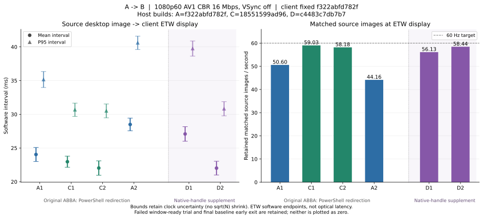

# 从“三帧延迟”到可解释的时间线：一次桌面串流 profiling

2026-11-16

1080p、60 FPS、视频播放稳定，拖动鼠标却仍然明显落后。用户估计画面约慢三帧，并提供了 Sunshine + Moonlight 的跟手体验作为参考。这次调查的目标，是在同一条客户端 A → 主机 B 连接上，区分输入、采集、编码和显示的等待，再验证改动是否改善了真正的新画面。

最终找到了约 **9–12 ms 的已捕获图像驻留**，恢复了主机接近 60 Hz 的新源输出。最终两轮“源桌面图 → 客户端 ETW 显示”的平均区间为 **26.01–28.17 ms、21.00–23.04 ms**。其中一轮仍有客户端长尾；这些软件测量尚不能证明稳定一帧延迟，也不能证明物理鼠标反馈已经解决。

## 先固定负载，再讨论延迟

实验固定主机源为 1920×1080、60 FPS、AV1、CBR 目标 16 Mbps，客户端关闭 VSync，使用 Intel 硬件编解码。实际收流码率约 16.7–17.3 Mbps；目标码率与包含传输开销的实测值分别记录。客户端测试视图全屏，PresentMon 观察到 `Hardware Composed: Independent Flip`。窗口化的合成路径没有完成同条件复验。

我们保留了原有背景串流和日常应用，没有为了跑分停止用户会话。因此，GPU、桌面合成器与系统调度仍可能受到背景负载影响。这是一组受控但未完全隔离的工程实验。

主机运行专用测试图：60 Hz 变色条、512×512 的确定性纹理（16 个相位）、可读帧号与 24 位黑白位码，以及随鼠标事件移动的标记。它既提供持续变化的编码负载，也让“编码了同一张旧图”容易被识别。每次绘制记录本机 QPC、间隔与耗时；请求 60 FPS 不能替代实际绘制节奏检查。

最初的假设包括网络拥塞、编码缓冲、采集节拍重复等待、客户端取图及显示排队。阅读 [Sunshine](https://github.com/SunshineStream/Sunshine) 与 [Moonlight Qt](https://github.com/moonlight-stream/moonlight-qt) 的采集、呈现和输入路径，帮助确定了检查方向；本轮没有做同条件的两套软件横向实测。

## 两份可以复用的刺激工具

本轮实际使用的动态图脚本已整理为 [latency_scene.ps1](../tools/windows/latency_scene.ps1)。场景使用 Windows PowerShell，后面的鼠标工具需要 Python 3，无需第三方 Python 依赖。在主机 B 的交互式 Windows 桌面打开 PowerShell，先列出屏幕，再选择目标：

```powershell
Add-Type -AssemblyName System.Windows.Forms
[System.Windows.Forms.Screen]::AllScreens | Select-Object DeviceName, Bounds
$monitorName = Read-Host '输入目标屏幕的 DeviceName'
$sceneOut = Join-Path $PWD ('latency-scene-' + [guid]::NewGuid().ToString('N'))
New-Item -ItemType Directory -Path $sceneOut | Out-Null
powershell.exe -NoProfile -ExecutionPolicy Bypass -File .\tools\windows\latency_scene.ps1 `
  -Stage $sceneOut -Monitor $monitorName -Seconds 60 -Fps 60
```

脚本按所选屏幕的物理几何建立自有无边框窗口，使用高精度等待计时器和 QPC 节拍，不修改显示配置，不主动激活窗口。命令中的执行策略参数仅作用于此次 PowerShell 子进程。`ready.json` 给出实际窗口及屏幕矩形，`scene-report.json` 保存绘制时间线和清理结果。到期自动结束；在另一个终端向该次输出目录写入 `stop` 文件可提前结束，写入 `freeze` 文件可暂停主动重绘。冻结测试图后，外部桌面合成更新仍可能产生新采集图。

鼠标刺激通过 Windows `SendInput` 发送绝对移动，经过真实操作系统输入路径，而非只给某个窗口投递移动消息。API 返回成功插入的事件数，不代表远端应用已经响应；还受 Windows 完整性级别限制。[SendInput 官方说明](https://learn.microsoft.com/en-us/windows/win32/api/winuser/nf-winuser-sendinput)

本轮私有调度器使用两秒从窗口宽度 25% 移至 75%、随后回到起点的锯齿轨迹，高度为 55%，循环请求休眠 8 ms；请求约 125 Hz，实际频率随调度变化。实验后另提取了通用工具 [latency_pointer_probe.py](../tools/windows/latency_pointer_probe.py)，默认采用两秒三角往返、120 Hz。**本文数据不是由这个新文件直接生成的**；复现实验时，各组应统一轨迹、频率，并检查实际发送统计。

在客户端 A 为实验单独打开一个串流窗口，查询其进程，然后运行：

```powershell
Get-Process | Where-Object {
  $_.MainWindowHandle -ne 0 -and $_.ProcessName -match 'eclipse'
} | Select-Object Id, MainWindowTitle
$streamPid = [uint32](Read-Host '输入专用测试串流窗口的 PID')
$probeOut = Join-Path $PWD ('pointer-' + [guid]::NewGuid().ToString('N') + '.json')
python .\tools\windows\latency_pointer_probe.py `
  --pid $streamPid --seconds 25 --hz 120 --start-delay 3 --output $probeOut
```

倒计时三秒内手动切到目标窗口并松开按钮、修饰键，也可用 `--hwnd` 精确指定窗口。用绝对鼠标模式测试；目标点被其他窗口遮挡或受到相对模式、光标锁中心等范围约束时，工具会在注入前停止。工具只移动鼠标，不点击、不发送键盘、不抢焦点；失焦、目标消失或按下鼠标按钮、修饰键时停止，并不检测任意键，也不将手动移动光标直接推断为接管。正常结束时，仅在光标仍符合最后目标位置等条件下恢复原位置。输出包含实际频率、间隔和停止原因。它是**负载发生器，不是延迟计**。

公开场景脚本与本轮使用版本逐字节一致，并通过 Windows PowerShell 语法解析。最终公开鼠标工具在自有置顶窗口完成三秒检查：360 次移动、实际 120.14 Hz、零漏调度 tick、正常结束并恢复原光标；窗口收到 193 个 `WM_MOUSEMOVE`，操作系统可合并消息，不要求与注入次数一一对应。此检查仅证明刺激工具可执行，不是串流 E2E 或物理输入延迟验收。

## 每个时间戳必须属于同一张图

“收包 → 解码 → 取邮箱 → Draw → Present”只有在同一图像身份下才有意义。可变槽位若在稍后重新读取元数据，可能把旧像素和新时间戳拼成一条看似很快的时间线。我们先修正身份冻结，再信任后续关联。

接收图像绑定行 ID、媒体 epoch、轨道、SSRC、RTP 时间戳、解码 generation 和 PTS；继续关联源 generation、源帧号与 DXGI `LastPresentTime`。重复编码同一源图沿用源身份，不增加“独立新源 FPS”。客户端只允许替换已解码的中间图，不靠丢压缩参考帧制造较低延迟。

呈现端同时记录带身份的原生 Present 调用和 [PresentMon 2.6.0](https://github.com/GameTechDev/PresentMon/releases/tag/v2.6.0) ETW 数据。按 PID、DXGI 交换链和调用时间括区唯一匹配，歧义或缺失直接记为不可关联；同一源图多次提交时取首次被系统识别显示的事件。`MsInPresentAPI` 是调用耗时，`MsUntilDisplayed` 才用于建立 Present 到系统显示的时间关系；它们不等于面板像素发光时刻。[PresentMon 字段与参数](https://github.com/GameTechDev/PresentMon/blob/v2.6.0/README-ConsoleApplication.md)

独立采集 PresentMon 时，可以指定实验窗口 PID，使用唯一会话名，保留未显示行：

```powershell
.\PresentMon-2.6.0-x64.exe --process_id $streamPid `
  --output_file .\presents.csv --timed 25 --terminate_after_timed `
  --no_console_stats --no_track_input --qpc_time --write_display_metadata `
  --session_name ('latency-' + [guid]::NewGuid().ToString('N'))
```

运行账户需具备 ETW 采集权限。CSV 仍需与应用身份日志关联，单独运行这条命令得不到源到显示的 E2E；跨机调度和离线关联器属于本轮实验设施，尚未作为公开一键基准工具提供。

## 跨机器用区间，避免制造精确答案

A、B 的 QPC 起点不同，不能直接相减。校时记录四个时刻：A 发请求 C1、B 收到 H2、B 回复 H3、A 收到 C4。用主机同钟差 `S−H2`、`S−H3` 将源事件 S 映射到客户端区间，约束为：

```text
源事件在 A 上的可能时间：
[ C1 + (S − H2) − 漂移预算,
  C4 + (S − H3) + 漂移预算 ]
E2E 区间 = 客户端 ETW 显示时间 − 上述源时间区间
```

换算按各自频率进行，整数向外舍入；epoch、频率、先后关系或新鲜度不符即拒绝。采用五秒有效期和 1000 ppm 相对漂移预算，后者是工程假设，并非已测得的振荡器保证。没有用 RTT/2 假定上下行对称，也没有随样本数增加而把相关校时误差除以 √N。

以下均值和 P95 分别对区间下界、上界统计。它们是软件端点区间，包含匹配与时钟限制，不是光学测量或统计置信区间。

## 先否决一个看起来更快的版本

更早的一组单节拍候选试验确实降低了约 4–5 ms 平均值，但两轮独立新源显示仅约 49.61、50.53 Hz，相邻基线约 58.88、59.47 Hz，P95 也未稳定改善。解码器仍能报接近 60 FPS，却没有 60 张不同的新画面。这种取舍没有被接受。

随后改为让共享采集拥有唯一输出节拍：已就绪新图不再等待第二个完整周期；周期内释放旧租约并等新图，冻结身份随图交付。这消除了原先约 9–12 ms 的槽内驻留。它是某一阶段的收益，不能直接宣称全链路固定减少同样的毫秒数。

有效候选 C 恢复了新源节拍，但静态场景暴露出过量轮询。最终 D 仅在上一周期确认重复图时，将重试间隔设为 `min(周期/4, 4 ms)`；新图、未知状态、恢复和帧率改变均重置为 1 ms，避免把静态退避带入正常更新。

## 完整结果：保留两组对照的边界

客户端全部固定为 `f322abfd782f`。主机基线 A 为 `f322abfd782f`，候选 C 为 `18551599ad96`，最终 D 为 `c4483c7db7b7`。前四轮按 A/C/C/A 顺序，采用相同调度器；D1/D2 改用原生文件句柄输出日志并增加自有窗口就绪防护，是补充实验，不能混成同一个 ABBA。

| 轮次 | 源图→ETW 平均区间 ms | P95 区间 ms | 可关联独立新源显示 Hz |
|---|---|---|---:|
| A1 | 23.003–25.081 | 33.976–36.340 | 50.598 |
| C1 | 22.143–23.797 | 29.692–31.656 | 59.030 |
| C2 | 20.966–23.099 | 29.482–31.533 | 58.181 |
| A2 | 27.554–29.433 | 39.617–41.585 | 44.163 |
| D1，补充 | 26.007–28.166 | 38.630–40.873 | 56.127 |
| D2，补充 | 20.999–23.040 | 29.776–31.872 | 58.445 |



[下载 PNG](assets/latency-profiling/final-results.png)。右图统计的是可关联子集，不冒充全部系统显示率。D1/D2 有效源图样本为 1161/1200；管线到原生提交覆盖为 92.22%/97.23%，原生提交到系统显示覆盖为 98.89%/97.72%。已保留独立源的源描述与校时映射覆盖均为 100%。

D1/D2 主机稳态新源/重复源为 1280/0、1271/1，接近 60 Hz；客户端可关联显示率仍低于主机输出率。同帧分段揭示了差异（均值 / P95，ms）：

| 分段 | C1 | C2 | D1 | D2 |
|---|---|---|---|---|
| B 源图→B 末 RTP 写入 | 11.930 / 15.794 | 10.872 / 17.546 | 13.223 / 19.655 | 10.008 / 15.393 |
| A 解码输出→A 原生 Present | 6.270 / 13.295 | 6.586 / 13.934 | 8.930 / 20.159 | 7.267 / 15.236 |
| A 原生 Present→ETW 显示 | 3.438 / 6.131 | 3.077 / 5.171 | 2.994 / 4.478 | 2.934 / 4.742 |

D1 的解码输出→取邮箱为 4.646/12.030 ms，取邮箱→Draw 为 4.034/9.958 ms；源图绘制间隔 P95 为 17.357 ms，其他三轮为 17.515–17.783 ms。D1 的测试图节奏和 Present 后等待没有更差，客户端 UI 交接与主机编码都有波动。累计邮箱替换计数 D1/D2 为 242/74，含启动阶段，不能当作稳态丢图比例。具体波动原因未证实。

CPU 按主机同钟媒体区间拟合进程累计 CPU 斜率，排除启动和结束的大 JSON 输出。动态用首 RTP+5 秒到末 RTP；冻结图用最后实际绘制+1 秒到末 RTP−0.5 秒，至少五点且未处于停止阶段。100% 表示一个逻辑核满载。原四轮为 33.20%、36.80%、38.98%、34.17%，D1/D2 为 31.52%/32.99%，不是整机占用率。

| 冻结图组 | Acquire 次/秒 | CPU 单核等价 | 新源 / 超时 |
|---|---:|---:|---:|
| A | 59.74 | 21.83% | 0 / 602 |
| C | 702.94 | 26.56% | 0 / 7779 |
| D | 318.80 | 23.82% | 133 / 3150 |

三轮均使用原生日志句柄并显式开启诊断。D 冻结后仍出现 133 次外部合成更新，A/C 为零，因此静态负载不严格相同；这张表只能报告观察，不能宣称补丁造成了确定比例的 CPU 下降。

## 输入 ACK 很快，为什么鼠标仍可能落后

D1/D2 入队→系统注入的窗口均值分别为 1.335–1.514 ms、1.402–1.796 ms，仍带约 1.1–1.3 ms 校时不确定度。它从客户端入队开始，未覆盖 **OS→窗口消息/GUI→入队**，也不代表应用已经画出响应。D1/D2 输入通道的 `input_sent` 计数为 310/816，不能等同于刺激工具的 SendInput 尝试数；采样时焦点与权限均为真，现有证据不能把低计数直接归咎于网络掉输入。

已有“输入→严格晚于成功注入的合格后继源图首显”统计，D1 四窗均值为 51.544±13.193、44.629±10.109、58.199±5.001、53.139±10.439 ms；样本为 10/10/1/2，第一窗 P95 达 142.992 ms，后两窗过少，不能作为稳定分位。D2 四窗为 39.837±9.444、37.004±9.676、37.607±10.744、40.229±8.045 ms，各 11 样本，窗口 P95 为 46.557–50.626 ms。

这个指标使用较宽的 DXGI 回执显示区间，**不证明该后继画面由输入导致**，更不是物理鼠标到面板延迟。动画本来就在更新，不能把“注入之后有新图”冒充应用因果响应。不同总体的输入均值和视频均值也不能直接相加。

下一步应补齐 OS 消息到 GUI 入队的年龄。[GetMessageTime](https://learn.microsoft.com/en-us/windows/win32/api/winuser/nf-winuser-getmessagetime) 可提供最近取出消息的队列创建毫秒时间，但不是硬件采样时刻或 QPC，需处理计数回绕并建立同机映射。本轮尚未完成这段测量。真正的鼠标到像素还需要可识别因果的交互测试，或高速相机/光电测量。

## 后续：偶发鼠标落后，需要补齐哪段证据

用户随后反馈显示约为两帧，但鼠标有时流畅、有时在持续移动中明显落后。正常时的被动日志中，RTT 窗口 P95 约 1.6–2.2 ms，客户端邮箱等待约 1 ms；主机输入提交与应用计数相近，未见注入错误。这些是正常状态的局部观察，不能代表卡顿发生时的情况。

回看 D1，首帧后约 12–17 秒，视频仍有 295/300 张解码图进入 Draw，而输入成功发送增量只有 28 条。此时已成功输入的 ACK 仍很快。这个组合提示了**幸存者偏差**：未到 GUI、被门禁阻挡或尚未完成发送的输入，不会出现在成功 ACK 的均值里。旧刺激程序缺少逐次窗口命中与光标约束检查，也不能据此断言产品丢失输入。

因此新增了可选的 Windows 输入元数据观测，启用方法见 [输入观测说明](native-latency.md)。它记录 `WM_MOUSEMOVE` 消息年龄、GUI 收到的指针事件、实际门禁原因、Update 到指针处理及派发前的耗时，并报告计数、分位桶界和最大值。Windows 消息与 egui 事件分别统计，不猜测一一对应；`MSG.time` 不是硬件时间，事件间隔包含自然空闲，派发计数也不代表已经入队或注入。默认关闭，不记录坐标或按键内容。

调查还发现一个独立的所有权缺陷：共享同一采集源的多路光标通道，原先会覆盖同一个唤醒回调；关闭任一路还可能清掉其他流的回调。部分流因而可能依赖原有 50 ms 后备定时器。修复改为逐发送任务持有独立订阅，取消时只移除自身，通知在锁外执行。订阅生命周期测试和原生加密通道测试通过，但用户当前虚拟屏没有提供独立光标位置元数据，尚不能把这一缺陷认定为本次卡顿根因。

新的受控轮采用公共工具的前台、窗口命中和光标范围守卫，但 Windows 未将前台交给实验窗口，试验在鼠标负载开始前停止。它不构成新的延迟样本或改善对照。下一次复发应先用新增漏斗定位等待发生在消息、GUI、发送还是主机，再决定是否调整输入调度；目前没有足够证据继续修改视频节拍。

2026-11-16，用户确认 `7c661b472e95` 的全屏体验是其记忆中最佳，指定为后续回归对照。两端实际运行该构建，观察到 1080p、约 60 FPS、AV1 硬解、原生 D3D11 呈现及 VSync 关闭。另一次不操作窗口的 20 秒 PresentMon 观察中，1190 条 Present 均为 `Hardware Composed: Independent Flip`，Present 到系统报告显示平均 2.509 ms、P95 3.163 ms。这只描述客户端呈现末段；当时是日常桌面，未固定动画与目标码率，不能替代前文的受控 E2E 测量。

后续候选应与保留的这个完整构建做同条件对照，分别检查窗口和全屏。分辨率、帧率、编码、目标码率、本地刷新率、VSync、背景负载和刺激工具保持一致，同时比较新源显示率、延迟尾部和输入反馈。不能只凭平均值下降接受新源帧率降低，也不能用窗口模式的收益代替全屏回归检查。

## 失败也属于实验结果

早期正式版本存在图槽元数据错配风险，不能充当修正后的精确基线。另有启动、焦点和权限准备失败，均保留，不填为零。第一次最终补充轮已收到 AV1 首帧、主机正常发送并退出，但测试窗口未通过可见性筛选；增加自有隐藏态防护后重试成功，恢复分支实际没有触发，所以可见性根因仍未确定。最后一次补充基线在约两秒早退，没有解码探测或首帧，不构成有效对照，未换用旧数据冒充。

旧 PowerShell 按行重定向巨大终端 JSON 会拖慢并截断退出，改用原生文件句柄后主机正常退出；这不能被描述成修复了网络关闭。所有实机采样已结束，没有为了得到漂亮数字反复选配。

这轮确定修正了新图槽驻留和重复节拍，建立了能解释新源、客户端等待与系统显示的证据链。最终软件 E2E 平均为 21–28 ms，但 D1 的长尾、不同窗口模式、背景负载敏感性与 OS 输入前段仍待调查。持续拖动、点击、打字及静置后恢复的真实跟手体验，仍需要用户验收。

## 补充：用 CPU 火焰图区分计算和等待

接着对既有客户端和主机进程采集 Windows CPU 栈、上下文切换及 ReadyThread。请求观察约 20 秒，实际统计包含录制边界的约 23 秒；没有把它裁成未经证明的精确稳态区间，也没有停止背景串流。

| 指标 | 客户端 | 主机 |
|---|---:|---:|
| Count 加权 CPU 样本 | 24,450 | 24,577 |
| 缺失、歧义或 PC 不匹配栈 | 6.54% | 5.99% |
| 完整 off-CPU 区间 | 186,751 | 265,024 |
| 无法拆分 Ready/Blocked 的区间 | 6.07% | 2.15% |

CPU 火焰图表示采样时线程正在执行什么，宽度不是帧延迟。调用者的包含样本会与子调用重叠，也不能相加。线程等输入、驱动事件或 GPU 时，可能几乎不占 CPU，却仍有墙钟等待；反过来，多线程并行计算可以累积很多 CPU 时间，而没有同等长度的帧延迟。[WPA 的 CPU 分析](https://learn.microsoft.com/en-us/windows-hardware/test/wpt/cpu-analysis)区分采样与调度分析，复现时应同时检查两者，而非只看一张热点图。

这次客户端 UI 的已知 Ready P50/P95/最大值为 **0.015/0.085/0.450 ms**；主机两条含 MF 编码调用的热线程 Ready P95 为 **0.079/0.074 ms**。有限样本没有支持几帧量级的 CPU 调度排队，因此没有直接加入 MMCSS 或提高进程优先级。未知拆分和未复现的偶发卡顿仍保留为未知。UI 的 Blocked 最大值约 38 ms，尚未关联帧身份或 GPU fence，不能直接命名为“某帧 GPU 等待”。

主机 MF 编码函数包含 5,358 个样本，但执行叶分散在驱动、内核和应用。进程同时承担多路工作，不能把它全部算给单个 1080p 流，更不能由函数宽度推算每帧编码毫秒。源码使用 MF 事件等待输入/输出；这一正常等待不应为了降低图上占比而删除。

生成图之前，先按进程、线程、时间戳及唯一触发事件绑定栈，再核对采样 PC 的首末方向。未知栈保留“未知调用者＋已知 PC”，Count 权重守恒。可以将已验证的栈聚合为 `根;调用者;叶 Count`，再用 [FlameGraph](https://github.com/brendangregg/FlameGraph) 生成交互 SVG；横轴排序不表示时间顺序。SDK 函数还需核对实际加载映像和精确函数范围，未命名地址保持模块＋偏移，不能用最近符号猜函数。本轮离线提取器尚未作为公共一键工具提供，原始进程图也未随文章公开。

## 补充：窗口模式的等待，不能只靠缩短队列猜测

用户切换窗口模式后，同一实际 DXGI 链又取得一组日常观察：

| 模式 | PresentMon 模式 | Present→系统显示均值 / P95 ms |
|---|---|---:|
| 全屏 | Hardware Composed: Independent Flip | 2.509 / 3.163 |
| 窗口 | Composed: Flip | 28.275 / 31.349 |

窗口的 Present API 均值约 0.080 ms，不能因为调用很快就认定画面已经显示。这里的主要差异出现在提交后的合成/显示末段。不过两次是同链的顺序日常观察，没有固定动画、码率和背景负载，**不是固定负载的窗口/全屏 E2E 对照**。窗口化也并非必然要多等几帧；是否获得 MPO、DirectFlip 或 Independent Flip 还取决于格式、几何、缩放与遮挡等条件。[微软 flip-model 指南](https://learn.microsoft.com/en-us/windows/win32/direct3ddxgi/for-best-performance--use-dxgi-flip-model)

随后只改变交换链最大帧延迟，按 **3/1/1/3** 做四轮窗口试验，其余保持 1080p60、AV1、CBR 16 Mbps、VSync 关闭。Present→系统显示均值/P95 依次为 **25.275/33.267、24.785/34.099、23.356/33.925、23.493/29.263 ms**。没有看到 limit=1 的稳定净收益，不能只挑较低均值而忽略尾部或等待转移，默认值继续保持 **3**。

更重要的有效性检查发现，四轮源帧身份始终只有 **frame_id=1**，其后均为重复源。测试图报告约 60 Hz 绘制，不能证明动态像素实际进入被采集桌面；实验窗口的可见性也未建立。故这些轮次只保留为后台客户端呈现路径的局部测量，**不纳入源→显示 E2E，不计算动态新源显示率，也不与前台全屏直接比较**。后续诊断确认只取得初始 DXGI 新图，仍未证明测试场景所在桌面与采集线程的实际关系；没有据此直接修改产品采集行为。恢复对照前，应先验证测试图可见、源身份持续更新，再测队列或格式。

## 补充：火焰图支持的一项小改动

客户端 UI 的 `Config::from_env` 包含 **831 个样本，约占进程样本 3.40%**，整个观察期各秒均有，并非只发生在启动。原实现仅固定配置来源选择；默认存储分支仍重复读取环境，并检查旧配置迁移目录是否存在，使渲染路径持续进入文件系统。

改动 `2913506` 统一缓存**成功解析后的整个进程配置**：冷路径串行初始化，成功后读取缓存副本；迁移等可恢复错误不发布成功值，下次仍可重试。原有便携模式优先、来源固定及来源错误规则保留，调用者修改自己的副本不影响全局。这样直接修共同入口，无需在各 GUI 调用点分别加缓存。

配置与迁移的 6 项 release 测试通过，包括新增的并发初始化一次、真实迁移错误修复后重试和副本隔离；同轮额外匹配的 4 项既有容量配置测试也通过。Windows 完整开发包已构建，SDK 的 1704 项导入核验通过，包内清单摘要与插件 SDK 身份一致。现有证据支持消除重复配置解析和目录检查这一开销，**尚未证明它改善了呈现 E2E 或物理鼠标跟手性**；验收仍需保留此前全屏基线，按同条件比较。

随后在两台 Windows 机器运行同一个 release 微基准：将修改前后的真实配置源码编入同一程序，共用未改动的迁移与原子写模块；在预建的私有 XDG 目录中，验证两版解析结果一致。冷初始化单独记录，预热后按旧/新/新/旧重复两组，每轮 10,000 次，并保留返回值构造与释放。

| 机器角色 | 旧热调用中位数 | 缓存后热调用中位数 |
|---|---:|---:|
| 客户端 | 45.137 µs | 106.135 ns |
| 主机 | 34.767 µs | 81.305 ns |

这验证了配置解析热调用不再反复进入环境与文件系统路径。基准没有运行完整 GUI 或串流，也未测硬件输入至画面，所以不能把数百倍的函数调用改善描述为应用或串流提速。首次启动仍需解析与必要迁移；新包的端到端收益仍待同条件实测。

## 用持续更新的源图复测 Windows 窗口呈现

这次在真实的 1080p60 桌面播放全屏动态图，客户端用普通窗口串流，开启垂直同步，协商 AV1 SDR 和 48 Mbps CBR。四轮实测源图更新 59.7–60.0 次/秒、收流约 50–51 Mbps，Windows 均报告 `Composed: Flip`。测试轮流将同一开发包的 DXGI 呈现队列上限设为 3、1、1、3，按图像身份将 2,429 张源图关联到客户端首次系统显示。

| 顺序 | 队列上限 | 首显 P50 | 首显 P95 | 每秒显示的不同源图 | 相邻不同源图间隔 P95 |
| --- | ---: | ---: | ---: | ---: | ---: |
| 1 | 3 | 49.4 ms | 64.5 ms | 49.6 | 33.4 ms |
| 2 | 1 | 53.6 ms | 70.1 ms | 45.5 | 50.0 ms |
| 3 | 1 | 58.8 ms | 75.9 ms | 41.2 | 49.9 ms |
| 4 | 3 | 51.1 ms | 67.0 ms | 46.5 | 50.0 ms |

第 1 轮的串流窗口大部分时间拥有焦点。第 2 和第 4 轮的全部 34 次采样中，焦点都在其它窗口。单看这两轮，队列上限 1 的首显 P95 为 70.1 ms，默认上限 3 为 67.0 ms。第 3 轮跨机校时关联覆盖了 94.7% 的可识别源图，其余三轮为 100%。这些结果支持继续使用默认上限 3。全屏独立翻转和真实鼠标输入仍各有自己的基线。

逐张匹配同一条 PresentMon 记录的 GPU 完成和系统显示时间，两者间隔的中位数为 **21.2–27.0 ms**。这个区间涵盖窗口合成与等待刷新，给出了后续优化窗口呈现时可直接复测的终点。[PresentMon 指标定义](https://github.com/GameTechDev/PresentMon/blob/main/README-ConsoleApplication.md)

另有一项可独立验证的开销。Windows 客户端原先每次绘制都获取后台缓冲并创建渲染目标视图。D3D11 可以在同一尺寸下沿用视图，每帧绑定，调整缓冲尺寸前释放。在同一块 GPU 上交替运行 12 组、每组 4,000 次，视图准备与绑定每次用时的组中位数从 **2.06 µs 降到 0.33 µs**。用不同尺寸和连续翻转生成的 20 帧逐像素校验通过。上表四轮都使用视图复用，表内差异仅用于评估队列设置。[微软 DXGI 资源说明](https://learn.microsoft.com/en-us/windows/win32/direct3ddxgi/d3d10-graphics-programming-guide-dxgi) · [ResizeBuffers 引用生命周期](https://learn.microsoft.com/en-us/windows/win32/api/dxgi/nf-dxgi-idxgiswapchain-resizebuffers)
