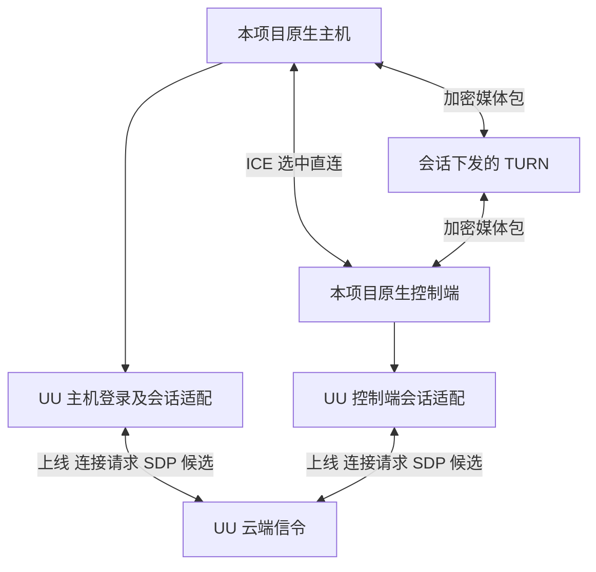

# 原生两端通过 UU 云端连接与中继的接入方案

本方案针对自有原生主机和控制端：保留现有采集、硬件编码、解码、输入与呈现，增加 UU 云端连接适配，尝试使用正常账号会话下发的寻址、信令和 ICE 服务。当前代码尚未实现该原生公网入口；本文是源码核对后的实施方案。

**可以参考 uu-remote-linux。它提供了自有被控端接入 UU 云端并与官方客户端互通的实现依据；它不等于一个可直接填入任意程序的公共匿名 TURN 服务。** 前提是账号正常登录、连接获授权，以及服务实际向该会话下发可用的 ICE 配置。是否下发中继、如何限制连接与带宽，仍由服务方决定，不能据此承诺免费、无限量或长期可用。

## 打洞和中继是两种连接结果

| 部分 | 作用 | 是否转发持续视频 |
|---|---|---|
| 信令服务 | 设备上线、找到目标、交换 SDP 和 ICE 候选 | 通常不负责媒体转发 |
| STUN 与 ICE 检查 | 获得候选地址并探测两端能否直接通信，包括 NAT 穿透 | 成功直连后，视频直接在两端之间传输 |
| TURN | 分配中继地址，在直连不可用等情况下转发数据包 | 选择中继路径时会转发持续媒体 |

TURN 不等于“保证打洞成功”：直连和中继是 ICE 可以选出的不同路径。取得 TURN 配置也不能代替信令，两端仍要先交换连接信息。[WebRTC 建连说明](https://webrtc.org/getting-started/peer-connections)、[TURN 标准](https://www.rfc-editor.org/rfc/rfc8656.html)

## uu-remote-linux 实际做了什么

核对的上游版本为 `50ed54d77a9084d18797061650bed9f85293c421`。

它的主机先登录、接入 UU 房间和 Socket.IO 信令。接到连接请求时，将请求中的 ICE 配置与连接标识关联，再创建该连接的 WebRTC PeerConnection；SDP 和候选也经 UU 信令交换。它还实现了官方客户端需要的控制消息，因此官方客户端可以操作这个自有主机。[主机会话入口](https://github.com/VallierDev/uu-remote-linux/blob/50ed54d77a9084d18797061650bed9f85293c421/src/main.rs)、[信令适配](https://github.com/VallierDev/uu-remote-linux/blob/50ed54d77a9084d18797061650bed9f85293c421/src/signaling.rs)

其中 `session_ice.rs` 提供了最直接的参考：解析会话携带的 `iceServers`、URL、用户名和凭据，处理 `force_relay`，再生成 `RTCConfiguration`；配置按连接传入，避免不同会话串用。存在强制中继要求却没有 TURN 配置时返回错误。[会话 ICE 配置](https://github.com/VallierDev/uu-remote-linux/blob/50ed54d77a9084d18797061650bed9f85293c421/src/session_ice.rs)、[PeerConnection 创建与候选交换](https://github.com/VallierDev/uu-remote-linux/blob/50ed54d77a9084d18797061650bed9f85293c421/src/webrtc.rs)

这证明可以研究并实现这条接入链，不证明任意 NAT、运营商或限制网络都已验证。解析了 `turns:` URL 也不代表依赖库一定能完成 TURN/TLS 连接；传输支持必须另外核对。

## 对本项目推荐的结构

连接适配负责“如何找到对方并建立获授权的 WebRTC 会话”，媒体和控制适配负责“建立后双方说什么”。原生两端使用 UU 网络服务，并不要求把现有编码器换成官方编码器。

图中的直连和中继表示不同的候选路径，不是同一份视频必须同时发两份。TURN 主要处理传输，不要求理解 Eclipse 的键鼠 JSON；但 UU 云端是否完整转发自定义会话所需的 SDP 和数据通道协商，仍需实际验证。

建议分为两个阶段：

1. **先补 UU 主机连接适配，验证基础互通。** 使用既有 UU 控制端路径连接自有主机，先做生成画面的 H.264 观看会话，打通设备上线、信令、ICE 与退出。若覆盖官方客户端观看，还需完成它要求的基础控制握手。复用本项目采集和编码，不搬入另一套桌面管线。
2. **再让自有两端协商 Eclipse 能力。** 仍通过 UU 的正常账号及会话流程建连，双方明确识别后，使用自己的控制、权限及后续编码扩展。官方客户端没有声明这些能力时继续基础 UU 协议；只支持原生扩展的入口也不能冒充已经兼容官方客户端。

仅为了原生两端公网互连，不必先实现官方客户端的所有文件、终端和显示工具。可以先实现云端建连与原生媒体会话，但其自定义通道能否通过服务是首个验证点；完整 UU 主机兼容则是可逐步增加的能力。

## 当前具体缺少哪些部分

| 部分 | 当前实现 | 需要补充 |
|---|---|---|
| UU 主机上线 | 已有登录和设备注册组件；CLI `host` 仍明确未实现 | 主机房间创建、上线状态、连接请求、重连和退出的完整状态机 |
| UU 控制端 | `controller.rs` 已有加入房间、接收 ICE、trickle SDP/候选 | 对自有主机选择适配模式，保留会话标识、能力及取消逻辑 |
| 原生信令 | 依赖可直接访问的主机 TLS/TCP 地址 | 增加云端信令入口；外网不能要求先连通主机局域网 TCP 才能交换 SDP |
| 原生 ICE | `NativePeer` 使用空 ICE 服务配置，并只接受 host 候选 | 按本次云端会话注入 ICE 配置，允许相应 host/srflx/relay 候选及其更新 |
| 地址校验 | 候选地址必须等于已认证 TCP 对端地址 | LAN 模式保留现有规则；云模式通过会话归属和身份验证绑定对端，不能把信令服务器 IP 当成媒体对端 IP |
| 会话寿命 | 原生会话把 TLS 连接断开作为退出信号之一 | 将云端释放、取消、PeerConnection 失败和原生授权撤销接入统一关闭逻辑 |
| 原生权限 | 已有主机许可、配对身份和输入释放规则 | 云端可寻址不自动获得桌面权限；保留自有身份绑定和许可，认证前不采集或注入 |
| 中继诊断 | 当前没有完整展示原生公网选中路径 | 显示实际候选对、直连/中继、传输类型与中继流量，提供明确失败原因 |

不能只给 `RTCConfiguration` 填几个 URL：外网信令、候选校验和会话生命周期的假设也要一起改。LAN 与云模式应共用媒体组件，各自保留清楚的连接规则。

## ICE 配置和身份如何管理

ICE 配置属于本次连接，不能把某次下发的用户名和凭据写成公共默认配置，也不应在新房间继续使用旧会话参数。连接失败、账号失效、重连和服务释放应分别处理；具体凭据有效期由服务实际行为决定，不假定某个固定时长。

公共解析应兼容 `urls` 为字符串或数组的格式，并区分“收到配置”和“当前依赖可用的配置”。强制中继时若过滤后没有可用 TURN，必须明确失败，不能悄悄使用直连后把测试记为中继成功。

日志只记录服务数量、支持的传输类型、候选类型、选择结果和失败阶段，不输出 TURN 密码、账号令牌、完整 SDP 或原生授权凭据。账号和 Eclipse 可信设备记录继续分别管理。

若要保留原生端原有的身份保证，需把已配对身份与本次会话及 DTLS 对端身份绑定。不能因为云端提供了一个房间，就默认跳过原生授权。具体绑定方式属于新增握手设计，需要版本协商；当前严格的 TLS JSON 不能直接添加字段后期待旧版本接受。

## 网络支持与实际验收

当前本项目固定的 WebRTC 依赖仅实现 TURN/UDP 收集，兼容路径还过滤 `turns:`。第一阶段可以验证 UDP 打洞和 TURN/UDP；在某些全面封锁 UDP 的网络中仍可能失败。后续支持 TURN/TCP 或 TURN/TLS 需要升级或补齐底层实现，并实际验证，不只是放开 URL 过滤。

最小验收应使用自有生成画面，不依赖真实桌面：

1. 正常登录和授权后，自有主机能收到控制端请求；SDP、候选与会话标识不会混用，取消和重连能清理旧会话。
2. 两个不同 NAT 网络下建立直连，检查实际选中的候选对，记录持续解码帧数及错误。
3. 为自有测试会话显式设置 Relay 策略，使用服务实际下发的配置，确认选中路径至少一端为 relay，并持续传输生成视频。不能把“列表里有 TURN”当作“已通过官方中继传视频”。
4. 无可用中继、凭据失效和网络中断时明确失败；授权撤销后停止采集、输入和当前会话。
5. LAN 入口、既有官方主机兼容连接及旧版本基础观看回归通过；原生扩展只在双方确认后启用。

Relay 策略用于验证实际中继能力，不代表日常应始终中继。日常可允许 ICE 选择可用路径，并检查选择结果；中继可能带来额外路程与服务侧带宽限制，不应将它视为比直连更低延迟。

## 实施顺序与结论

先做“云端建连＋生成画面”的小闭环，确认会话内 ICE 下发、外网直连、强制中继各自实际成功；再接现有硬编、声音、键鼠与原生能力协商。最关键的投入是 UU 主机信令与原生公网连接抽象，不是重写现有视频编解码。

uu-remote-linux 可以作为同协议的设计与行为参考，尤其是主机房间管理、连接标识隔离和会话 ICE 配置；它的 GPL 源码不能直接改标成本项目许可。当前 LAN 版本仍不具备本文描述的公网功能，后续实现与实网验收应独立记录。总体协议边界见[协议兼容与传输架构](protocol-compatibility-and-transport.md)。
