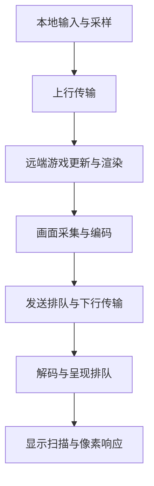

# 电脑交互式串流低延迟技术与文献综述

**资料截至 2026 年 10 月 29 日。** 范围包括电脑到电脑的局域网串流、互联网远程桌面和云游戏；远程 XR 仅作为预测与混合渲染的相关研究。本文讨论需要键鼠或手柄闭环交互的画面串流，不讨论以数秒缓冲换取稳定播放的普通视频直播。

**确实存在能显著降低串流延迟的技术，但要针对瓶颈选择。** 局域网的重点是采集、GPU 数据路径、编解码与显示队列；互联网的重点是距离、发送排队、拥塞控制与丢包恢复。预测、重投影和本地渲染可以让交互不必等待远端返回，但其反馈可能是估计或局部结果。论文中的亚毫秒编解码、网络帧延迟和“零延迟”不能直接等同于完整的按键到屏幕响应。

从工程应用看，最值得关注的是低缓冲硬件编码、端到端帧调度，以及以带宽换计算时间的 PyroWave 和 JPEG XS；从学术研究看，LoopTailor、Pudica、ACE、LADR、BLADE 分别给出了同步、排队、突发帧、丢包和 Wi-Fi 尾延迟的代表性方案。下文分别解释其原理、实验口径和适用条件。

# 1 延迟指标与完整链路

用户关心的通常是 **input-to-photon 或 click-to-photon**：按下按键、移动鼠标或操作手柄，到客户端屏幕相应像素真正发生变化的时间。经典云游戏测量研究已把响应拆成网络、平台、游戏与播放环节；硬件光学测量还需要包含输入外设和显示器。[Chen 等 2014](https://gaminganywhere.org/pub/2014tmm.pdf)、[NVIDIA 测量报告](https://developer.nvidia.com/blog/understanding-and-measuring-pc-latency/)

可将一次真实远端响应的关键路径近似写为：

**总延迟 ≈ 输入等待 + 上行 + 游戏更新与渲染 + 采集与编码 + 发送排队与下行 + 解码与呈现 + 显示响应。**

这是定位瓶颈的分解模型。不同帧可以并行处理，分片编码与传输也可能重叠，实际计算应按事件依赖和时间戳还原关键路径，避免重复相加。

| 常见指标 | 实际测量内容 | 主要遗漏 |
| --- | --- | --- |
| Ping 或网络 RTT | 网络请求与回复的往返时间 | 游戏、采集、编解码和显示 |
| 编码或解码耗时 | 某个处理阶段的执行时间 | 该阶段之外的等待和传输 |
| 单向视频延迟 | 从源帧的某个时间点到接收或播放 | 输入上行和此前的游戏处理，具体终点也可能不同 |
| 往返帧交付延迟 | 发送端产生或发送帧到收到客户端 ACK | 用户输入与显示器实际发光 |
| 串流附加延迟 | 串流相比本机显示增加的时间 | 本机游戏本来已有的响应延迟 |
| 输入到光子 | 实际操作到目标像素变化 | 最接近完整体验，但需控制测量位置和方法 |

Moonlight 官方也强调：软件无法直接测量所有输入、合成器和显示面板延迟，不同产品统计面板里的同名数字可能不可比。[Moonlight FAQ](https://github.com/moonlight-stream/moonlight-docs/wiki/Frequently-Asked-Questions)

帧周期能解释很多看似奇怪的延迟。在 60 Hz 下，一个周期是 16.67 ms；120 Hz 是 8.33 ms；240 Hz 是 4.17 ms。按随机到达、相位均匀的简化模型，等待下一个刷新机会平均约为半个周期。若采集、解码和显示分别多缓存一帧，累积等待就可能超过实际编码时间。这些数值来自周期换算，不是某款串流软件的实测性能。

# 2 可以直接落地的低延迟工程

## GPU 数据路径与低缓冲硬件编码

把高分辨率原始画面从 GPU 读回 CPU、转换颜色后再传回 GPU，会增加数据搬运和同步。应尽量复用 GPU 纹理，在 GPU 上完成颜色转换和编码输入准备，只把压缩后的数据交给网络。Windows Desktop Duplication API 可直接提供 GPU 内存中的桌面图像，并提供变化区域和鼠标元数据，是这类实现的重要基础。[Microsoft Desktop Duplication](https://learn.microsoft.com/en-us/windows-hardware/drivers/display/desktop-duplication-api)

传统 H.264、HEVC、AV1 也能用于低延迟串流，关键在于配置与数据路径。NVIDIA 的低延迟建议包括 LL 或 ULL 模式、CBR、很小的 VBV 缓冲，以及根据需要使用帧内刷新。应避免不必要的未来帧等待和重排序。不能笼统地说“所有 B 帧都必须关闭”：SDK 13.0 支持只参考过去帧的单向 B 帧，适用能力需要查询硬件。[NVENC 编程指南 第 8.19 与 9 节](https://docs.nvidia.com/video-technologies/video-codec-sdk/13.0/nvenc-video-encoder-api-prog-guide/index.html)

因此，“换成 AV1 就一定更快”并不成立。编码标准决定压缩工具，具体硬件、画质目标、缓冲策略和客户端解码能力共同决定总耗时。更高压缩效率可以缓解带宽瓶颈，也可能被额外处理或缓冲抵消。

## PyroWave 以带宽换取 GPU 编解码速度

PyroWave 采用小波变换、帧内编码和高度并行的 GPU 计算，减少运动预测等复杂处理。作者 2025 年的工程报告在 RX 9070 XT 上给出复杂 1080p 画面的约 **0.13 ms 编码、低于 0.1 ms 解码**。这是特定 GPU 的编解码自测，未包括采集、网络和显示；其质量对照又采用了受限的帧内编码设置，不宜外推为全面优于常规帧间编码。[PyroWave 作者技术报告](https://themaister.net/blog/2025/06/16/i-designed-my-own-ridiculously-fast-game-streaming-video-codec-pyrowave/)

截至检索日，Valve 已在 Steam Remote Play beta 提供 Pyrowave 试用。官方说明其带宽通常为其他串流编码的 **5 至 10 倍**，建议至少千兆有线网络，手动码率范围为 100 至 500 Mbit/s。它支持可选 4:4:4 与 HDR，但实际配置是否受益仍取决于网络和显示等环节。[Valve 官方说明](https://steamcommunity.com/groups/homestream/discussions/0/564794422009744473)

这条路线对高带宽局域网很有吸引力。工程上应比较“少花的编解码时间”和“多花的发送及排队时间”：链路有充足余量时可能明显受益，链路接近饱和时则可能增加尾延迟。

## JPEG XS 与低于一帧的处理

JPEG XS 是 ISO/IEC 21122 标准中的低延迟轻量图像编码，针对中等压缩比和视觉无损质量设计。JPEG 委员会说明其编解码延迟可以只有若干图像行；RTP 传输已有 RFC 9134。它体现了另一条重要路线：以行或小区域为单位流水处理，减少等待整帧完成的时间。[JPEG XS 官方介绍](https://jpeg.org/jpegxs/)、[RFC 9134](https://www.rfc-editor.org/rfc/rfc9134.html)

JPEG XS 更偏向专业视频链路或需要改造的专用管线，现成桌面客户端支持需单独确认；千兆网络能否承载，取决于分辨率、帧率、色深和压缩比。这类技术适合带宽充足、允许专用软硬件和管线改造的环境。标准支持低于一帧的编解码延迟，并不保证任意软件实现、屏幕采集 API 或显示器都能做到同样效果。若上游只能交付整帧，仍会保留整帧等待。[ISO/IEC 21122-1:2024](https://www.iso.org/standard/85247.html)

## 减少呈现队列并协调帧时间

客户端解码快，也可能因呈现队列过深而显示旧画面。应在平滑性、丢帧和新鲜度之间选择；显示链路还应检查合成、刷新率与电视图像处理。DXGI 的可等待交换链就是通过控制何时开始下一帧来减少呈现等待，但会影响 CPU 与 GPU 并行度。[Microsoft DXGI 降延迟指南](https://learn.microsoft.com/en-us/windows/uwp/gaming/reduce-latency-with-dxgi-1-3-swap-chains)

更进一步的方向是让远端渲染、采集与客户端显示协同调度。LoopTailor 的研究价值在于证明：即使网络良好，多次垂直同步也会成为主因。它需要跨越云端与客户端修改调度，不能简单等同于在某个菜单中关闭 VSync。其结果见第 4 节。

# 3 互联网和无线网络中的降延迟技术

## 让码率和发包服从帧的截止时间

吞吐量充足不代表实时帧能够及时到达。编码输出会突发，链路容量也会变化；如果发送端继续积压过时画面，用户会看到“流畅但落后”的视频。因此应同时考虑每帧大小、完成时间、可用带宽和已经形成的队列。

Salsify 代表了编码器与传输联合设计：按当前网络能力决定每帧压缩长度与发送时间，而不只控制长时间平均码率。SQP 则利用与帧传输耦合的包列采样和延迟信号，平衡链路利用率与队列。这些研究说明，通用大文件传输的目标不能直接代替实时画面的目标。[Salsify](https://www.usenix.org/conference/nsdi18/presentation/fouladi)、[SQP](https://arxiv.org/abs/2207.11857)

Pudica 重点避免带宽探测本身造成排队；ACE 重点处理编码突发与平滑发包之间的矛盾。二者可以提供互补思路：既要减少网络中的队列，也要减少发送器内部的等待。ACE 的编码复杂度控制主要基于软件 x264，不能假设能原样迁移到所有硬件编码器。[Pudica](https://www.usenix.org/conference/nsdi24/presentation/wang-shibo)、[ACE 原文](https://zilimeng.com/papers/ace-sigcomm25.pdf)

## 按剩余时间选择重传与前向纠错

重传能精确修复丢失数据，但检测和重新往返可能错过显示时限。前向纠错 FEC 提前发送冗余信息，可以减少等待，却占用带宽并可能加重拥塞。合理方案需要根据丢包原因、RTT 和剩余截止时间选择，而不是固定堆高冗余比例。RFC 8854 明确讨论了这种取舍，RFC 8836 强调实时拥塞控制应限制自身形成的排队。[RFC 8854 第 8 节](https://www.rfc-editor.org/rfc/rfc8854.html)、[RFC 8836](https://www.rfc-editor.org/rfc/rfc8836.html)

LADR 进一步把丢包规避、检测和恢复联合起来。它也说明，“UDP 总是更低延迟”过于简单：协议之上的拥塞控制、网络设备行为和恢复策略都很重要。QUIC 或 WebRTC 是构建系统的工具，协议名称本身不能证明已经消除了持续运行中的队列。

## 无线尾延迟需要处理 MAC 层竞争

Wi-Fi 的问题不只在信号强度和平均吞吐量。多个设备竞争信道可能造成短时发送饥饿，即使应用层主动降码率，也未必能完全消除。BLADE 通过自适应竞争窗口处理这类问题，需 AP 侧实现支持；它的显著结果针对无线尾延迟和卡顿，不能理解为所有按键响应都快了数倍。[BLADE](https://www.usenix.org/conference/nsdi26/presentation/guo-fengqian)

实际部署可先建立有线基线，再检查无线竞争、其他业务负载与码率突发。这样才能区分编解码问题和无线接入问题，而不是仅用一次测速判断串流网络。

## 边缘部署降低真实网络路径

把服务器放到离用户更近、路由更合适的位置，可以降低不可省略的网络往返。早期测量研究已系统讨论集中式云与边缘节点的覆盖差异；具体覆盖比例依赖当时网络，不能直接套用到今天。[Choy 等 2012](https://cs.uwaterloo.ca/~bernard/edgecloud)

对于必须由远端处理当前输入的真实结果，上行与下行的因果路径仍然存在。CDN 缓存无法像缓存普通视频那样复用每个用户独有的实时画面。若距离成为主要瓶颈，继续微调编码器只能改善总预算中的一部分。

# 4 直接降低流水线和传输延迟的代表论文

下表保留各论文自己的测量口径。不同列中的百分比和倍数不能直接合并，也不能据此给软件做统一性能排名。

| 文献 | 核心方法 | 作者报告的结果与适用边界 |
| --- | --- | --- |
| Fouladi 等 Salsify NSDI 2018 | 按帧联合选择编码长度与发送时机 | 展示编码与传输联合优化的收益；是实时视频研究原型，历史对照软件不能代表 2026 年产品性能。[论文](https://www.usenix.org/conference/nsdi18/presentation/fouladi) |
| Ray 等 SQP 2022 预印本 | 帧耦合探测与低排队拥塞控制 | 在 AR 串流平台 A/B 实验中，相比 Copa，高带宽且低帧延迟会话占比在 LTE 和 Wi-Fi 分别增加 27 和 15 个百分点；并非输入响应降低相同比例。[论文](https://arxiv.org/abs/2207.11857) |
| Wang 等 Pudica NSDI 2024 | 探测带宽利用率并快速排空队列 | 论文汇总报告平均及尾部帧延迟分别降至基线约 1/3.1 和 1/4.9。评估采用往返帧延迟，属于传输指标。[论文](https://www.usenix.org/system/files/nsdi24-wang-shibo.pdf) |
| Li 等 LoopTailor NSDI 2025 | 减少并协调云端与客户端 VSync | 在移动云游戏平台降低约 34% 的交互延迟，稳定低于 100 ms。针对 Android 图形管线，不能把该绝对值推广到全部 PC 串流。[论文](https://www.usenix.org/conference/nsdi25/presentation/li-yang) |
| Huang 等 ACE SIGCOMM 2025 | 编码复杂度与发包突发联合控制 | 实验报告相比 WebRTC* 基线，P95 视频延迟最多下降 43%，维持相当画质。其视频帧发送与接收时间测量不等同于点击到发光。[论文](https://zilimeng.com/papers/ace-sigcomm25.pdf) |
| Wang 等 LADR NSDI 2026 | 联合规避丢包、快速检测与机会式 FEC | 生产结果中 99.87% 的帧在 100 ms 内完成交付确认。计时为发送端创建帧至收到客户端 ACK，包含确认返回。[论文](https://www.usenix.org/system/files/nsdi26-wang-jing.pdf) |
| Guo 等 BLADE NSDI 2026 | 自适应 Wi-Fi 竞争窗口 | 高信道竞争下，Wi-Fi 包传输尾延迟改善超过 5 倍，视频卡顿率下降超过 90%，其中卡顿定义为帧交付延迟超过 200 ms；需要接入点侧支持。[论文](https://www.usenix.org/conference/nsdi26/presentation/guo-fengqian) |

这组工作覆盖了不同层面的等待：同步等待、发送端等待、网络排队、丢包恢复和无线竞争。对已有系统，先做分项测量，往往比直接替换整个串流协议更有针对性。

# 5 预测和重投影怎样绕过交互等待

## 推测执行提前生成可能的未来

Outatime 原名 DeLorean，是微软研究院 2014 年技术报告。它提前推测未来输入并生成多种结果，发送到客户端后再选择和修正。作者在 Doom 3、Fable 3 上报告能够掩盖最高 250 ms 的网络延迟。这提供了跨越 RTT 等待的经典思路，但需额外计算、状态管理和传输，预测错误时也需要补偿。[Outatime 技术报告](https://www.microsoft.com/en-us/research/publication/outatime-using-speculation-to-enable-low-latency-continuous-interaction-for-cloud-gaming/)

如果应用本身可修改，这条路线具有研究价值；对任意黑盒桌面程序，通常难以获取可回滚状态和枚举输入结果。它通过提前计算与本地修正改变用户获得反馈的时刻，并未缩短物理网络 RTT；预测错误时仍需与真实状态校正。

## 重投影让相机立即响应最新输入

重投影使用已收到的图像和可能的深度信息，按最新视角重新变换画面。它对相机旋转、瞄准或头部运动尤其有用，但新出现的遮挡区域、动态物体和远端事件无法仅靠旧图像准确恢复。

Kim 等 2020 年论文研究 late input sampling 与 post-render warp。在受控瞄准任务中，最多消除了 80 ms 新增延迟所造成的任务性能损失的 80%。这里改善的是瞄准表现，不能改写为“真实端到端延迟降低 80%”。[Kim 等原文](https://casual-effects.com/research/Kim2020Latency/Kim2020Latency.pdf)

## ZGaming 的零延迟结论应如何阅读

ZGaming 将背景重投影、历史 3D 块缓存补洞、服务器辅助 LSTM 前景预测结合起来。项目摘要报告同画质下交互延迟从 23 ms 到 0 ms，但论文第 8 节说明主实验未计入 LSTM 推断开销，原型部分计算尚不能实时运行。因此应把它视为预测架构的概念验证，不能据摘要认定已经得到完整实时的零延迟系统。[项目页](https://pku-netvideo.github.io/zgaming/)、[作者完整论文](https://www.cuiyong.net/lunwen/2023/Zero-Latency_3D_Cloud_Gaming_by_Image_Prediction.pdf)

评价预测系统必须同时问三个问题：画面是否及时、画面是否正确、出现错误后如何回到真实状态。对文字编辑、支付结果或需要准确反馈的 CAD 操作，错误预测的代价与游戏转视角不同；本地游标或局部反馈可立即显示，远端操作成功仍需确认。

# 6 混合渲染改变本地和远端的工作划分

另一种结构性办法是让客户端承担交互敏感部分，把高成本但较能容忍延迟的工作留给远端。

Kahawai 研究本地低细节渲染加云端差分，以及本地和远端分别生成部分帧。其原型在相近画质下带宽最低约为普通视频薄客户端的 1/6。这里的主要证据是带宽与体验，需要本地 GPU 和游戏引擎配合，不能理解为通用桌面延迟降低六倍。[Kahawai MobiSys 2015](https://www.microsoft.com/en-us/research/publication/kahawai-high-quality-mobile-gaming-using-gpu-offload/)

Furion 把易预测的背景与交互敏感前景分开处理。2020 年期刊版报告了很低的应用级响应时间，但计时不包含输入子系统和显示硬件。这类成果说明，合理分工可让关键交互摆脱完整远端渲染链路，前提是应用和客户端架构允许改造。[Furion TMC 2020 原文](https://www.cuiyong.net/lunwen/2020/Y4FlLC-Furion_Engineering_High-Quality_Immersive_Virtual_Reality_on_Todays_Mobile_Devices.pdf)

对电脑串流，可以据此区分两种目标：通用像素串流应优先优化现有采集到显示管线；如果能够控制应用，则可以把游标、视角、前景或低质量预览放到本地，远端逐步补充高质量结果。后者的潜力更大，实现范围也更窄。

# 7 按场景选择技术

下表是根据前述证据形成的工程判断，不是跨论文统一实测排名。

| 目标场景 | 优先路线 | 原因和代价 |
| --- | --- | --- |
| 同屋或同建筑的电脑串流 | GPU 纹理路径、低缓冲硬件编码、客户端浅队列 | 先消除本地等待，尤其适合 RTT 已很小的环境 |
| 千兆以上稳定局域网追求极低延迟 | 测试 PyroWave 或 JPEG XS 类轻量编码 | 可用更多带宽换取低计算和小缓冲，需要检查客户端和管线支持 |
| 互联网远程游戏或图形桌面 | 近端服务器、帧截止时间控制、自适应码率 | 避免把旧画面排进队列，同时保持必要画质 |
| Wi-Fi 偶发长卡顿 | 有线对照、分析竞争与突发、针对性恢复 | 平均带宽足够仍可能有严重尾延迟，部分研究方案需改 AP |
| 可修改引擎的游戏或 XR | 预测、重投影、混合渲染 | 能显著改善即时反馈，但需处理错误、遮挡和本地计算 |
| 办公与文字为主的远程桌面 | 变化区域传输、本地游标、必要时采用 4:4:4 | 注意文字清晰度与交互语义，单纯提高视频帧率未必最划算 |

Sunshine 与 Moonlight 适合搭建可观察、可修改的开源基线；Steam Remote Play beta 提供了 Pyrowave 的实际测试入口。选择它们是为了便于分项实验，并不构成通用产品性能排名。[Sunshine 配置文档](https://docs.lizardbyte.dev/projects/sunshine/latest/md_docs_2configuration.html)、[Moonlight FAQ](https://github.com/moonlight-stream/moonlight-docs/wiki/Frequently-Asked-Questions)、[Valve 官方说明](https://steamcommunity.com/groups/homestream/discussions/0/564794422009744473)

关于能降多少，最有用的是先算预算。例如，假设一个系统总响应 80 ms，其中编解码合计 6 ms，即使把它缩到 0.5 ms，总量也只减少 5.5 ms；如果问题是三处各等待一个 60 Hz 周期，则排队优化的潜在空间大得多。这是说明瓶颈的假设算例，不是产品数据。

# 8 如何验证大幅降延迟和选择研究课题

## 建议的验证方法

主指标采用外部光学方法：同步记录实际输入触发和目标屏幕像素变化；高速摄影可以观察整个过程，光电传感器配合输入触发可更精确。软件日志用于解释阶段耗时，再用外部测量校准。NVIDIA 的延迟报告区分完整系统与仅 PC 部分的统计，LDAT 则展示基于输入触发与亮度传感器的 click-to-photon 测量。[软件统计报告](https://developer.nvidia.com/blog/understanding-and-measuring-pc-latency/)、[LDAT 官方说明](https://developer.nvidia.com/nvidia-latency-display-analysis-tool)

一次有意义的比较应同时固定或报告：

- 分辨率、真实渲染帧率、串流帧率、两端显示刷新率及测试像素位置。
- 两端硬件、驱动、编码参数、HDR 与色度格式，以及呈现模式。
- 同码率和相近画质两组对照，避免通过大幅牺牲画质得到误导性的速度结果。
- 网络拓扑、RTT、可用带宽、交叉流、丢包及突发丢包，覆盖有线和无线。
- 中位数、P95、P99、超时帧比例、丢帧和卡顿持续时间；预测方案另报错误率、修正幅度和额外算力。

串流附加延迟与完整操作延迟应分别报告。只有画面时间差而没有输入触发的实验，可以证明远端画面落后多少，不能单独证明完整按键响应是多少。

## 值得继续研究的方向

**围绕显示截止时间协调渲染 编码与网络。** 让各阶段围绕客户端显示时刻安排工作，在过期帧、重传和新帧之间分配预算。已有工作分别优化部分环节，组合后的关键问题是跨层信号、时钟误差、稳定性和尾延迟。

**高带宽局域网中的低于一帧流水线。** 将轻量 GPU 编码与采集、分片发送、解码和呈现贯通，检查编码微基准的改善能否转化为光学输入响应改善。仅优化编码 kernel 不足以完成这个目标。

**带有错误约束的本地补偿。** 将可安全立即反馈的动作与必须等待远端确认的动作分开，给预测误差、补洞和回滚设定预算。对办公、CAD 和远程开发，这比只追求视觉上的“零延迟”更有实际意义。

以上是基于文献的研究判断。实际立项应先用可复现测量确认目标场景的主瓶颈，再决定优化软件管线、网络算法还是应用架构。

# 9 参考文献和技术资料

## 架构与测量基础

1. Cai, W., et al. **A Survey on Cloud Gaming: Future of Computer Games.** IEEE Access, 4:7605–7620, 2016. 经典分类综述，产品数据需按历史背景阅读。[作者版 PDF](https://faculty.washington.edu/weicaics/paper/papers/CaiSHCLLH162.pdf) · [DOI](https://doi.org/10.1109/ACCESS.2016.2590500)
2. Shea, R., Liu, J., Ngai, E. C.-H., Cui, Y. **Cloud Gaming: Architecture and Performance.** IEEE Network, 27(4):16–21, 2013. 架构和早期实测。[作者版 PDF](https://www.cuiyong.net/lunwen/2013/Cloud_gaming_architecture_and_performance.pdf) · [DOI](https://doi.org/10.1109/MNET.2013.6574660)
3. Chen, K.-T., et al. **On the Quality of Service of Cloud Gaming Systems.** IEEE Transactions on Multimedia, 16(2):480–495, 2014. 响应分解与测量。[作者版 PDF](https://gaminganywhere.org/pub/2014tmm.pdf) · [DOI](https://doi.org/10.1109/TMM.2013.2291532)
4. Choy, S., Wong, B., Simon, G., Rosenberg, C. **The Brewing Storm in Cloud Gaming: A Measurement Study on Cloud to End-User Latency.** NetGames, 2012. 云端与边缘的延迟覆盖问题。[作者页面](https://cs.uwaterloo.ca/~bernard/edgecloud)

## 同步与网络尾延迟

5. Fouladi, S., et al. **Salsify: Low-Latency Network Video through Tighter Integration between a Video Codec and a Transport Protocol.** NSDI, 2018, 267–282. [论文与视频](https://www.usenix.org/conference/nsdi18/presentation/fouladi)
6. Ray, D., Smith, C., Wei, T., Chu, D., Seshan, S. **SQP: Congestion Control for Low-Latency Interactive Video Streaming.** arXiv:2207.11857, 2022. 此处引用预印本。[论文](https://arxiv.org/abs/2207.11857)
7. Wang, S., et al. **Pudica: Toward Near-Zero Queuing Delay in Congestion Control for Cloud Gaming.** NSDI, 2024, 113–129. [论文与视频](https://www.usenix.org/conference/nsdi24/presentation/wang-shibo)
8. Li, Y., et al. **Dissecting and Streamlining the Interactive Loop of Mobile Cloud Gaming.** NSDI, 2025, 595–611. LoopTailor。[论文与视频](https://www.usenix.org/conference/nsdi25/presentation/li-yang)
9. Huang, X., et al. **ACE: Sending Burstiness Control for High-Quality Real-time Communication.** SIGCOMM, 2025. [作者版 PDF](https://zilimeng.com/papers/ace-sigcomm25.pdf) · [DOI](https://doi.org/10.1145/3718958.3750520)
10. Wang, J., et al. **From Source to Solution: Tackling Packet Losses in Large-scale Cloud Gaming Systematically and Precisely.** NSDI, 2026, 1191–1206. LADR。[论文与视频](https://www.usenix.org/conference/nsdi26/presentation/wang-jing)
11. Guo, F., et al. **BLADE: Adaptive Wi-Fi Contention Control for Next-Generation Real-Time Communication.** NSDI, 2026, 131–151. [论文与视频](https://www.usenix.org/conference/nsdi26/presentation/guo-fengqian)

## 预测补偿与混合渲染

12. Lee, K., et al. **Outatime: Using Speculation to Enable Low-Latency Continuous Interaction for Cloud Gaming.** Microsoft Research Technical Report MSR-TR-2014-115, 2014. 原名 DeLorean。[报告与 PDF](https://www.microsoft.com/en-us/research/publication/outatime-using-speculation-to-enable-low-latency-continuous-interaction-for-cloud-gaming/)
13. Kim, J., Knowles, P., Spjut, J., Boudaoud, B., McGuire, M. **Post-Render Warp with Late Input Sampling Improves Aiming Under High Latency Conditions.** Proceedings of the ACM on Computer Graphics and Interactive Techniques, 3(2), Article 12, 2020. [作者版 PDF](https://casual-effects.com/research/Kim2020Latency/Kim2020Latency.pdf) · [DOI](https://doi.org/10.1145/3406187)
14. Wu, J., et al. **ZGaming: Zero-Latency 3D Cloud Gaming by Image Prediction.** SIGCOMM, 2023, 710–723. [项目与代码入口](https://pku-netvideo.github.io/zgaming/) · [作者版 PDF](https://www.cuiyong.net/lunwen/2023/Zero-Latency_3D_Cloud_Gaming_by_Image_Prediction.pdf) · [DOI](https://doi.org/10.1145/3603269.3604819)
15. Cuervo, E., et al. **Kahawai: High-Quality Mobile Gaming Using GPU Offload.** MobiSys, 2015. [研究页面](https://www.microsoft.com/en-us/research/publication/kahawai-high-quality-mobile-gaming-using-gpu-offload/) · [DOI](https://doi.org/10.1145/2742647.2742657)
16. Lai, Z., et al. **Furion: Engineering High-Quality Immersive Virtual Reality on Today’s Mobile Devices.** IEEE Transactions on Mobile Computing, 19(7):1586–1602, 2020. 此处引用期刊扩展版，另有 MobiCom 2017 早期版。[作者版 PDF](https://www.cuiyong.net/lunwen/2020/Y4FlLC-Furion_Engineering_High-Quality_Immersive_Virtual_Reality_on_Todays_Mobile_Devices.pdf) · [DOI](https://doi.org/10.1109/TMC.2019.2913364)

## 标准与工程技术报告

17. Arntzen, H.-K. **I designed my own ridiculously fast game streaming video codec – PyroWave.** 作者工程报告, 2025-06-16；属于工程自测。[报告](https://themaister.net/blog/2025/06/16/i-designed-my-own-ridiculously-fast-game-streaming-video-codec-pyrowave/) · [源代码](https://github.com/Themaister/pyrowave)
18. Valve / slouken. **Pyrowave video codec now in beta!** Steam Remote Play 官方说明, 2026 年 9 月发布并于 10 月更新。[官方帖](https://steamcommunity.com/groups/homestream/discussions/0/564794422009744473)
19. NVIDIA. **NVENC Video Encoder API Programming Guide.** Video Codec SDK 13.0。[文档](https://docs.nvidia.com/video-technologies/video-codec-sdk/13.0/nvenc-video-encoder-api-prog-guide/index.html)
20. JPEG Committee / ISO / IETF. **JPEG XS ISO/IEC 21122** 与 **RTP Payload Format for ISO/IEC 21122 JPEG XS, RFC 9134**, 2021。[标准概览](https://jpeg.org/jpegxs/) · [RFC](https://www.rfc-editor.org/rfc/rfc9134.html)
21. IETF. **WebRTC Forward Error Correction Requirements, RFC 8854**, 2021；**Congestion Control Requirements for Interactive Real-Time Media, RFC 8836**, 2021。[FEC](https://www.rfc-editor.org/rfc/rfc8854.html) · [拥塞控制](https://www.rfc-editor.org/rfc/rfc8836.html)
22. Microsoft. **Desktop Duplication API** 与 **Reduce latency with DXGI 1.3 swap chains.** 采集与呈现管线文档。[采集](https://learn.microsoft.com/en-us/windows-hardware/drivers/display/desktop-duplication-api) · [呈现](https://learn.microsoft.com/en-us/windows/uwp/gaming/reduce-latency-with-dxgi-1-3-swap-chains)
23. NVIDIA. **Understanding and Measuring PC Latency.** 2023。完整系统延迟分解与 PC 部分的软件测量；另列 LDAT 的硬件测量说明。[技术报告](https://developer.nvidia.com/blog/understanding-and-measuring-pc-latency/) · [LDAT](https://developer.nvidia.com/nvidia-latency-display-analysis-tool)
24. Moonlight / LizardByte. **Moonlight FAQ** 与 **Sunshine Configuration.** 开源实践与指标定义。[Moonlight](https://github.com/moonlight-stream/moonlight-docs/wiki/Frequently-Asked-Questions) · [Sunshine](https://docs.lizardbyte.dev/projects/sunshine/latest/md_docs_2configuration.html)

建议先读 Chen 2014 建立延迟分解，再读 LoopTailor、Pudica 和 ACE；希望做局域网工程可接着读 PyroWave、NVENC 和 JPEG XS；希望研究突破 RTT 的交互反馈，再读 Outatime、late-warp 与 ZGaming，并重点检查开销和错误补偿。
